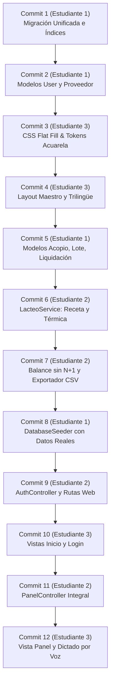

# GUÍA DE DISTRIBUCIÓN DE COMMITS PARA GITHUB (PROYECTO GRUPAL)
## SISTEMA DE GESTIÓN LÁCTEA COMUNITARIA · LAT COMPACTO

**Entorno:** Laravel 11/12 · PHP 8.2+ · MariaDB/MySQL (XAMPP)  
**Metodología:** Git Flow Simplificado Universitario (12 Commits Equitativos: 4 por Integrante)  
**Premisa del Repositorio:** El framework base de Laravel ya se encuentra subido en la rama `main` / `master`.

---

## 1. Asignación de Roles y Responsabilidades

| Integrante | Rol Arquitectural | Área de Especialidad | Cantidad de Commits |
| :--- | :--- | :--- | :---: |
| **Estudiante 1** | **Arquitecto de Base de Datos y Persistencia** | Migración unificada, Modelos Eloquent, Query Scopes, Índices de optimización y Semillero de datos (`DatabaseSeeder`). | **4 commits** |
| **Estudiante 2** | **Ingeniero de Lógica de Negocio y Backend Core** | Capa de Servicios (`LacteoService`), Dosificación estequiométrica, Algoritmo quincenal sin N+1, Controladores y Enrutamiento. | **4 commits** |
| **Estudiante 3** | **Diseñador Frontend y Experiencia de Usuario** | Design System Flat Fill Contrast (sin sombras ni bordes genéricos), Layout maestro trilingüe, Vistas Blade e interactividad Web Speech API. | **4 commits** |

---

## 2. Cronograma Secuencial y Lógico de Commits (Relación de Dependencias)

Para evitar colisiones (*merge conflicts*) y mantener una narrativa coherente en el historial de Git, los commits se realizan en el siguiente orden secuencial:



---

## 3. Guía Paso a Paso para Cada Integrante

### 👤 ESTUDIANTE 1: Persistencia, Modelos y Optimización

#### Commit 1.1: Migración Unificada de Base de Datos con Índices de Rendimiento
- **Archivos a agregar:**
  - `database/migrations/2026_01_01_000001_crear_tablas_lat_compacto.php`
  - `.env.example`
- **Comandos Git:**
  ```bash
  git add database/migrations/2026_01_01_000001_crear_tablas_lat_compacto.php .env.example
  git commit -m "feat(database): crear migracion unificada con indices compuestos para acopios y lotes"
  git push origin main
  ```

#### Commit 1.2: Modelos de Dominio Base (User y Proveedor) con Scopes
- **Archivos a agregar:**
  - `app/Models/User.php`
  - `app/Models/Proveedor.php`
- **Comandos Git:**
  ```bash
  git add app/Models/User.php app/Models/Proveedor.php
  git commit -m "feat(models): implementar modelos User (RBAC) y Proveedor con query scopes optimizados"
  git push origin main
  ```

#### Commit 1.3: Modelos Operativos de Acopio, Lote y Liquidación
- **Archivos a agregar:**
  - `app/Models/Acopio.php`
  - `app/Models/Lote.php`
  - `app/Models/Liquidacion.php`
- **Comandos Git:**
  ```bash
  git add app/Models/Acopio.php app/Models/Lote.php app/Models/Liquidacion.php
  git commit -m "feat(models): definir entidades Acopio (calidad), Lote (termica) y Liquidacion (finanzas)"
  git push origin main
  ```

#### Commit 1.4: Semillero Integral de Datos (DatabaseSeeder)
- **Archivos a agregar:**
  - `database/seeders/DatabaseSeeder.php`
- **Comandos Git:**
  ```bash
  git add database/seeders/DatabaseSeeder.php
  git commit -m "feat(seeders): poblar usuarios de prueba, ganaderos de Anta y lotes en enfriamiento"
  git push origin main
  ```

---

### 👤 ESTUDIANTE 2: Lógica de Negocio, Servicios y Controladores

#### Commit 2.1: Capa de Servicio para Dosificación y Curva Térmica
- **Archivos a agregar:**
  - `app/Services/LacteoService.php` (Parte 1: métodos `dosificarReceta` y `evaluarTermica`)
- **Comandos Git:**
  ```bash
  git pull origin main
  git add app/Services/LacteoService.php
  git commit -m "feat(services): implementar calculo estequiometrico de cuajo, sal y termica de pasteurizacion"
  git push origin main
  ```

#### Commit 2.2: Algoritmo de Liquidación sin N+1 y Generador de CSV
- **Archivos a agregar:**
  - `app/Services/LacteoService.php` (Parte 2: métodos `liquidarQuincena` y `exportarCsv`)
  - `config/lat.php`
- **Comandos Git:**
  ```bash
  git add app/Services/LacteoService.php config/lat.php
  git commit -m "perf(services): optimizar balance quincenal masivo en 3 consultas y exportador CSV bancario"
  git push origin main
  ```

#### Commit 2.3: Controlador de Autenticación y Enrutamiento Base
- **Archivos a agregar:**
  - `app/Http/Controllers/Controller.php`
  - `app/Http/Controllers/AuthController.php`
  - `routes/web.php`
- **Comandos Git:**
  ```bash
  git add app/Http/Controllers/Controller.php app/Http/Controllers/AuthController.php routes/web.php
  git commit -m "feat(auth): anadir AuthController con soporte multi-cargo y registro de rutas protegidas"
  git push origin main
  ```

#### Commit 2.4: Controlador Unificado de Operaciones del Panel
- **Archivos a agregar:**
  - `app/Http/Controllers/PanelController.php`
  - `app/Http/Controllers/HomeController.php`
- **Comandos Git:**
  ```bash
  git add app/Http/Controllers/PanelController.php app/Http/Controllers/HomeController.php
  git commit -m "feat(controllers): coordinar acopio, triage sanitario, ajuste de tina y movimientos financieros"
  git push origin main
  ```

---

### 👤 ESTUDIANTE 3: Diseño No Genérico, Vistas Blade y UX Rural

#### Commit 3.1: Hoja de Estilos Flat Fill Contrast y Activos Vectoriales
- **Archivos a agregar:**
  - `public/css/lat-design-system.css`
  - `public/brand/`
  - `public/favicon.svg`
- **Comandos Git:**
  ```bash
  git pull origin main
  git add public/css/lat-design-system.css public/brand/ public/favicon.svg
  git commit -m "style(ui): incorporar design system Brex Flat Fill Contrast y vectores del frasco de leche"
  git push origin main
  ```

#### Commit 3.2: Plantilla Maestra Accesible y Selector Trilingüe
- **Archivos a agregar:**
  - `resources/views/layouts/app.blade.php`
  - `app/Providers/AppServiceProvider.php`
- **Comandos Git:**
  ```bash
  git add resources/views/layouts/app.blade.php app/Providers/AppServiceProvider.php
  git commit -m "feat(views): maquetar layout maestro con selector trilingue (ES, QU, EN) y footer institucional"
  git push origin main
  ```

#### Commit 3.3: Vistas de Portada Pública y Acceso Seguro
- **Archivos a agregar:**
  - `resources/views/inicio.blade.php`
  - `resources/views/login.blade.php`
- **Comandos Git:**
  ```bash
  git add resources/views/inicio.blade.php resources/views/login.blade.php
  git commit -m "feat(views): disenar portada con propuesta de valor honesta y login con botones de demo rapida"
  git push origin main
  ```

#### Commit 3.4: Tablero Integral de Operaciones y Dictado por Voz
- **Archivos a agregar:**
  - `resources/views/panel.blade.php`
- **Comandos Git:**
  ```bash
  git add resources/views/panel.blade.php
  git commit -m "feat(views): culminar panel interactivo con dictado Web Speech API, termometro y liquidaciones"
  git push origin main
  ```

---

## 4. Resumen de Commits para la Sustentación Universitaria

| # | Autor | Mensaje Semántico de Commit | Componente Arquitectónico |
| :-: | :--- | :--- | :--- |
| **1** | Estudiante 1 | `feat(database): crear migracion unificada con indices compuestos...` | Persistencia / DDL |
| **2** | Estudiante 1 | `feat(models): implementar modelos User (RBAC) y Proveedor...` | Dominio / Eloquent |
| **3** | Estudiante 3 | `style(ui): incorporar design system Brex Flat Fill Contrast...` | Tokens CSS / UI |
| **4** | Estudiante 3 | `feat(views): maquetar layout maestro con selector trilingue...` | Presentación / Blade |
| **5** | Estudiante 1 | `feat(models): definir entidades Acopio, Lote y Liquidacion...` | Dominio / Relaciones |
| **6** | Estudiante 2 | `feat(services): implementar calculo estequiometrico de cuajo...` | Lógica de Negocio / SRP |
| **7** | Estudiante 2 | `perf(services): optimizar balance quincenal masivo en 3 consultas...` | Rendimiento / Anti-N+1 |
| **8** | Estudiante 1 | `feat(seeders): poblar usuarios de prueba, ganaderos de Anta...` | Datos de Demostración |
| **9** | Estudiante 2 | `feat(auth): anadir AuthController con soporte multi-cargo...` | Seguridad / HTTP |
| **10** | Estudiante 3 | `feat(views): disenar portada con propuesta de valor honesta...` | Presentación / Vistas |
| **11** | Estudiante 2 | `feat(controllers): coordinar acopio, triage sanitario y finanzas...` | Coordinación / MVC |
| **12** | Estudiante 3 | `feat(views): culminar panel interactivo con dictado Web Speech API...` | Frontend / Interactividad |

---

## 5. Verificación de Funcionamiento tras la Fusión
Una vez completados los 12 commits, cualquier evaluador o estudiante puede verificar la aplicación ejecutando en la terminal:
```bash
# 1. Configurar base de datos
cp .env.example .env
php artisan key:generate

# 2. Ejecutar migraciones e inicializar datos sembrados
php artisan migrate:fresh --seed

# 3. Probar aplicación en XAMPP
# Abrir navegador en: http://localhost/lat-compacto/
```
