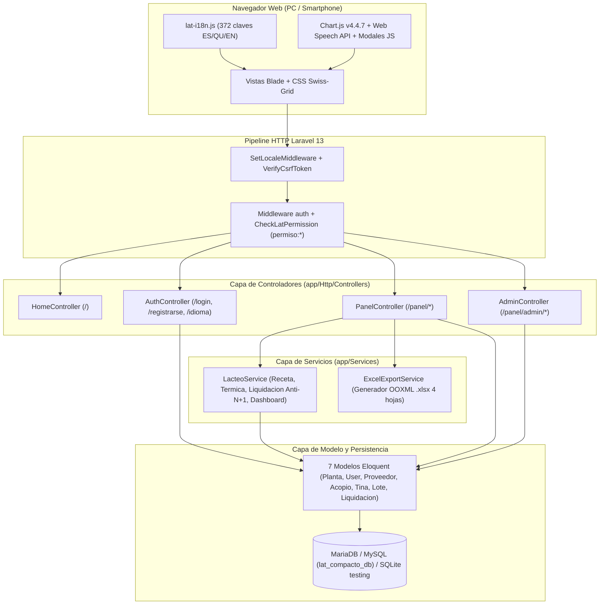
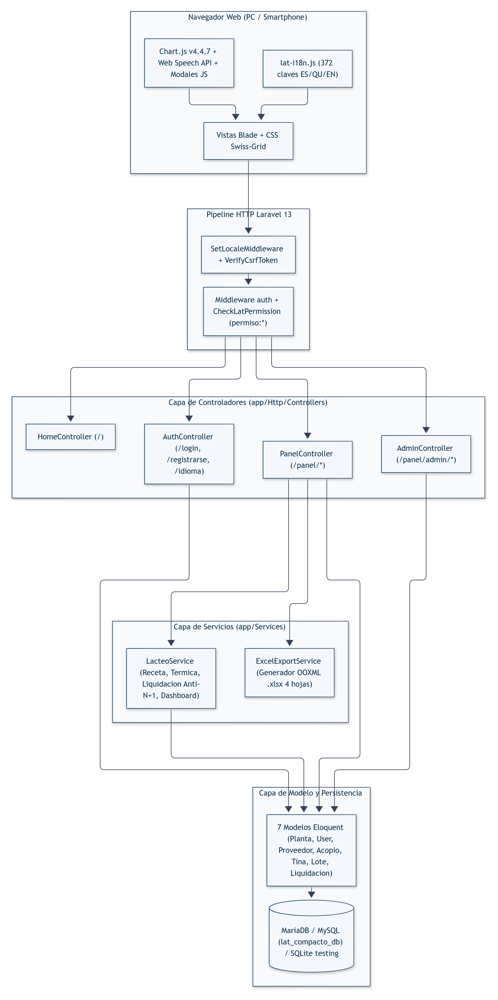
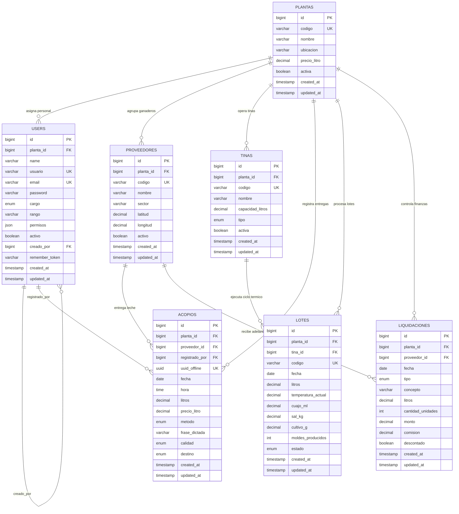
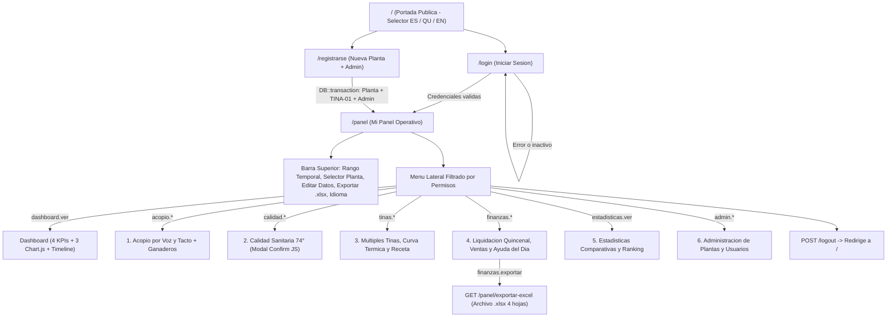
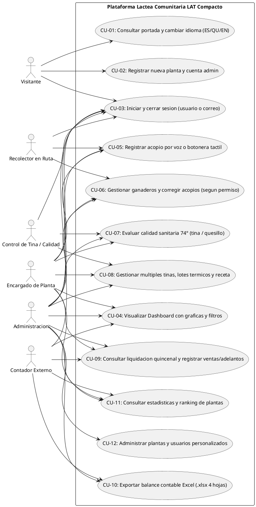
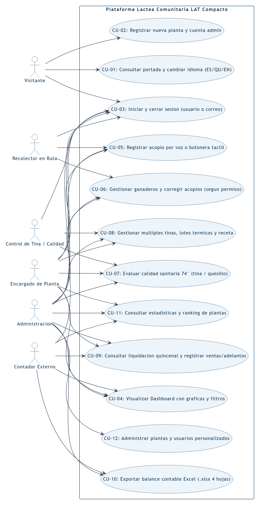
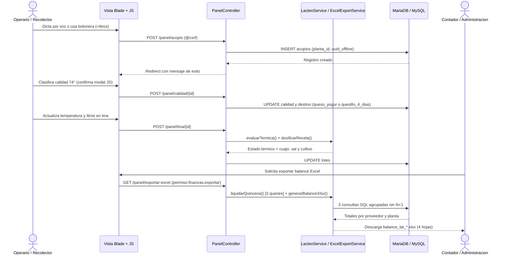
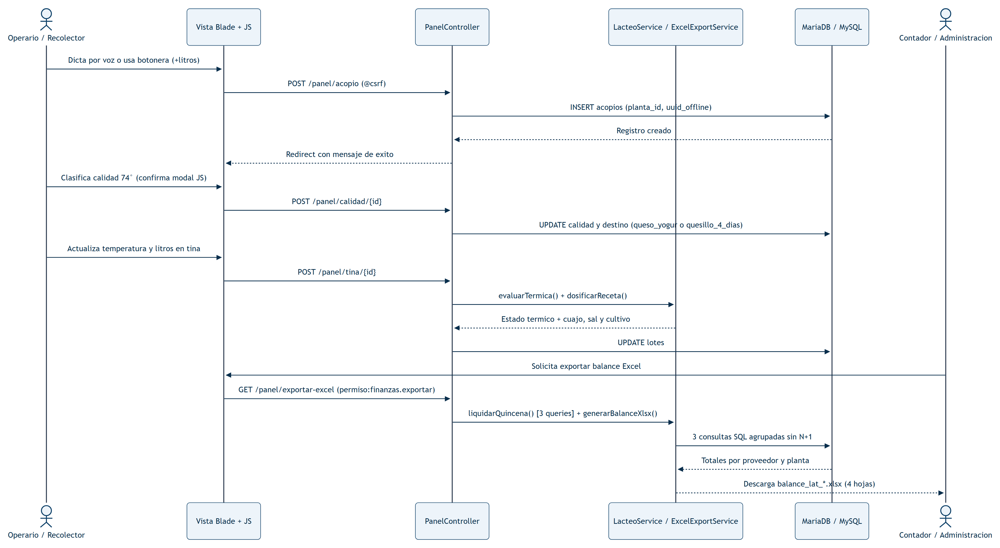
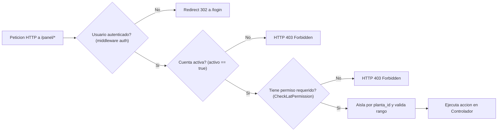

<div align="center">

“Año de la Esperanza y el Fortalecimiento de la Democracia”

# UNIVERSIDAD CONTINENTAL

**Facultad de Ingeniería**  
**Escuela Profesional de Ingeniería de Sistemas e Informática**

---

**Asignatura:** Programación Web — **NRC:** 24589

### PROYECTO: DESARROLLO DE APLICACIÓN WEB CON IMPACTO SOCIAL
## "PLATAFORMA LÁCTEA COMUNITARIA LAT COMPACTO"
### SISTEMA DE ACOPIO RURAL POR VOZ, CONTROL SANITARIO Y LIQUIDACIÓN JUSTA

**Caso Social:** Acopio rural por voz, control sanitario y liquidación justa en cadena láctea comunitaria

---

**ESTUDIANTES:**
- Ortiz Gutierrez, Nasdig Jordan (Arquitecto de Base de Datos y Persistencia) – 33.3%
- Lovatón Casas, Arantxa Alejandra (Ingeniero Backend y Lógica Core) – 33.3%
- Obregon Choque, Kelmer Wilder (Diseñador Frontend UI/UX y Accesibilidad) – 33.4%

**DOCENTE:** ALFREDO COLLANTES MENDOZA

**Fecha y lugar:** Cusco, 2026  
**Enlace al repositorio GitHub:** https://github.com/KelmerOC/LAT

</div>

---

## ÍNDICE DE CONTENIDO

- [1. RESUMEN EJECUTIVO](#1-resumen-ejecutivo)
- [2. INTRODUCCIÓN](#2-introducción)
  - [2.1 Contexto general](#21-contexto-general)
  - [2.2 Objetivo general](#22-objetivo-general)
  - [2.3 Objetivos específicos](#23-objetivos-específicos)
  - [2.4 Alcance actual del proyecto](#24-alcance-actual-del-proyecto)
  - [2.5 Beneficiarios directos e indirectos](#25-beneficiarios-directos-e-indirectos)
  - [2.6 Justificación del uso de tecnología web con impacto social](#26-justificación-del-uso-de-tecnología-web-con-impacto-social)
- [3. PROBLEMÁTICA SOCIAL Y JUSTIFICACIÓN](#3-problemática-social-y-justificación)
  - [3.1 Descripción de la problemática](#31-descripción-de-la-problemática)
  - [3.2 Evidencia de entrevistas (mínimo 3)](#32-evidencia-de-entrevistas-mínimo-3)
  - [3.3 Justificación del impacto social](#33-justificación-del-impacto-social)
  - [3.4 Análisis del rol de la ingeniería en la solución](#34-análisis-del-rol-de-la-ingeniería-en-la-solución)
- [4. MARCO ÉTICO Y RESPONSABILIDAD SOCIAL](#4-marco-ético-y-responsabilidad-social)
  - [4.1 Impacto de la solución tecnológica en la sociedad](#41-impacto-de-la-solución-tecnológica-en-la-sociedad)
  - [4.2 Consideraciones éticas en el desarrollo](#42-consideraciones-éticas-en-el-desarrollo)
  - [4.3 Plan de sostenibilidad y transferencia a la comunidad](#43-plan-de-sostenibilidad-y-transferencia-a-la-comunidad)
  - [4.4 Políticas de respeto a la propiedad intelectual](#44-políticas-de-respeto-a-la-propiedad-intelectual)
  - [4.5 Acuerdos de trabajo y compromisos del equipo](#45-acuerdos-de-trabajo-y-compromisos-del-equipo)
- [5. DISEÑO Y ARQUITECTURA DE LA SOLUCIÓN](#5-diseño-y-arquitectura-de-la-solución)
  - [5.1 Framework seleccionado y justificación](#51-framework-seleccionado-y-justificación)
  - [5.2 Arquitectura MVC](#52-arquitectura-mvc)
  - [5.3 Modelo de datos](#53-modelo-de-datos)
  - [5.4 Diseño de interfaz](#54-diseño-de-interfaz)
  - [5.5 Diseño de seguridad web](#55-diseño-de-seguridad-web)
  - [5.6 Escalabilidad y sostenibilidad](#56-escalabilidad-y-sostenibilidad)
- [6. INFORME DE FUNCIONALIDAD DE LA PÁGINA WEB](#6-informe-de-funcionalidad-de-la-página-web)
  - [6.1 Módulos del sistema](#61-módulos-del-sistema)
  - [6.2 Flujo de navegación](#62-flujo-de-navegación)
  - [6.3 Roles y permisos](#63-roles-y-permisos)
  - [6.4 Casos de uso principales](#64-casos-de-uso-principales)
  - [6.5 Funcionalidades CRUD completas](#65-funcionalidades-crud-completas)
  - [6.6 Métricas proyectadas de impacto social](#66-métricas-proyectadas-de-impacto-social)
- [7. DESARROLLO INICIAL Y OPTIMIZACIÓN TÉCNICA](#7-desarrollo-inicial-y-optimización-técnica)
  - [7.7 Optimización de consultas y rendimiento](#77-optimización-de-consultas-y-rendimiento)
    - [7.7.1 Diagnóstico inicial](#771-diagnóstico-inicial)
    - [7.7.2 Técnicas aplicadas](#772-técnicas-aplicadas)
    - [7.7.3 Evidencias antes/después](#773-evidencias-antesdespués)
  - [7.8 Seguridad web implementada y evidencias](#78-seguridad-web-implementada-y-evidencias)
    - [7.8.1 Amenazas consideradas](#781-amenazas-consideradas)
    - [7.8.2 Controles implementados](#782-controles-implementados)
    - [7.8.3 Evidencias de pruebas](#783-evidencias-de-pruebas)
- [8. GESTIÓN DEL PROYECTO](#8-gestión-del-proyecto)
  - [8.1 Cronograma con hitos y responsables](#81-cronograma-con-hitos-y-responsables)
  - [8.2 Distribución de responsabilidades](#82-distribución-de-responsabilidades)
  - [8.3 Registro de reuniones y acuerdos](#83-registro-de-reuniones-y-acuerdos)
  - [8.4 Acuerdos de trabajo y compromisos](#84-acuerdos-de-trabajo-y-compromisos)
- [9. REFERENCIAS Y PROPIEDAD INTELECTUAL](#9-referencias-y-propiedad-intelectual)
  - [9.1 Referencias bibliográficas](#91-referencias-bibliográficas)
  - [9.2 Licencias de software utilizadas](#92-licencias-de-software-utilizadas)
  - [9.3 Declaración de originalidad](#93-declaración-de-originalidad)
- [10. ANEXOS](#10-anexos)
  - [Anexo A: Manual de usuario](#anexo-a-manual-de-usuario)
  - [Anexo B: Evidencias de entrevistas](#anexo-b-evidencias-de-entrevistas)
  - [Anexo C: Capturas de pantalla del sistema](#anexo-c-capturas-de-pantalla-del-sistema)
  - [Anexo D: Diagramas adicionales](#anexo-d-diagramas-adicionales)
  - [Anexo E: Enlace al repositorio Git](#anexo-e-enlace-al-repositorio-git)
  - [Anexo F: Declaración de originalidad firmada](#anexo-f-declaración-de-originalidad-firmada)
  - [Anexo G: Evidencias de optimización de consultas](#anexo-g-evidencias-de-optimización-de-consultas)
  - [Anexo H: Evidencias de pruebas de seguridad web](#anexo-h-evidencias-de-pruebas-de-seguridad-web)

---

## 1. RESUMEN EJECUTIVO

La **Plataforma Láctea Comunitaria LAT Compacto** es una aplicación web con impacto social pensada para microempresas queseras familiares, asociaciones ganaderas y pequeños productores de Zurite, Anta y Cusco Provincia. Busca resolver problemas cotidianos del acopio matutino: cuadernos borrados por la lluvia o el suero, desacuerdos al calcular las liquidaciones quincenales, pérdida de leche con acidez y pantallas incómodas de usar con manos mojadas o guantes.

El sistema fue programado en **Laravel 13** (PHP 8.3+) con arquitectura MVC y capa de servicios (`LacteoService` y `ExcelExportService`), sobre base de datos MariaDB/MySQL y listo para ejecutarse en XAMPP local o en contenedor Docker para Render. Integra gestión multi-planta, acopio por voz (Web Speech API) y botonera táctil, control sanitario a 74° con desvío a quesillos de 4 días, monitoreo térmico de múltiples tinas con cálculo automático de insumos, liquidación quincenal sin comisión (S/ 0.00), exportación nativa a Excel (`.xlsx`), dashboard con gráficas Chart.js, permisos granulares por rol y rango, interfaz trilingüe (español, quechua e inglés) y 11 pruebas automatizadas en PHPUnit. Su uso busca dar cuentas claras, evitar desperdicio y cuidar la privacidad rural. *(181 palabras)*

---

## 2. INTRODUCCIÓN

### 2.1 Contexto general

En la provincia de Anta (especialmente en el distrito de Zurite) y en comunidades ganaderas de Cusco Provincia como Markjo, Compone, Izcuchaca, Huayllacocha, Cachimayo y Chinchero, la producción de leche fresca sostiene la economía diaria de cientos de familias campesinas. Cada madrugada, entre las 06:00 y las 08:00 horas, la leche llega en porongos de aluminio hacia pequeñas queserías familiares administradas generalmente por padres e hijos.

En la mayoría de estos centros, el control diario todavía se lleva en cuadernos escolares. La lluvia, el frío, el lavado constante de envases y las salpicaduras de suero mojan y borran los apuntes de pesaje. Cuando termina la quincena y toca calcular cuánto corresponde a cada ganadero —restando los adelantos en efectivo o en moldes de queso que pidió durante los quince días—, aparecen diferencias que dañan la confianza entre productores y queseros.

Por otro lado, los programas comerciales o ERP de suscripción mensual cobran licencias o porcentajes por operación que una planta artesanal de 50 a 1,000 litros diarios no puede cubrir, y tampoco están adaptados al uso con una sola mano ni al idioma quechua (*Runasimi*). Para responder a este problema construimos **LAT Compacto** dentro del curso de Programación Web, aplicando los temas del semestre: diseño responsivo, patrón MVC con capa de servicios, optimización de consultas en Eloquent y seguridad web con roles granulares.

### 2.2 Objetivo general

Desarrollar e implementar la aplicación web comunitaria **LAT Compacto** en Laravel y MariaDB/MySQL para microempresas queseras y asociaciones ganaderas de Anta y Cusco Provincia, digitalizando el acopio de leche por voz y botonera táctil, el control sanitario sin desperdicio, el monitoreo térmico de múltiples tinas con receta estandarizada, el análisis visual mediante dashboards y la liquidación quincenal sin cobro de comisiones (S/ 0.00).

### 2.3 Objetivos específicos

- Diseñar e implementar una base de datos relacional normalizada de 7 tablas con claves foráneas e índices para operar varias plantas lácteas, múltiples tinas por planta, productores, acopios, lotes térmicos, movimientos financieros y usuarios con permisos personalizados.
- Separar la lógica de negocio en servicios dedicados (`LacteoService` y `ExcelExportService`) para calcular automáticamente el cuajo, la sal y el cultivo, seguir el enfriamiento de pasteurización (72 °C a 36–40 °C), generar liquidaciones quincenales sin consultas N+1, comparar estadísticas entre plantas y exportar archivos Excel (`.xlsx`).
- Construir una interfaz web responsiva y accesible basada en la guía visual `DESIGN.md`, con botones táctiles grandes (`>= 54 px` y `>= 64 px`), dictado por voz, gráficas interactivas en Chart.js y cambio completo entre español, quechua e inglés.
- Implementar autenticación y control de acceso por cargo, rango y 18 permisos específicos, junto con defensas contra vulnerabilidades web frecuentes (SQLi, XSS, CSRF y escalamiento de privilegios) y respeto a la Ley N.° 29733 de Protección de Datos Personales [1].
- Validar el sistema con pruebas automatizadas en PHPUnit (11 casos), un script base de verificación visual en Playwright (`tests/e2e/visual-standards.cjs`) y configuración lista para despliegue local (XAMPP) y en contenedor (Docker/Render).

### 2.4 Alcance actual del proyecto

Al cierre del curso, el proyecto creció respecto a su propuesta inicial de una sola planta y 5 tablas. Tras revisar el código real del repositorio `https://github.com/KelmerOC/LAT`, la siguiente tabla resume con claridad qué está implementado y qué funciones quedaron como mejoras futuras:

| Componente / Funcionalidad | Estado actual | Evidencia real en el repositorio |
| :--- | :---: | :--- |
| Portal público honesto + Registro de nueva planta + Login híbrido | **Implementado** | `HomeController.php`, `AuthController.php`, `inicio.blade.php`, `login.blade.php`, `register.blade.php` |
| Arquitectura multi-planta y aislamiento por `planta_id` | **Implementado** | `Planta.php`, migración `2026_01_01_000002`, selector de planta en `topbar.blade.php` |
| Dashboard interactivo con 4 KPIs, filtros temporales y 3 gráficas Chart.js | **Implementado** | `LacteoService::obtenerDatosDashboard()`, `sections/dashboard.blade.php`, `public/js/chart.umd.min.js` |
| Módulo 1: Acopio por voz (Web Speech API), botonera 54 px y CRUD de entregas/ganaderos | **Implementado** | `PanelController@guardarAcopio/actualizarAcopio/eliminarAcopio/guardarProveedor`, `sections/acopio.blade.php` |
| Módulo 2: Triage sanitario (prueba de alcohol 74°) con desvío a quesillo 4 días y confirmación JS | **Implementado** | `PanelController@evaluarCalidad`, `sections/calidad.blade.php`, `partials/modals.blade.php` |
| Módulo 3: Gestión de múltiples tinas por planta, lotes térmicos y cálculo automático de insumos | **Implementado** | `Tina.php`, `Lote.php`, `LacteoService::dosificarReceta/evaluarTermica`, `sections/tinas.blade.php` |
| Módulo 4: Liquidación quincenal sin N+1 (S/ 0.00), adelantos, ventas y Ayuda del Día sin DNI | **Implementado** | `LacteoService::liquidarQuincena()`, `PanelController@registrarMovimiento`, `sections/finanzas.blade.php` |
| Módulo 5: Estadísticas comparativas ("¿Quién vende más?"), 1 gráfica de dona Chart.js y Excel `.xlsx` (4 hojas) | **Implementado** | `LacteoService::obtenerEstadisticas()`, `ExcelExportService.php`, `sections/estadisticas.blade.php` |
| Módulo 6: Administración de plantas y usuarios personalizados con 18 permisos y 4 rangos | **Implementado** | `AdminController.php`, `User.php`, `CheckLatPermission.php`, `sections/admin.blade.php` |
| Internacionalización trilingüe completa (ES / QU / EN) con 372 claves y persistencia en sesión | **Implementado** | `public/js/lat-i18n.js`, `SetLocaleMiddleware.php`, ruta `GET /idioma/{lang}` |
| Suite PHPUnit (11 pruebas) + script base E2E Playwright + despliegue Docker/Render y XAMPP | **Implementado** *(E2E por actualizar al sidebar)* | `tests/Feature/LatFuncionalidadesTest.php`, `tests/e2e/visual-standards.cjs`, `Dockerfile`, `docker/start.sh` |
| Cola de sincronización offline en `localStorage`, mapa Leaflet/OSM, OTP por correo y Libro de Reclamaciones D.S. 011-2011-PCM | **Fuera de esta versión (trabajo futuro)** | Preparados en esquema los campos `uuid_offline` (`acopios`) y `latitud`/`longitud` (`proveedores`); se proyectan para una fase posterior. |

### 2.5 Beneficiarios directos e indirectos

| Tipo de beneficiario | Grupo identificado | Beneficio concreto con LAT Compacto |
| :--- | :--- | :--- |
| **Directos** | Microempresas queseras familiares y encargados de planta (Zurite, Anta y Cusco) | Reemplazan los cuadernos mojados por registros digitales ordenados, estandarizan la receta de cada tina y obtienen balances en Excel listos para su gestión. |
| **Directos** | Recolectores en ruta y operarios de planta (incluidos adultos mayores) | Capturan litros dictando al micrófono o tocando teclas grandes con una mano, sin necesidad de tener correo electrónico personal ni memorizar menús complejos. |
| **Directos** | Pequeños productores ganaderos (proveedores de 5 L a 150 L por entrega) | Reciben cuentas claras cada quincena sin comisión (S/ 0.00), el mismo precio por litro sin importar su volumen y aprovechamiento de leche ácida en quesillos en vez de rechazo. |
| **Indirectos** | Contadores externos, cajas rurales y entidades bancarias | Cuentan con reportes `.xlsx` ordenados con sumatorias automáticas (`SUM`), facilitando declaraciones ante SUNAT y respaldo crediticio para las familias. |
| **Indirectos** | Trabajadores de apoyo eventual en planta y consumidores locales | Los apoyos por jornal cobran sin entregar datos sensibles innecesarios (Ley N.° 29733), y los consumidores reciben quesos y derivados elaborados bajo control térmico y sanitario uniforme. |

### 2.6 Justificación del uso de tecnología web con impacto social

Optar por una **aplicación web responsiva** en lugar de una aplicación móvil nativa o un programa de escritorio tiene sentido práctico para la realidad rural cusqueña:

- **Sin barreras de dispositivo ni instalación:** Corre directamente desde el navegador de cualquier celular Android de gama básica o computadora en planta, sin depender de tiendas de aplicaciones ni pagar licencias de publicación.
- **Costo cero y doble despliegue:** Una quesería sin internet permanente puede instalarla en una laptop local con XAMPP (`README.md`), mientras que una asociación con varias plantas conectadas puede publicarla en la nube mediante el `Dockerfile` configurado para Render.
- **Inclusión real:** Al combinar HTML semántico, diseño de alto contraste, dictado por voz y traducción completa al quechua (*Runasimi*), la web acerca la gestión digital a operarios que suelen quedar excluidos de los sistemas empresariales tradicionales.

---

## 3. PROBLEMÁTICA SOCIAL Y JUSTIFICACIÓN

### 3.1 Descripción de la problemática

A partir del trabajo previo de levantamiento en el distrito de Zurite (provincia de Anta) y las comunidades lecheras de Cusco Provincia —complementado con datos sectoriales de la Dirección Regional de Agricultura de Cusco [2] y el INEI [3]—, se identificaron cinco problemas que frenan el crecimiento de las queserías artesanales:

1. **Deterioro de los cuadernos de pesaje:** En la cuenca de Cusco y Anta se producen más de 45,000 litros diarios de leche cruda [2], y alrededor del 78% de las queserías artesanales aún anota el acopio en cuadernos de papel. La lluvia de madrugada y las salpicaduras de suero borran cifras y provocan desacuerdos financieros al liquidar la quincena.
2. **Dificultad para usar interfaces convencionales en campo:** Los recolectores y encargados manipulan porongos metálicos con manos frías, mojadas o con guantes; los formularios pequeños de escritorio o celulares resultan lentos e incómodos.
3. **Pérdida de valor por acidificación prematura:** En temporadas cálidas o lluviosas, entre el 8% y el 12% de la leche llega con acidez detectable en la prueba de alcohol a 74°. Si no se clasifica y deriva rápido a quesillos frescos de consumo corto (4 días), se malogra toda una tina o se descarta la leche perjudicando al productor.
4. **Cálculos manuales de tina y desorden en adelantos:** Sin una referencia rápida de enfriamiento (de 72 °C a 36–40 °C) ni una calculadora exacta de cuajo, sal y cultivo según los litros reales del día, los quesos salen desparejos. A la vez, los adelantos en dinero o moldes de queso que piden los ganaderos se apuntan en hojas sueltas y se olvidan al cerrar la quincena.
5. **Informalidad en pagos eventuales y riesgos de privacidad:** Cerca del 92% del personal de apoyo temporal (lavado de porongos o volteo de quesos) cobra jornales en efectivo en mano. Pedir DNI y fichas extensas para estos pagos menores complica el registro y contradice el principio de proporcionalidad de la Ley N.° 29733 [1].

### 3.2 Evidencia de entrevistas (mínimo 3)

Durante la etapa de diagnóstico en campo se realizaron entrevistas semiestructuradas a actores de la cadena láctea de Zurite (Anta). De la versión anterior del informe (`docs/INFORME_PROYECTO_LAT_CUSCO.docx.md`) se rescataron los hallazgos de las dos entrevistas con identificación completa y los apuntes de una tercera entrevista de ruta/adelantos cuyo registro nominal y ficha firmada están pendientes de adjuntar en físico/imagen:

| N.° | Entrevistado | Rol / Lugar y fecha | Problema declarado en entrevista | Requerimiento derivado para LAT Compacto |
| :-: | :--- | :--- | :--- | :--- |
| 1 | **Don Eloy Condori** | Ganadero y recolector — Zurite, Anta (11/10/2026) | *"El cuaderno se moja y se borran los números. En la quincena hay dudas con el quesero."* | Registro digital de entregas con dictado por voz, confirmación auditiva y liquidación quincenal clara. |
| 2 | **Elvis (hijo)** | Productor y encargado de planta — Zurite, Anta (11/10/2026) | *"Al tanteo en vasito; si la leche cambia de cantidad, a veces el queso no cuaja parejo. Si la leche cambia, hay que saber si va a queso o a otro derivado."* | Calculadora automática de cuajo, sal y cultivo según litros en tina, más triage sanitario a 74° con desvío a quesillo de 4 días. |
| 3 | **Actor de ruta / gestión de planta** *(nombre completo y ficha firmada por adjuntar)* | Recolector en moto / apoyo de planta — Anta (octubre 2026) | *"Con manos mojadas y frío no se puede escribir en teclado; hablándole al celular es inmediato. Además, si los adelantos no se anotan bien, al final de la quincena se olvidan."* | Botonera táctil grande (`>= 54 px`) como respaldo del dictado por voz y módulo de adelantos (efectivo y queso) descontados automáticamente en la quincena. |

> **[INSERTAR EVIDENCIA VISUAL AQUÍ]**
> - **Qué mostrar:** Escaneos o fotografías legibles de las 3 fichas de entrevista firmadas (completando el nombre y consentimiento del tercer entrevistado). Las fotografías de campo del cuaderno físico de acopio y la tina quesera artesanal tomadas durante la visita a Zurite/Anta se incluyen en el **Anexo B**.
> - **Herramienta recomendada:** Cámara fotográfica o escáner de fichas físicas de entrevista (respetando la privacidad de los entrevistados).
> - **Archivo/Ruta de referencia en el repo:** `docs/INFORME_PROYECTO_LAT_CUSCO.docx.md` (secciones 2.6.2 y 12.1–12.2) y `Anexo B` de `docs/INFORME_FINAL_LAT.md`.

### 3.3 Justificación del impacto social

Frente a las opciones que hoy existen en el mercado, **LAT Compacto** se diseñó expresamente para no expulsar a las familias de menores recursos:

| Criterio de comparación | Cuaderno de papel | Hoja de Excel manual | ERP comercial SaaS | LAT Compacto (actual) |
| :--- | :--- | :--- | :--- | :--- |
| **Costo mensual / licencia** | Bajo costo inicial | Licencia ofimática | Alto (S/ 150 a S/ 450/mes) | **S/ 0.00** (código libre MIT) |
| **Uso con manos húmedas o guantes** | Nulo (el papel se rompe) | Difícil (requiere teclado) | Bajo (pantallas cargadas) | **Alto** (voz + teclas de 54 px) |
| **Idioma quechua (*Runasimi*)** | No aplica | No disponible | No disponible | **Trilingüe nativo** (ES / QU / EN) |
| **Control de tinas y recetas** | Al cálculo manual | Fórmulas frágiles | Módulos industriales caros | **Automático** por volumen y °C |
| **Liquidación y adelantos** | Suma manual con errores | Armado lento | Exige plan contable complejo | **Automático** (0% comisión) + `.xlsx` |

Además, el proyecto se alinea directamente con cinco **Objetivos de Desarrollo Sostenible (ODS)** de la Agenda 2030:
- **ODS 1 (Fin de la Pobreza) y ODS 2 (Hambre Cero):** Protege el ingreso de las familias ganaderas evitando pérdidas por apuntes borrados o descarte de leche.
- **ODS 8 (Trabajo Decente y Crecimiento Económico):** Ordena la gestión financiera de las microempresas familiares y facilita reportes Excel para formalización.
- **ODS 10 (Reducción de las Desigualdades):** Incorpora el idioma quechua, dictado vocal y trato igualitario sin sesgo entre productores pequeños y grandes.
- **ODS 12 (Producción y Consumo Responsables):** Promueve el principio de cero desperdicio al transformar la leche con acidez en quesillos frescos de 4 días.

### 3.4 Análisis del rol de la ingeniería en la solución

Desde la Ingeniería de Sistemas e Informática, resolver este caso significó tomar decisiones técnicas pensadas para las condiciones reales del campo y no simplemente adaptar una plantilla genérica:

- **Modelado relacional y rendimiento:** Se diseñaron 7 tablas relacionadas con 12 índices explícitos (10 compuestos y 2 simples) y 7 restricciones `UNIQUE` para que las consultas de acopio, calidad, tinas y liquidaciones respondan rápido incluso en computadoras básicas con XAMPP.
- **Separación de responsabilidades (SRP):** Los cálculos lecheros (cuajo, sal, cultivo y enfriamiento), el cierre quincenal sin consultas N+1, las estadísticas y la generación del libro `.xlsx` se mantienen dentro de `app/Services/`, evitando sobrecargar los controladores.
- **Accesibilidad (WCAG 2.1 AA):** Se definieron colores con contraste comprobado (`#c2410c` sobre blanco con ratio `>= 5.2:1`, `#0a2f4d` para texto principal), navegación por teclado, atributos `aria-*` y botón de pausa en el carrusel de portada (criterio WCAG 2.2.2) [4].
- **Seguridad desde el diseño:** El acceso no depende de un solo campo de "admin"; se armó un catálogo de 18 permisos y 4 rangos con aislamiento por `planta_id` para evitar accesos cruzados entre plantas o escalamiento de privilegios.

---

## 4. MARCO ÉTICO Y RESPONSABILIDAD SOCIAL

### 4.1 Impacto de la solución tecnológica en la sociedad

Digitalizar el acopio y la liquidación cambia la dinámica diaria de la quesería comunitaria: cada entrega queda respaldada con fecha, hora, volumen, método de captura (voz o manual) y resultado sanitario. Esto reduce los malentendidos al final de la quincena y fortalece la confianza entre los comuneros y la planta. A la vez, el dashboard visual con gráficas de litros, ventas, gastos y moldes permite que los jóvenes de la familia colaboren en la administración del negocio con información clara en tiempo real.

### 4.2 Consideraciones éticas en el desarrollo

Los principios éticos definidos en `PRODUCT.md` y `DESIGN.md` están trasladados directamente al comportamiento del código:

| Principio ético | Cómo se cumple en el código de LAT Compacto |
| :--- | :--- |
| **Comisión S/ 0.00** | Configurado en `config/lat.php` (`LAT_COMISION=0.00`), en el valor por defecto de `liquidaciones.comision` y en `LacteoService::liquidarQuincena()`. |
| **Trato justo sin sesgo** | Cada planta aplica un mismo `precio_litro` a todos sus ganaderos, ya entreguen 5 L o 150 L. |
| **Cero desperdicio sanitario** | Al clasificar un porongo como `acida` en `PanelController@evaluarCalidad`, el destino pasa automáticamente a `quesillo_4_dias` en lugar de eliminar el registro. |
| **Minimización de datos (Ley N.° 29733)** [1] | La tabla `proveedores` identifica a cada ganadero con código comunitario (`PRV-01`) sin solicitar DNI; los pagos de tipo `ayuda_del_dia` permiten `proveedor_id = null` sin datos sensibles; el correo electrónico (`users.email`) es opcional para operarios. |
| **Veracidad y honestidad visual** | La portada (`inicio.blade.php`) no muestra contadores inventados de clientes ni testimonios ficticios, y las fotos de stock del carrusel llevan la nota visible *"Fotografías referenciales de stock, no de socios de la plataforma"*. |
| **Inclusión cultural y lingüística** | El sistema ofrece 372 claves traducidas al Español, Quechua (*Runasimi*) e Inglés en `public/js/lat-i18n.js`, sincronizadas con la sesión del servidor (`SetLocaleMiddleware`). |

### 4.3 Plan de sostenibilidad y transferencia a la comunidad

Para que LAT Compacto pueda mantenerse operativo al terminar el curso sin depender de pagos mensuales:

1. **Software 100% libre de regalías:** Tanto el backend (PHP/Laravel), la base de datos (MariaDB/MySQL) como las librerías de interfaz (Chart.js, fuentes abiertas Inter) usan licencias permisivas. Incluso la exportación a Excel (`ExcelExportService.php`) fue desarrollada en PHP puro con `zlib`, sin paquetes comerciales.
2. **Despliegue flexible según conectividad:** Las plantas sin internet estable pueden ejecutarlo en red local usando XAMPP (`http://localhost/lat-compacto/`), mientras que las asociaciones que requieran acceso remoto entre varias plantas ya cuentan con `Dockerfile`, `docker/000-default.conf` y `docker/start.sh` preparados para Render.
3. **Transferencia y capacitación:** Se contempla entregar el repositorio público en GitHub, el manual de usuario ilustrado (Anexo A) y sesiones prácticas con los responsables de planta de Anta para configurar sus proveedores, tinas y cuentas de operarios.

### 4.4 Políticas de respeto a la propiedad intelectual

- Todas las librerías declaradas en `composer.json` y `package.json` se utilizan respetando sus licencias originales (MIT, BSD-3-Clause, Apache-2.0 e ISC), listadas con su versión exacta en la sección 9.2.
- El diseño visual (`DESIGN.md`), las hojas CSS (`lat-design-system.css` y `lat-dashboard.css`), los logotipos SVG en `public/brand/`, los servicios (`LacteoService`, `ExcelExportService`) y las traducciones (`lat-i18n.js`) fueron elaborados por el equipo para este proyecto académico.
- Las fotografías del carrusel de portada provienen de Unsplash bajo licencia libre y se citan explícitamente como referenciales.

### 4.5 Acuerdos de trabajo y compromisos del equipo

El equipo estableció reglas claras de trabajo colaborativo: dividir responsabilidades por capa arquitectónica (Base de datos, Backend Core y Frontend/UX), documentar los cambios en GitHub con mensajes semánticos, revisar entre los tres integrantes el funcionamiento antes de cada avance y mantener honestidad técnica al diferenciar lo que ya está implementado de lo que queda como trabajo futuro.

---

## 5. DISEÑO Y ARQUITECTURA DE LA SOLUCIÓN

### 5.1 Framework seleccionado y justificación

Para el desarrollo se eligió **Laravel 13** (`laravel/framework v13.39.0` sobre **PHP 8.3+**, ejecutado también en imagen `php:8.4-apache` en Docker) [7], [8], [11] junto con **Blade**, **Eloquent ORM**, **MariaDB/MySQL** y **JavaScript Vanilla + Chart.js 4.4.7** [10]. Las razones prácticas de esta elección son:

| Criterio técnico | Justificación con Laravel 13 + Stack elegido |
| :--- | :--- |
| **Productividad y orden MVC** | Separa con claridad rutas (`routes/web.php`), middlewares, controladores, modelos, vistas Blade y servicios, reduciendo código repetitivo [7]. |
| **Seguridad integrada por defecto** | Incluye consultas preparadas PDO vía Eloquent, escape automático en Blade (`{{ }}`), protección `@csrf`, hashing Bcrypt y manejo seguro de sesiones [7], [8]. |
| **Bajo peso en redes rurales** | Al generar el HTML en el servidor con Blade y usar JS nativo sin frameworks SPA pesados, las pantallas cargan rápido en celulares económicos y conexiones móviles lentas. |
| **Compatibilidad local y nube** | Funciona sin complicaciones en XAMPP local y también dentro de un contenedor Docker (`Dockerfile`) para despliegue en la nube [11]. |
| **Pruebas automatizadas nativas** | Se integra directamente con **PHPUnit 12** y SQLite en memoria (`:memory:`), permitiendo validar permisos, rutas y reglas de negocio en pocos segundos. |

### 5.2 Arquitectura MVC

El sistema aplica una arquitectura **MVC apoyada en Capa de Servicios y Middlewares de Autorización e Idioma**:

- **Cliente / Navegador:** Renderiza las vistas Blade con estilos Swiss-Grid (`lat-design-system.css` y `lat-dashboard.css`), ejecuta `lat-i18n.js` (traducción instantánea ES/QU/EN), `Chart.js` [10] (4 gráficas interactivas en `/panel`: 3 en el Dashboard y 1 de dona sanitaria en Estadísticas) y la **Web Speech API** [9] (dictado y confirmación hablada).
- **Enrutamiento y Middlewares (`bootstrap/app.php`, `routes/web.php`):** Cada petición web pasa por `SetLocaleMiddleware` (idioma en sesión), la verificación CSRF de Laravel, `auth` en rutas `/panel/*` y `CheckLatPermission` (`permiso:*`) en las acciones protegidas.
- **Controladores (`app/Http/Controllers/`):** Reciben la petición HTTP (`HomeController`, `AuthController`, `PanelController`, `AdminController`), validan los datos, resuelven la planta activa y delegan los cálculos a los servicios.
- **Capa de Servicios (`app/Services/`):** `LacteoService` centraliza el cálculo de insumos, el control térmico, la liquidación quincenal sin N+1, las estadísticas y los datos del dashboard; `ExcelExportService` arma el archivo `.xlsx` (OOXML/PKZIP) de 4 hojas.
- **Modelos y Persistencia (`app/Models/`, MariaDB/MySQL):** 7 modelos Eloquent (`Planta`, `User`, `Proveedor`, `Acopio`, `Tina`, `Lote`, `Liquidacion`) con relaciones, casts y *scopes* reutilizables (`dePlanta`, `activos`, `delDia`, `delPeriodo`, `enProceso`).





### 5.3 Modelo de datos

La base de datos `lat_compacto_db` se construye mediante **3 migraciones versionadas** en `database/migrations/`:
1. `2026_01_01_000001_crear_tablas_lat_compacto.php` (esquema base de 5 tablas e índices compuestos iniciales).
2. `2026_01_01_000002_agregar_plantas_tinas_y_ventas.php` (evolución multi-planta, tabla `tinas`, relaciones `planta_id`/`tina_id` y ventas de productos).
3. `2026_11_18_205518_agregar_permisos_personalizados_usuarios.php` (soporte para cargo `personalizado`, columna `rango`, JSON `permisos` y auditoría `creado_por`).

#### Diagrama Entidad-Relación (Mermaid `erDiagram`)




#### Diccionario de datos consolidado (7 tablas reales)

| Tabla | Campo | Tipo y longitud | Restricciones / Claves | Descripción funcional |
| :--- | :--- | :--- | :--- | :--- |
| **`plantas`** | `id` | `BIGINT UNSIGNED` | `PK`, `AUTO_INCREMENT` | Identificador único de la planta láctea. |
| | `codigo` | `VARCHAR(20)` | `UNIQUE`, `NOT NULL` | Código identificador (ej. `PLT-01`). |
| | `nombre` | `VARCHAR(140)` | `NOT NULL` | Razón social o nombre comunitario de la planta. |
| | `ubicacion` | `VARCHAR(140)` | `DEFAULT 'Cusco Provincia'` | Sector, distrito o provincia de operación. |
| | `precio_litro` | `DECIMAL(6,2)` | `DEFAULT 1.65` | Precio base vigente por litro de leche (S/). |
| | `activa` | `BOOLEAN` | `INDEX (idx_plantas_activa)` | Indica si la planta se encuentra operativa. |
| **`users`** | `id` | `BIGINT UNSIGNED` | `PK`, `AUTO_INCREMENT` | Identificador único del usuario. |
| | `planta_id` | `BIGINT UNSIGNED` | `FK -> plantas.id` (`NULL ON DELETE`) | Planta a la que pertenece el operador. |
| | `name` | `VARCHAR(120)` | `NOT NULL` | Nombre completo del trabajador o responsable. |
| | `usuario` | `VARCHAR(60)` | `UNIQUE`, `NOT NULL` | Credencial simple de acceso (sin exigir correo). |
| | `email` | `VARCHAR(191)` | `NULLABLE`, `UNIQUE` | Correo electrónico opcional (vía `Schema::defaultStringLength(191)`; validación `max:255`). |
| | `password` | `VARCHAR(255)` | `NOT NULL` | Contraseña cifrada con Bcrypt (`hashed`). |
| | `cargo` | `ENUM` | 6 valores (`administracion` ... `personalizado`) | Plantilla de rol operativo asignada. |
| | `rango` | `VARCHAR(40)` | `DEFAULT 'operador'` | Nivel jerárquico (`administrador`, `supervisor`, `operador`, `personalizado`). |
| | `permisos` | `JSON` | `NULLABLE` | Arreglo de claves granulares activas (hasta 18 controles). |
| | `activo` | `BOOLEAN` | `DEFAULT true` | Habilita o revoca el inicio de sesión. |
| | `creado_por` | `BIGINT UNSIGNED` | `FK -> users.id` (`NULL ON DELETE`) | Auditoría de quién creó la cuenta. |
| **`proveedores`** | `id` | `BIGINT UNSIGNED` | `PK`, `AUTO_INCREMENT` | Identificador único del productor ganadero. |
| | `planta_id` | `BIGINT UNSIGNED` | `FK -> plantas.id` (`CASCADE`) | Planta a la que entrega leche. |
| | `codigo` | `VARCHAR(20)` | `UNIQUE`, `NOT NULL` | Código comunitario (ej. `PRV-01`, sin requerir DNI). |
| | `nombre` | `VARCHAR(120)` | `NOT NULL` | Nombre del productor ganadero. |
| | `sector` | `VARCHAR(120)` | `NULLABLE` | Comunidad o anexo (ej. Markjo, Compone, Zurite). |
| | `latitud` / `longitud` | `DECIMAL(10,7)` | `NULLABLE` | Coordenadas geográficas preparadas para ruteo futuro. |
| | `activo` | `BOOLEAN` | `INDEX` simple y compuesto con `planta_id` | Filtra ganaderos vigentes en la ruta. |
| **`tinas`** | `id` | `BIGINT UNSIGNED` | `PK`, `AUTO_INCREMENT` | Identificador único de la tina. |
| | `planta_id` | `BIGINT UNSIGNED` | `FK -> plantas.id` (`CASCADE`) | Planta propietaria de la tina. |
| | `codigo` | `VARCHAR(30)` | `UNIQUE (planta_id, codigo)` | Código interno de tina (ej. `TINA-01`). |
| | `nombre` | `VARCHAR(100)` | `NOT NULL` | Nombre descriptivo (ej. *Tina Quesillo Fresco 4 Días*). |
| | `capacidad_litros` | `DECIMAL(8,2)` | `DEFAULT 500.00` | Capacidad máxima en litros (validación en carga de lotes). |
| | `tipo` | `ENUM` | `principal_queso`, `quesillo`, `yogur`, `multiproposito` | Línea de transformación asignada. |
| | `activa` | `BOOLEAN` | `INDEX (planta_id, activa)` | Estado operativo o en mantenimiento. |
| **`acopios`** | `id` | `BIGINT UNSIGNED` | `PK`, `AUTO_INCREMENT` | Identificador único de la entrega diaria. |
| | `planta_id` | `BIGINT UNSIGNED` | `FK -> plantas.id` (`CASCADE`) | Planta receptora (`idx_acopios_planta_fecha`). |
| | `proveedor_id` | `BIGINT UNSIGNED` | `FK -> proveedores.id` (`CASCADE`) | Ganadero que entregó la leche (`idx_acopios_proveedor_fecha`). |
| | `registrado_por` | `BIGINT UNSIGNED` | `FK -> users.id` (`NULL ON DELETE`) | Operario que registró el pesaje. |
| | `uuid_offline` | `CHAR(36)` | `UNIQUE`, `NOT NULL` | UUID v4 idempotente por entrega. |
| | `fecha` / `hora` | `DATE` / `TIME` | `NOT NULL` | Día y hora exacta de recepción (`idx_acopios_fecha_calidad`). |
| | `litros` / `precio_litro` | `DECIMAL(8,2)` / `(6,2)` | `NOT NULL` | Volumen entregado y precio pactado en esa fecha. |
| | `metodo` | `ENUM` | `voz`, `manual` | Medio de captura utilizado. |
| | `frase_dictada` | `VARCHAR(255)` | `NULLABLE` | Transcripción capturada por Web Speech API. |
| | `calidad` | `ENUM` | `pendiente` (default BD), `buena`, `acida` | Resultado de la prueba de alcohol a 74° (`guardarAcopio` registra inicialmente `buena`). |
| | `destino` | `ENUM` | `pendiente` (default BD), `queso_yogur`, `quesillo_4_dias` | Ruta productiva (`queso_yogur` inicial; cambia a `quesillo_4_dias` si es ácida). |
| **`lotes`** | `id` | `BIGINT UNSIGNED` | `PK`, `AUTO_INCREMENT` | Identificador único del lote térmico. |
| | `planta_id` / `tina_id` | `BIGINT UNSIGNED` | `FK -> plantas.id`, `tinas.id` | Planta y tina donde se procesa el lote. |
| | `codigo` | `VARCHAR(40)` | `UNIQUE`, `NOT NULL` | Código de lote (ej. `LOTE-TINA-01-20261118-143000`). |
| | `fecha` / `litros` | `DATE` / `DECIMAL(8,2)` | `NOT NULL` | Fecha de proceso y volumen cargado en tina. |
| | `temperatura_actual` | `DECIMAL(5,1)` | `DEFAULT 72.0` | Lectura térmica actual del lote (°C). |
| | `cuajo_ml`, `sal_kg`, `cultivo_g` | `DECIMAL(8,2)` | `NOT NULL` | Insumos calculados automáticamente por `LacteoService`. |
| | `moldes_producidos` | `INT UNSIGNED` | `DEFAULT 0` | Unidades reales obtenidas al finalizar el lote. |
| | `estado` | `ENUM` | `pasteurizando`, `enfriando`, `lista_para_cuajo`, `terminado` | Fase actual del ciclo (`idx_lotes_fecha_estado`, `idx_lotes_planta_estado`). |
| **`liquidaciones`** | `id` | `BIGINT UNSIGNED` | `PK`, `AUTO_INCREMENT` | Identificador único del movimiento financiero. |
| | `planta_id` | `BIGINT UNSIGNED` | `FK -> plantas.id` (`CASCADE`) | Planta a la que corresponde el asiento. |
| | `proveedor_id` | `BIGINT UNSIGNED` | `FK -> proveedores.id` (`NULL ON DELETE`) | Ganadero asociado (`NULL` en ventas o *Ayuda del Día*). |
| | `fecha` / `tipo` | `DATE` / `ENUM` | 6 tipos (`quincena`, `adelanto_efectivo`, `adelanto_queso`, `ayuda_del_dia`, `gasto_operativo`, `venta_producto`) | Clasificación contable del movimiento. |
| | `concepto` | `VARCHAR(160)` | `NOT NULL` | Descripción del ingreso, gasto o adelanto. |
| | `litros` / `cantidad_unidades` | `DECIMAL(9,2)` / `INT` | `DEFAULT 0` | Litros liquidados o unidades/moldes vendidos o entregados. |
| | `monto` / `comision` | `DECIMAL(10,2)` / `(6,2)` | `comision DEFAULT 0.00` | Importe en soles y garantía de comisión S/ 0.00. |
| | `descontado` | `BOOLEAN` | `INDEX (proveedor_id, descontado)` | Marca si un adelanto ya fue descontado en quincena. |

*(Todas las tablas incluyen además marcas de auditoría `created_at` y `updated_at`.)*

### 5.4 Diseño de interfaz

El diseño visual se documenta formalmente en `DESIGN.md` y se implementa en `public/css/lat-design-system.css` (portal público y tokens base) y `public/css/lat-dashboard.css` (panel operativo modular con barra lateral). Su identidad se denomina **Editorial Swiss-Grid y Acuarela Andina**:

- **Paleta cromática y contraste WCAG 2.1 AA:** Fondo blanco papel (`#ffffff`), niebla andina (`#f2f7fb`), azul marino profundo para texto (`#0a2f4d`), azul celeste (`#0284c7`), azul oceánico (`#0d4068`) y naranja ember accesible (`#c2410c` sobre blanco con contraste `>= 5.2:1`; `#ff5900` reservado para acentos y nodos).
- **Geometría limpia y ergonómica:** Líneas divisorias expuestas de `1px` (*hairlines*), bordes rectos de `0px` a `2px` en botones y tablas, tarjetas multimedia con radio de `8px`, tipografía `Inter` variable con cifras tabulares ligeras (`font-weight: 300`, `tabular-nums`), botonera táctil de `>= 54 px` y botón de dictado de `>= 64 px`.
- **Dashboard operativo moderno:** Estructura `.dash-shell` con sidebar lateral fijo de `268 px` en escritorio (convertido en menú deslizable *off-canvas* en pantallas `<= 992 px`), topbar con selector de rango (`Hoy`, `7 días`, `Quincena`, `Mes`), selector multi-planta, acceso rápido a *Editar datos* y botón de exportación Excel.

#### Wireframes y mockups ya generados en el repositorio (`mockups/`)

Mediante los scripts reproducibles `scripts/generate_wireframes.cjs` y `scripts/generate_mockups.cjs` (con Playwright), el equipo cuenta con **10 archivos gráficos** versionados en la carpeta `mockups/`:

| N.° | Pantalla representada | Wireframe esquemático (B/N) | Mockup de alta fidelidad (monocromo) |
| :-: | :--- | :--- | :--- |
| 1 | Portada pública Swiss-Grid y barra trilingüe | `mockups/mockup_1_portada_wireframe.png` | `mockups/mockup_1_portada_desktop_bw.png` |
| 2 | Panel operativo — Módulo 1: Acopio por voz y botonera | `mockups/mockup_2_panel_acopio_wireframe.png` | `mockups/mockup_2_panel_acopio_desktop_bw.png` |
| 3 | Panel operativo — Módulo 2: Control sanitario 74° | `mockups/mockup_3_control_sanitario_wireframe.png` | `mockups/mockup_3_control_sanitario_desktop_bw.png` |
| 4 | Panel operativo — Módulo 3: Monitoreo térmico y receta | `mockups/mockup_4_tina_receta_wireframe.png` | `mockups/mockup_4_tina_receta_desktop_bw.png` |
| 5 | Vista móvil smartphone (390 × 844 px) y menú táctil | `mockups/mockup_5_movil_wireframe.png` | `mockups/mockup_5_movil_smartphone_bw.png` |

> **[INSERTAR EVIDENCIA VISUAL AQUÍ]**
> - **Qué mostrar:** Composición visual con los mockups y wireframes de la carpeta `mockups/` junto con capturas a color actuales del nuevo Dashboard con sidebar lateral, gráficas Chart.js y matriz de usuarios personalizados.
> - **Herramienta recomendada:** Navegador Chrome/Edge + DevTools (`F12`, vistas de escritorio `1280×800` y móvil `390×844`) y archivos PNG de `mockups/`.
> - **Archivo/Ruta de referencia en el repo:** `mockups/*.png`, `DESIGN.md`, `resources/views/panel.blade.php` y `resources/views/panel/sections/dashboard.blade.php`.

### 5.5 Diseño de seguridad web

El diseño de seguridad de LAT Compacto se estructuró tomando como referencia la guía **OWASP Top 10 (2021)** [5] para prevenir los riesgos más frecuentes en aplicaciones web multi-usuario:

- **Amenazas identificadas:** Control de acceso roto o escalamiento entre plantas/rangos (A01), exposición de credenciales o sesiones inseguras (A02/A07), inyección SQL y Cross-Site Scripting —XSS— (A03), falsificación de peticiones entre sitios —CSRF— (A01/A05) y errores de configuración del servidor o dependencias desactualizadas (A05/A06).
- **Controles previstos en el diseño:**
  - *Autenticación y gestión de sesiones:* Inicio de sesión híbrido (correo o usuario) verificando `activo = true`, contraseñas con hash Bcrypt [8], regeneración del ID de sesión tras autenticarse, cierre con invalidación completa y cookies `HttpOnly` + `SameSite=Lax`.
  - *Autorización por roles, rangos y permisos:* Middleware `CheckLatPermission` (`permiso:*`) en cada ruta operativa protegida, ocultamiento condicional de controles en Blade, filtrado estricto por `planta_id` en todas las consultas y validación jerárquica para que un supervisor jamás asigne permisos superiores a los suyos ni modifique administradores.
  - *Prevención de SQL Injection:* Uso obligatorio de Eloquent ORM y *Query Builder* con consultas parametrizadas PDO [7], [8], más validación estricta con `Rule::exists(...)->where('planta_id', ...)` en identificadores externos.
  - *Prevención de XSS:* Escape automático de Blade (`{{ }}`) para todo dato proveniente de usuarios o base de datos, escritura DOM mediante `.textContent` en `lat-i18n.js` y saneamiento XML (`ENT_XML1 | ENT_QUOTES`) al generar archivos `.xlsx`.
  - *Integridad y configuración segura:* Tokens `@csrf` en formularios mutables, whitelists `$fillable` contra *Mass Assignment*, bloqueo de listado de directorios (`Options -Indexes`) y forzado de HTTPS en producción (`AppServiceProvider`).

> **Nota de trazabilidad:** La implementación detallada de cada control, el análisis de brechas pendientes y las evidencias de pruebas de seguridad se desarrollan de forma explícita en la **sección 7.8 (Seguridad web implementada y evidencias)** y en el **Anexo H**.

### 5.6 Escalabilidad y sostenibilidad

- **Escalabilidad de datos:** El aislamiento lógico por `planta_id` y los 12 índices explícitos (10 compuestos y 2 simples) permiten sumar nuevas queserías, varias tinas y miles de entregas diarias sin volver lentos los reportes ni mezclar datos entre organizaciones.
- **Escalabilidad funcional:** Los permisos granulares en formato JSON (`PERMISOS_CATALOGO`) y la capa de servicios facilitan agregar futuros módulos (como mapas de ruta Leaflet o sensores térmicos IoT) sin reescribir el núcleo ni afectar cuentas existentes.
- **Sostenibilidad operativa:** El despliegue en contenedor (`Dockerfile` + `docker/start.sh` con `config:cache`, `route:cache`, `view:cache` y `opcache`) [11] convive con el uso local en XAMPP, manteniendo los costos de infraestructura muy bajos para asociaciones rurales.

---

## 6. INFORME DE FUNCIONALIDAD DE LA PÁGINA WEB

### 6.1 Módulos del sistema

La aplicación se divide en una **Zona Pública** (portada, login, registro y cambio de idioma) y una **Zona Privada (`/panel`)** organizada en el **Dashboard general** más **6 módulos operativos**:

| Módulo | Ruta / Sección en UI | Propósito y funciones principales |
| :--- | :--- | :--- |
| **Portal Público y Registro** | `/`, `/login`, `/registrarse`, `/idioma/{lang}` | Presenta la propuesta de valor sin métricas falsas, carrusel con pausa WCAG, selector trilingüe (ES/QU/EN), acceso híbrido con 6 botones de perfiles demo (de los 8 usuarios y 3 plantas sembrados) y alta pública de nueva planta con su `TINA-01` inicial. |
| **Dashboard General** | `/panel` (`#sec-dashboard`) | Muestra 4 tarjetas KPI con variación porcentual respecto al período anterior (`hoy`, `7d`, `quincena`, `mes`), 3 gráficas interactivas Chart.js [10] (acopio diario óptima vs ácida, ventas vs gastos, moldes producidos), ocupación de tinas, ranking multi-planta y actividad reciente. |
| **M1: Acopio por voz y tacto** | `#sec-acopio` (`/panel/acopio`, `/panel/proveedor`) | Registra entregas de leche dictando al micrófono (`Web Speech API` con confirmación hablada en `es-PE`) [9] o sumando litros con la botonera táctil de `54 px` (`+10` a `+50`). Permite crear ganaderos y corregir o eliminar entregas erróneas. |
| **M2: Calidad sanitaria (74°)** | `#sec-calidad` (`/panel/calidad/{id}`) | Lista las entregas del día para aplicar la prueba de alcohol a 74°. Cada cambio solicita confirmación mediante modal JS: aprueba leche óptima para tina principal o desvía leche ácida a quesillos frescos de 4 días. |
| **M3: Múltiples tinas y receta** | `#sec-tina` (`/panel/tinas`, `/panel/tina/{id}`) | Permite crear y editar varias tinas por planta (queso, quesillo, yogur, multipropósito), iniciar lotes validando capacidad máxima, actualizar temperatura/litros viendo el avance de enfriamiento (72 °C a 36–40 °C), recalcular cuajo/sal/cultivo y cerrar el lote con los moldes obtenidos. |
| **M4: Liquidación y ventas** | `#sec-quincena` (`/panel/movimiento`) | Calcula en vivo la liquidación quincenal de cada proveedor (bruto menos adelantos pendientes, comisión S/ 0.00), permite registrar/editar/eliminar ventas de productos, adelantos (efectivo o queso), gastos operativos y pagos de *Ayuda del Día* sin pedir DNI. |
| **M5: Estadísticas y Excel `.xlsx`** | `#sec-estadisticas` (`/panel/exportar-excel`) | Presenta el ranking comparativo de plantas (*"¿Quién vende más?"*), gráfica de dona sanitaria (Chart.js), top 6 ganaderos, proporción voz vs manual y descarga directa de un libro Excel `.xlsx` de 4 hojas con fórmulas `SUM`. |
| **M6: Plantas y usuarios** | `#sec-admin` (`/panel/admin/*`) | Gestiona el catálogo de plantas lácteas (código, ubicación, precio/litro, estado) y crea o edita usuarios con credenciales propias, cargo, rango jerárquico y matriz interactiva de 18 permisos por sección y control. |

### 6.2 Flujo de navegación

La navegación separa claramente el acceso público del entorno operativo. Al iniciar sesión, `PanelController@index` calcula automáticamente `primeraSeccionPermitida()` para llevar al usuario directamente a la primera sección que su perfil puede ver (por ejemplo, un recolector entra directo a *1. Acopio* y no ve menús ni datos financieros). La sección activa se recuerda en `sessionStorage` por ID de usuario.




### 6.3 Roles y permisos

En `app/Models/User.php` el sistema define **6 cargos** (5 plantillas predefinidas + `personalizado`), **4 rangos jerárquicos** (`administrador`, `supervisor`, `operador`, `personalizado`) y **18 permisos granulares** agrupados en 7 secciones. La siguiente matriz refleja exactamente las constantes `PERMISOS_CATALOGO` y `PLANTILLAS_CARGO` del código:

| Sección | Permiso granular (`permiso:*`) | Administración (`donjusto`) | Encargado Planta (`carlos.anta`) | Recolector Ruta (`mateo.ruta`) | Control Tina (`sabina.tina`) | Contador Externo (`contador.marco`) | Personalizado (ej. `lucia.personal`) |
| :--- | :--- | :---: | :---: | :---: | :---: | :---: | :---: |
| **Dashboard** | `dashboard.ver` | Sí | Sí | No | No | Sí | Configurable (No) |
| | `dashboard.ver_red` | Sí | No | No | No | No | Configurable (No) |
| **1. Acopio** | `acopio.ver` | Sí | Sí | Sí | No | No | Configurable (No) |
| | `acopio.crear` | Sí | Sí | Sí | No | No | Configurable (No) |
| | `acopio.editar` | Sí | Sí | No | No | No | Configurable (No) |
| | `acopio.proveedores` | Sí | Sí | Sí | No | No | Configurable (No) |
| **2. Calidad** | `calidad.ver` | Sí | Sí | No | Sí | No | Configurable (**Sí**) |
| | `calidad.evaluar` | Sí | Sí | No | Sí | No | Configurable (**Sí**) |
| **3. Tinas** | `tinas.ver` | Sí | Sí | No | Sí | No | Configurable (**Sí**) |
| | `tinas.operar` | Sí | Sí | No | Sí | No | Configurable (**Sí**) |
| | `tinas.gestionar` | Sí | Sí | No | No | No | Configurable (No) |
| **4. Finanzas** | `finanzas.ver` | Sí | Sí | No | No | Sí | Configurable (No) |
| | `finanzas.registrar` | Sí | Sí | No | No | No | Configurable (No) |
| | `finanzas.editar` | Sí | No | No | No | No | Configurable (No) |
| | `finanzas.exportar` | Sí | No | No | No | Sí | Configurable (No) |
| **5. Estadísticas** | `estadisticas.ver` | Sí | Sí | No | No | Sí | Configurable (No) |
| **6. Admin** | `admin.usuarios` | Sí | No | No | No | No | Configurable (según rango) |
| | `admin.plantas` | Sí | No | No | No | No | Configurable (No) |

*(Nota: Un usuario de rango `supervisor` al que se le otorgue `admin.usuarios` solo puede crear/editar cuentas dentro de su misma planta y asignar únicamente un subconjunto de sus propios permisos; nunca puede modificar ni crear administradores.)*

### 6.4 Casos de uso principales





#### Especificación resumida de los casos de uso clave

| Código | Caso de uso | Actor principal | Flujo básico y resultado esperado |
| :--- | :--- | :--- | :--- |
| **CU-02** | Registrar planta y administrador | Visitante | Completa formulario en `/registrarse`; el sistema valida unicidad y crea en `DB::transaction()` la planta (`PLT-XX`), `TINA-01` y el usuario `administracion`, iniciando sesión automáticamente. |
| **CU-05** | Registrar acopio por voz o tacto | Recolector / Encargado | Selecciona ganadero, dicta la frase por micrófono (o pulsa `+10` a `+50` en botonera) y envía `POST /panel/acopio`; se guarda con `uuid_offline`, `precio_litro` vigente y `registrado_por`. |
| **CU-07** | Evaluar calidad sanitaria 74° | Control de Tina / Encargado | Elige *Aprobar* o *Desviar a quesillo*, confirma en el modal JS y envía `POST /panel/calidad/{id}`; actualiza `calidad` y `destino` (`queso_yogur` o `quesillo_4_dias`). |
| **CU-08** | Operar tina y receta automática | Control de Tina / Encargado | Inicia lote validando `litros <= capacidad_litros`; al actualizar °C o litros, `LacteoService` recalcula cuajo, sal, cultivo, moldes estimados y estado térmico; al cerrar, registra `moldes_producidos` y pasa a `terminado`. |
| **CU-10** | Exportar balance Excel `.xlsx` | Contador / Administración | Accede a `GET /panel/exportar-excel`; `LacteoService` consolida la quincena en 3 consultas y `ExcelExportService` descarga un libro `.xlsx` válido con 4 hojas y fórmulas `SUM`. |
| **CU-12** | Crear usuario personalizado | Administración / Supervisor | Abre modal en `#sec-admin`, define usuario/clave/rango y marca los permisos exactos por sección; `AdminController` valida jerarquía y persiste el JSON `permisos` y `creado_por`. |

### 6.5 Funcionalidades CRUD completas

A continuación se detallan las operaciones **Create, Read, Update y Delete** verificadas en `routes/web.php` y los cuatro controladores del repositorio:

| Entidad / Recurso | Create (Crear) | Read (Consultar) | Update (Actualizar) | Delete (Eliminar / Inactivar) | Controlador y permiso |
| :--- | :--- | :--- | :--- | :--- | :--- |
| **Acopios (`acopios`)** | `POST /panel/acopio` (`guardarAcopio`) | `GET /panel` (`index` — entregas del día y series) | `PUT /panel/acopio/{id}` (`actualizarAcopio`) y `POST /panel/calidad/{id}` (`evaluarCalidad`) | `DELETE /panel/acopio/{id}` (`eliminarAcopio`, con modal JS) | `PanelController` (`acopio.crear`, `acopio.editar`, `calidad.evaluar`) |
| **Movimientos / Ventas (`liquidaciones`)** | `POST /panel/movimiento` (`registrarMovimiento`) | `GET /panel` (`index` — liquidación quincenal y últimos 25 movimientos) y `GET /panel/exportar-excel` | `PUT /panel/movimiento/{id}` (`actualizarMovimiento`) | `DELETE /panel/movimiento/{id}` (`eliminarMovimiento`, con modal JS) | `PanelController` (`finanzas.ver`, `finanzas.registrar`, `finanzas.editar`, `finanzas.exportar`) |
| **Ganaderos (`proveedores`)** | `POST /panel/proveedor` (`guardarProveedor`) | `GET /panel` (`index` — lista activa ordenada por nombre) | `PUT /panel/proveedor/{id}` (`actualizarProveedor`, implementado en backend; en la UI actual el modal muestra alta y listado) | Baja lógica vía campo `activo` en modelo/BD | `PanelController` (`acopio.proveedores`) |
| **Tinas (`tinas`)** | `POST /panel/tinas` (`crearTina`) | `GET /panel` (`index` — grilla de tinas y ocupación) | `PUT /panel/tinas/{id}` (`editarTina`, incluye estado `activa`) | Inactivación segura (`activa = 0`, preserva historial de lotes) | `PanelController` (`tinas.ver`, `tinas.gestionar`) |
| **Lotes térmicos (`lotes`)** | `POST /panel/tinas/{tinaId}/lote` (`iniciarLoteEnTina`) | `GET /panel` (`index` — lote activo por tina y moldes diarios) | `POST /panel/tina/{id}` (`actualizarTina` — °C, litros y cierre `terminado`) | Cierre definitivo a estado `terminado` (trazabilidad intacta) | `PanelController` (`tinas.operar`) |
| **Plantas (`plantas`)** | `POST /registrarse` (`register`) y `POST /panel/admin/plantas` (`crearPlanta`) | `GET /panel` (`index` — tabla con conteo de tinas/usuarios y ranking) | `PUT /panel/admin/plantas/{id}` (`actualizarPlanta`) y `POST /panel/cambiar-planta` | Inactivación controlada (`activa = 0` para no borrar historial) | `AuthController` / `AdminController` / `PanelController` (`admin.plantas`) |
| **Usuarios (`users`)** | `POST /registrarse` (`register`) y `POST /panel/admin/usuarios` (`crearUsuario`) | `GET /panel` (`index` — listado filtrado por planta/rango) | `PUT /panel/admin/usuarios/{id}` (`actualizarUsuario` — cargo, rango, clave y 18 permisos) | Desactivación lógica (`activo = 0`, impide auto-desactivarse) | `AuthController` / `AdminController` (`admin.usuarios`) |

### 6.6 Métricas proyectadas de impacto social

Rescatando los indicadores base levantados en el diagnóstico inicial de Anta/Zurite y actualizándolos al alcance final del sistema:

| Indicador de impacto | Línea base (cuaderno manual) | Meta con LAT Compacto | Cómo se mide / verifica |
| :--- | :--- | :--- | :--- |
| **Pérdida o borrado de apuntes de acopio** | ~12% de registros dañados por agua/suero | **0%** de extravío de registros | Auditoría de entregas en tabla `acopios` y respaldo diario. |
| **Tiempo de registro por entrega** | ~50 segundos por proveedor (papel y lapicero) | **< 10 segundos** por entrega | Cronometraje en recepción usando dictado vocal o botonera `54 px`. |
| **Trazabilidad de leche ácida aprovechada** | Desordenado / rechazo frecuente | **100%** clasificada hacia `quesillo_4_dias` | Gráfica de distribución sanitaria y hoja *Detalle Acopios* del `.xlsx`. |
| **Tiempo de cierre de liquidación quincenal** | 6 a 8 horas sumando cuadernos y adelantos | **Instantáneo (< 200 ms)** + Excel en 1 clic | Respuesta del servidor en `LacteoService::liquidarQuincena()`. |
| **Costo por uso de software para la quesería** | S/ 150–450/mes (ERP) o comisión por litro | **S/ 0.00 garantizado** | Parámetro `LAT_COMISION=0.00` y licencia abierta en GitHub. |
| **Inclusión de operarios quechuahablantes** | 0% (interfaces solo en español) | **100% de la interfaz** (372 etiquetas en *Runasimi*) | Conmutador trilingüe verificado en `LatFuncionalidadesTest`. |

---

## 7. DESARROLLO INICIAL Y OPTIMIZACIÓN TÉCNICA

En esta sección se presentan los dos apartados técnicos obligatorios de cierre sobre el código implementado en el repositorio: la optimización de consultas SQL y rendimiento (`7.7`) y la seguridad web aplicada con sus pruebas (`7.8`).

### 7.7 Optimización de consultas y rendimiento

#### 7.7.1 Diagnóstico inicial

Durante el desarrollo de las liquidaciones quincenales y del panel analítico identificamos tres problemas frecuentes de rendimiento en aplicaciones Laravel con Eloquent:

1. **Problema N+1 en cierres quincenales y listados:** Consultar primero los proveedores y, dentro de un bucle `foreach`, sumar en base de datos los litros de `acopios` y los adelantos de `liquidaciones` por cada ganadero generaría `1 + 2N` consultas SQL (por ejemplo, 101 consultas para 50 proveedores), haciendo lento el panel en una PC local con XAMPP.
2. **Escaneos completos de tabla (*Full Table Scan*):** Filtrar acopios por fecha y planta, lotes activos por estado o adelantos pendientes sin índices compuestos obliga a MariaDB a revisar toda la tabla cuando el historial crece a miles de filas.
3. **Consultas innecesarias según el rol y cálculos repetidos:** Cargar datos de tinas, liquidaciones, estadísticas y usuarios para un recolector que solo usa *Acopio* desperdicia memoria y consultas. Además, en nuestra revisión de `PanelController@index` (línea 243) y `LacteoService::obtenerDatosDashboard()` (línea 407) vimos que para cuentas con acceso a Estadísticas y Dashboard se llama dos veces a `obtenerEstadisticas()` (una para la quincena y otra para el rango del dashboard, lo que repite el cálculo cuando `rango=quincena`), y que el uso de `whereDate('fecha', ...)` aplica la función `DATE(fecha)` en MySQL/MariaDB, reduciendo el aprovechamiento del índice B-Tree.

#### 7.7.2 Técnicas aplicadas

En el código actual del repositorio ya se implementaron las siguientes mejoras:

| Técnica de optimización | Ubicación exacta en el repositorio | Efecto técnico logrado |
| :--- | :--- | :--- |
| **Agregación SQL agrupada Anti-N+1 (3 consultas fijas)** | `app/Services/LacteoService.php` (`liquidarQuincena`, líneas 84–139) | Cambia `1 + 2N` consultas por exactamente **3 consultas fijas** (`Proveedor::select(...)`, `Acopio::groupBy('proveedor_id')->selectRaw('SUM(litros)')` y `Liquidacion::groupBy('proveedor_id')->selectRaw('SUM(monto)')`), cruzando los resultados en memoria en orden `O(N)`. |
| **12 índices explícitos (10 compuestos + 2 simples) y 7 `UNIQUE`** | `database/migrations/2026_01_01_000001` y `2026_01_01_000002` | Acelera búsquedas por planta, rango de fechas, calidad, proveedor, estado de lote y adelantos (`idx_acopios_planta_fecha`, `idx_acopios_proveedor_fecha`, `idx_acopios_fecha_calidad`, `idx_liquidaciones_prov_descontado`, `idx_liquidaciones_planta_fecha_tipo`, `idx_lotes_planta_estado`, etc.). |
| **Eager Loading y selección puntual de columnas (`select`)** | `app/Http/Controllers/PanelController.php` (líneas 117–238) | Uso de `with('proveedor:id,codigo,nombre,sector')`, `with('loteActivo')`, `with(['planta:id,codigo,nombre', 'creador:id,name,usuario'])` y `withCount(['tinas', 'users', 'proveedores'])`, evitando N+1 y reduciendo datos cargados. |
| **Carga condicional según permisos del usuario** | `app/Http/Controllers/PanelController.php` (líneas 106–248) | Solo consulta tablas de las secciones autorizadas (`$puedeVerFinanzas`, `$puedeVerTinas`, `$puedeVerDashboard`, etc.). Un recolector de ruta omite por completo las consultas de tinas, liquidaciones, dashboard y usuarios. |
| **Límite en listados recientes y sumas en SQL** | `PanelController.php` (`limit(25)`), `LacteoService.php` (`limit(4)`, `groupBy('planta_id')`) | Limita las filas mostradas en historiales recientes y calcula el ranking multi-planta mediante `SUM`/`COUNT` directamente en SQL. |
| **Caché de producción y PHP OPcache** | `Dockerfile`, `docker/start.sh` | Activa `opcache` y ejecuta `config:cache`, `route:cache` y `view:cache` al iniciar el contenedor [11]. |

*Mejoras pendientes detectadas en la auditoría:* reemplazar `whereDate('fecha', ...)` por `whereBetween('fecha', [$desde, $hasta])` en `Acopio::scopeDelPeriodo()` y `LacteoService` (pues `fecha` es columna `DATE`), reutilizar `$estadisticas` cuando el rango del dashboard coincida con la quincena para evitar la doble llamada a `obtenerEstadisticas()`, y agregar `paginate()` en historiales largos.

#### 7.7.3 Evidencias antes/después

Comparativa técnica del impacto de las optimizaciones implementadas en el núcleo de liquidación y panel:

| Escenario evaluado | Antes (enfoque ingenuo / sin índices) | Después (implementación actual en LAT) | Mejora obtenida |
| :--- | :--- | :--- | :--- |
| **Liquidación quincenal de 50 productores** | `1 + 2(50) = 101` consultas SQL (N+1 en bucle) | **3 consultas SQL fijas** (`SELECT` + 2 `GROUP BY SUM`) | **-97.0%** consultas a BD |
| **Listado de entregas diarias + productor** | `1 + N` consultas por cada entrega en tabla | **2 consultas** (`acopios` + `WHERE id IN (...)` vía `with`) | Eliminación total de N+1 |
| **Listado de plantas con conteo de tinas y usuarios** | `1 + 3P` consultas para `P` plantas | **1 consulta** con subconsultas `withCount()` | Eliminación de N+1 en Admin |
| **Carga de `/panel` para `mateo.ruta` (solo Acopio)** | Ejecutaba consultas de dashboard, tinas y finanzas | **Omite** consultas de 5 módulos no autorizados | Menor carga de BD y HTML más liviano |
| **Escaneo de tabla `acopios` por planta y fecha** | `type = ALL` (*Full Table Scan*) | Uso de `idx_acopios_planta_fecha` / `idx_acopios_proveedor_fecha` (óptimo con `BETWEEN`) | Reducción drástica de filas inspeccionadas |

> **[INSERTAR EVIDENCIA VISUAL AQUÍ]**
> - **Qué mostrar:** Captura de consola MariaDB/MySQL ejecutando `EXPLAIN` sobre las consultas de liquidación quincenal (comparando consulta sin índice / con `DATE(fecha)` frente a consulta con índice compuesto y `BETWEEN`) y captura de la pestaña `Network` de DevTools mostrando el tiempo de respuesta (`TTFB`) y peso de `/panel`.
> - **Herramienta recomendada:** Consola MySQL de XAMPP (`C:\xampp\mysql\bin\mysql.exe`) o phpMyAdmin + Chrome/Edge DevTools (`F12 -> Network`).
> - **Archivo/Ruta de referencia en el repo:** `app/Services/LacteoService.php` (líneas 84–139 y 144–169), `database/migrations/2026_01_01_000001_crear_tablas_lat_compacto.php` y `Anexo G`.

---

### 7.8 Seguridad web implementada y evidencias

#### 7.8.1 Amenazas consideradas

En correspondencia con el diseño planteado en la sección 5.5 y el estándar **OWASP Top 10 (2021)** [5], evaluamos las siguientes amenazas sobre el código real del repositorio:

| Código OWASP | Amenaza evaluada | Riesgo concreto en LAT Compacto |
| :--- | :--- | :--- |
| **A01:2021** | Control de acceso roto (*Broken Access Control* / IDOR) | Que un recolector acceda a liquidaciones/exportación Excel, que un usuario edite acopios de otra planta manipulando `{id}`, o que un supervisor escale privilegios creando un administrador. |
| **A02:2021** | Fallas criptográficas | Almacenamiento inseguro de contraseñas o tráfico sin HTTPS en despliegue en la nube. |
| **A03:2021** | Inyección (SQL Injection y XSS) | Inyección SQL en el campo `login` o filtros, o ejecución de `<script>` malicioso en `concepto`, `nombre` o `frase_dictada` al mostrarse en tablas o exportarse a Excel. |
| **A05:2021** | Configuración de seguridad incorrecta | Subida accidental de `.env` o bases de datos a Git, listado público de carpetas en Apache o falta de cabeceras defensivas. |
| **A07:2021** | Fallas de identificación y autenticación | Secuestro/fijación de sesión, acceso de cuentas desactivadas o fuerza bruta sobre `/login`. |

#### 7.8.2 Controles implementados

La auditoría directa sobre controladores, middlewares, configuración y vistas confirmó los siguientes controles activos:

| Amenaza | Control implementado y verificado en código | Archivo de referencia en el repo |
| :--- | :--- | :--- |
| **Control de acceso roto y escalamiento** | Middleware `auth` en las 21 rutas privadas (`/panel` con filtrado interno por `seccionesPermitidas()` y **20 rutas operativas** protegidas con `CheckLatPermission` / `permiso:*` que devuelven **HTTP 403**); consultas filtradas con `dePlanta($planta->id)` (bloquea IDOR entre plantas); validación `Rule::exists('proveedores', 'id')->where('planta_id', $planta->id)`; métodos `permisosAsignables()` y `puedeGestionarUsuario()` que impiden otorgar permisos no poseídos, crear usuarios en otra planta o tocar cuentas `administracion`; bloqueo de auto-desactivación en sesión. | `routes/web.php`, `app/Http/Middleware/CheckLatPermission.php`, `app/Models/User.php`, `app/Http/Controllers/AdminController.php`, `app/Http/Controllers/PanelController.php` |
| **SQL Injection** | 100% de las lecturas y escrituras pasan por Eloquent ORM / PDO con *bindings* parametrizados; los únicos `selectRaw()` usan expresiones estáticas de agregación (`SUM(litros)`, `SUM(monto)`) sin interpolar entrada del usuario. | `app/Services/LacteoService.php`, `app/Http/Controllers/PanelController.php` |
| **Cross-Site Scripting (XSS)** | Escape automático `{{ }}` en todas las vistas Blade. La auditoría de `{!! !!}` confirmó que los 33 usos existentes corresponden únicamente a íconos SVG estáticos definidos internamente (`$icoDash`, `$icoEditar`, etc.), sin datos de usuario. `lat-i18n.js` usa `el.textContent` y `ExcelExportService::esc()` limpia caracteres de control y aplica `htmlspecialchars(..., ENT_XML1 \| ENT_QUOTES, 'UTF-8')`. | `resources/views/**/*.blade.php`, `public/js/lat-i18n.js`, `app/Services/ExcelExportService.php` |
| **CSRF** | Directiva `@csrf` en todos los formularios `POST`/`PUT`/`DELETE`, etiqueta `<meta name="csrf-token">` en `layouts/app.blade.php` y cookie `SESSION_SAME_SITE=lax`. | `resources/views/**/*.blade.php`, `config/session.php` |
| **Autenticación, contraseñas y sesiones** | Hash Bcrypt (`'password' => 'hashed'` y `Hash::make()`), verificación `'activo' => true` en `Auth::attempt()`, `$request->session()->regenerate()` al ingresar/registrar, `invalidate()` + `regenerateToken()` al salir, `http_only => true` y serialización JSON de sesión (`'serialization' => 'json'`). | `app/Http/Controllers/AuthController.php`, `app/Models/User.php`, `config/session.php` |
| **Configuración segura y Mass Assignment** | Whitelists `$fillable` y `$hidden` (`password`, `remember_token`) en modelos; `.gitignore` endurecido (excluye `.env` y BD binaria); `Options -Indexes` en `public/.htaccess` y `docker/000-default.conf`; `URL::forceScheme('https')` en producción. | `.gitignore`, `public/.htaccess`, `docker/000-default.conf`, `app/Providers/AppServiceProvider.php` |

*Mejoras de endurecimiento detectadas para el cierre antes de producción:*
1. Agregar limitación de intentos (`middleware('throttle:5,1')`) en `POST /login` y `POST /registrarse` contra fuerza bruta.
2. Añadir validación explícita `$request->validate(...)` en `PanelController::evaluarCalidad()` (`in:buena,acida`) y `PanelController::actualizarTina()` (rangos numéricos para `temperatura`, `litros` y `moldes`).
3. Incorporar un middleware de cabeceras HTTP de seguridad (`X-Frame-Options: SAMEORIGIN`, `X-Content-Type-Options: nosniff`, `Referrer-Policy`) y evitar prellenar `value="secreto123"` en `login.blade.php` cuando `APP_ENV=production`.

#### 7.8.3 Evidencias de pruebas

El repositorio cuenta con la suite automatizada **`tests/Feature/LatFuncionalidadesTest.php`** (11 casos de prueba en PHPUnit 12 con `RefreshDatabase` sobre SQLite en memoria), que cubre directamente seguridad de acceso, jerarquía de rangos y operaciones críticas:

| N.° | Método en `LatFuncionalidadesTest.php` | Qué verifica | Enfoque |
| :-: | :--- | :--- | :--- |
| 1 | `test_registro_publico_crea_planta_tina_y_usuario_admin` | Transacción atómica al registrar planta, `TINA-01` y admin autenticado. | Integridad / Auth |
| 2 | `test_admin_crea_y_edita_credenciales_de_usuario_y_no_admin_es_bloqueado` | Alta/edición de usuarios y rechazo **HTTP 403** cuando un no-admin intenta crear cuentas. | Seguridad RBAC |
| 3 | `test_usuario_personalizado_solo_ve_y_accede_a_sus_secciones_y_controles` | Usuario solo con `tinas.ver/operar` no ve otras secciones en HTML y recibe **HTTP 403** en 5 rutas prohibidas (`/acopio`, `/calidad`, `/tinas`, `/movimiento`, `/exportar-excel`). | Seguridad RBAC |
| 4 | `test_control_granular_ver_sin_editar_bloquea_modificaciones` | Usuario con `acopio.ver/crear` puede registrar, no ve el botón editar y recibe **HTTP 403** al enviar `PUT` o `DELETE`. | Seguridad granular |
| 5 | `test_rango_delegado_permite_crear_usuarios_solo_en_su_planta_y_sin_escalar` | Supervisor delega solo subconjunto de sus permisos en su planta; recibe **HTTP 403** si intenta otorgar `finanzas.ver`, crear en otra planta o modificar al admin. | Anti-escalamiento |
| 6 | `test_dashboard_retorna_series_temporales_y_respeta_filtro_de_rango` | Renderizado de los 3 `<canvas>` Chart.js y filtros `?rango=7d` y `?rango=mes`. | Funcional / Dashboard |
| 7 | `test_admin_gestiona_plantas_y_cambia_planta_activa` | Creación y edición multi-planta (`PLT-04`) con actualización de `precio_litro`. | CRUD Multi-planta |
| 8 | `test_multiples_tinas_agregar_editar_iniciar_y_finalizar_lote` | Ciclo completo: crear/editar `TINA-04`, iniciar lote a 72 °C (`pasteurizando`), enfriar a 38 °C (`lista_para_cuajo`) y cerrar con 20 moldes (`terminado`). | Lógica de negocio |
| 9 | `test_edicion_de_datos_acopio_y_movimiento` | Edición `PUT` de acopio (cambio automático de destino a `quesillo_4_dias`) y movimiento financiero. | CRUD / Consistencia |
| 10 | `test_exportacion_excel_xlsx_valida_y_estadisticas_de_plantas` | Firma binaria PKZIP (`PK\x03\x04`), 4 hojas XML del `.xlsx` y ranking comparativo de plantas. | Exportación / Stats |
| 11 | `test_cambio_de_idioma_persiste_en_sesion` | Conmutación de sesión `/idioma/qu` y `/idioma/en` reflejada en `data-server-locale` y etiquetas `data-i18n` en portada, login y panel. | Inclusión i18n |

*(Nota de auditoría: en el entorno local de trabajo `vendor/` y `node_modules/` no se encontraban instalados al momento de redactar este informe. Antes de la sustentación final corresponde ejecutar `composer install`, `php artisan test --compact`, `composer audit`, `npm audit` y las pruebas manuales de SQLi/XSS/CSRF del Anexo H. Asimismo, el script E2E `tests/e2e/visual-standards.cjs` requiere actualizar sus selectores de pestañas antiguos al nuevo sidebar lateral.)*

> **[INSERTAR EVIDENCIA VISUAL AQUÍ]**
> - **Qué mostrar:** Capturas en vivo de: (1) salida en verde de `php artisan test --compact` con los 11 tests pasando, (2) intento de SQLi (`' OR '1'='1' --`) rechazado en `/login`, (3) payload XSS (`<script>alert('XSS')</script>`) en concepto financiero mostrado como texto escapado sin ejecutarse, (4) petición `POST` sin token CSRF bloqueada con **HTTP 419**, y (5) reporte de `composer audit` y `npm audit`.
> - **Herramienta recomendada:** Terminal PowerShell + Navegador con DevTools (`F12 -> Network / Console / Elements`) + `curl`.
> - **Archivo/Ruta de referencia en el repo:** `tests/Feature/LatFuncionalidadesTest.php`, `app/Http/Middleware/CheckLatPermission.php`, `resources/views/login.blade.php` y `Anexo H`.

---

## 8. GESTIÓN DEL PROYECTO

### 8.1 Cronograma con hitos y responsables

El desarrollo del proyecto se organizó a lo largo de las **16 semanas** del semestre académico, consolidando el código en el repositorio GitHub durante noviembre de 2026 (`01/11/2026` al `18/11/2026`) y cerrando con la auditoría y entrega final:

| Semanas | Fase / Hito principal | Entregables concretos | Responsable principal | Estado |
| :---: | :--- | :--- | :--- | :---: |
| **1 – 2** | Diagnóstico social y levantamiento en campo | Identificación del caso lácteo en Zurite/Anta, entrevistas en campo, revisión de DRA Cusco/INEI y `PRODUCT.md`. | Todo el equipo | Completado |
| **3 – 4** | Especificación y diseño de arquitectura | Requerimientos RF/RNF, modelo ER inicial, diseño visual `DESIGN.md` y estructura del repositorio GitHub. | Nasdig / Arantxa / Kelmer | Completado |
| **5 – 6** | Persistencia base y modelos Eloquent | Instalación Laravel, migración base con índices compuestos, modelos iniciales (`User`, `Proveedor`, `Acopio`, `Lote`, `Liquidacion`) y `DatabaseSeeder`. | Nasdig Ortiz | Completado |
| **7 – 8** | Lógica core y vistas iniciales | `LacteoService` (receta, curva térmica, liquidación sin N+1), `AuthController`, `PanelController`, layout trilingüe y vistas iniciales. | Arantxa Lovatón / Kelmer Obregón | Completado |
| **9 – 10** | Rediseño Swiss-Grid y prototipado visual | Evolución a sistema editorial Swiss-Grid, líneas discontinuas en panel y generación de 10 archivos en `mockups/`. | Kelmer Obregón | Completado |
| **11 – 12** | Evolución multi-planta, multi-tina y exportación `.xlsx` | Migración `000002` (`plantas`, `tinas`, ventas), `ExcelExportService.php`, ranking de plantas y modales de edición/confirmación JS. | Nasdig / Arantxa / Kelmer | Completado |
| **13 – 14** | Dashboard analítico, permisos granulares, i18n total y Docker | Migración `permisos`/`rango`, `CheckLatPermission`, `SetLocaleMiddleware`, Dashboard Chart.js, 372 claves ES/QU/EN, `LatFuncionalidadesTest.php` y `Dockerfile` para Render. | Todo el equipo (integración: Kelmer) | Completado |
| **15 – 16** | Auditoría técnica, informe final y sustentación | Revisión integral de rendimiento/seguridad, elaboración de `docs/INFORME_FINAL_LAT.md` y `docs/INFORME_FINAL_LAT.docx`, diagramas y preparación de la sustentación. | Todo el equipo | En cierre |

### 8.2 Distribución de responsabilidades

El equipo mantuvo una división equilibrada de roles técnicos (33.3% / 33.3% / 33.4%) combinando desarrollo de código, diseño de base de datos, validación de campo, pruebas y documentación. En el historial real de Git (`28 commits` entre el `01/11/2026` y el `18/11/2026`) se refleja tanto el trabajo inicial por módulos como la integración final de funcionalidades:

| Integrante | Rol en el equipo | Responsabilidades técnicas y académicas cubiertas | Aporte trazado en GitHub |
| :--- | :--- | :--- | :--- |
| **Ortiz Gutierrez, Nasdig Jordan** | Arquitecto de Base de Datos y Persistencia (33.3%) | Migración unificada, índices compuestos anti *Full Table Scan*, modelos Eloquent y relaciones, ajuste de dependencias PHP 8.3, `DatabaseSeeder`, diccionario de datos y verificación SQL/EXPLAIN. | 7 commits (`75120565-arch`) |
| **Lovatón Casas, Arantxa Alejandra** | Ingeniero Backend y Lógica Core (33.3%) | Servicios de negocio (`LacteoService`: cálculo de insumos, control térmico, liquidación sin N+1), controladores core (`AuthController`, `PanelController`), rutas protegidas, diseño de casos de prueba y documentación de seguridad. | 3 commits (`Arantxa` / `Lovaton`) |
| **Obregon Choque, Kelmer Wilder** | Diseñador Frontend UI/UX y Accesibilidad (33.4%) | Design System Swiss-Grid (`DESIGN.md`, CSS), vistas Blade, Web Speech API, mockups/wireframes, integración de la etapa multi-planta/multi-tina, Dashboard Chart.js, matriz de permisos, i18n trilingüe (372 claves), `LatFuncionalidadesTest` y Docker/Render. | 18 commits (`KelmerOC`) |

### 8.3 Registro de reuniones y acuerdos

| N.° | Fecha | Participantes | Tema tratado | Acuerdos principales |
| :-: | :--- | :--- | :--- | :--- |
| 1 | 11 oct 2026 | Nasdig, Arantxa, Kelmer | Salida de campo y definición del caso social (Zurite / Anta) | Priorizar dictado por voz + botonera de `54 px`, desvío a quesillos de 4 días y comisión S/ 0.00 sin pedir DNI en jornales eventuales. |
| 2 | 01 nov 2026 | Nasdig, Arantxa, Kelmer | Arranque de repositorio y plan de commits (`GUIA_GITHUB_ESTUDIANTES.md`) | Establecer el orden de dependencias por capas (Migración -> Modelos -> Servicios -> Controladores -> Vistas) para evitar conflictos de fusión. |
| 3 | 03 nov 2026 | Nasdig, Arantxa, Kelmer | Revisión de diseño UI/UX y accesibilidad | Adoptar la guía Swiss-Grid (`DESIGN.md`), validar contraste AA y generar los 10 wireframes y mockups en `mockups/`. |
| 4 | 18 nov 2026 | Nasdig, Arantxa, Kelmer | Cierre técnico: Dashboard, multi-planta, permisos granulares e i18n | Integrar múltiples tinas, exportación nativa `.xlsx`, gráficas Chart.js, 18 permisos con jerarquía de rangos, 372 claves ES/QU/EN, pruebas PHPUnit y Docker para Render. |
| 5 | 24 nov 2026 | Nasdig, Arantxa, Kelmer | Auditoría de cierre y entrega final del informe | Auditar el código real frente a borradores anteriores, corregir inconsistencias en `docs/INFORME_FINAL_LAT.md`, generar `docs/INFORME_FINAL_LAT.docx` y repartir las capturas pendientes. |

### 8.4 Acuerdos de trabajo y compromisos

- **Buenas prácticas en Git:** Usar mensajes de commit semánticos (`feat`, `fix`, `style`, `perf`, `test`, `chore`, `docs`) y mantener `.env` y archivos binarios de base de datos fuera del repositorio.
- **Verificación previa a la sustentación:** Levantar el entorno limpio con `composer install`, `php artisan migrate:fresh --seed` y `php artisan test --compact` en la máquina de presentación y comprobar el contenedor Docker.
- **Compromiso de cierre visual y técnico:** Completar las evidencias marcadas con `[INSERTAR EVIDENCIA VISUAL AQUÍ]` (fichas firmadas de entrevistas, capturas a color del dashboard, `EXPLAIN` en MariaDB y pruebas de seguridad) en Google Docs antes de la sustentación final.

---

## 9. REFERENCIAS Y PROPIEDAD INTELECTUAL

### 9.1 Referencias bibliográficas

*(Referencias redactadas siguiendo el manual institucional de la Universidad Continental: ARIAS CHÁVEZ, Dennis. Manual para citar y referenciar fuentes en textos de ingeniería según la norma ISO 690-2, 2019 [6].)*

1. PERÚ. CONGRESO DE LA REPÚBLICA. *Ley N.° 29733: Ley de Protección de Datos Personales* [en línea]. Diario Oficial El Peruano, 3 de julio de 2011 [fecha de consulta: 24 de noviembre de 2026]. Disponible en: <https://www.gob.pe/institucion/congreso-de-la-republica/normas-legales/243470-29733>
2. DIRECCIÓN REGIONAL DE AGRICULTURA CUSCO (DRA CUSCO). *Compendio Estadístico Agropecuario de la Región Cusco 2023*. Cusco: Gobierno Regional de Cusco, 2024.
3. INSTITUTO NACIONAL DE ESTADÍSTICA E INFORMÁTICA (INEI). *IV Censo Nacional Agropecuario: Resultados de la actividad pecuaria en el departamento de Cusco* [en línea]. Lima: INEI, 2022 [fecha de consulta: 24 de noviembre de 2026]. Disponible en: <https://www.gob.pe/inei>
4. WORLD WIDE WEB CONSORTIUM (W3C). *Web Content Accessibility Guidelines (WCAG) 2.1* [en línea]. W3C Recommendation, 5 de junio de 2018 [fecha de consulta: 24 de noviembre de 2026]. Disponible en: <https://www.w3.org/TR/WCAG21/>
5. OWASP FOUNDATION. *OWASP Top Ten: The Ten Most Critical Web Application Security Risks* [en línea]. OWASP, 2021 [fecha de consulta: 24 de noviembre de 2026]. Disponible en: <https://owasp.org/www-project-top-ten/>
6. ARIAS CHÁVEZ, Dennis. *Manual para citar y referenciar fuentes en textos de ingeniería según la norma ISO 690-2* [en línea]. Huancayo: Universidad Continental, Fondo Editorial, 2019 [fecha de consulta: 24 de noviembre de 2026]. ISBN electrónico: 978-612-4443-04-6. Disponible en: <https://repositorio.continental.edu.pe/>
7. LARAVEL LLC. *Laravel Documentation: Eloquent ORM, Blade Templates, Validation and Security* [en línea]. Laravel Framework, 2026 [fecha de consulta: 24 de noviembre de 2026]. Disponible en: <https://laravel.com/docs>
8. THE PHP GROUP. *PHP Manual: PDO, Prepared Statements and Password Hashing* [en línea]. PHP Documentation Group, 2026 [fecha de consulta: 24 de noviembre de 2026]. Disponible en: <https://www.php.net/manual/es/>
9. MOZILLA DEVELOPER NETWORK (MDN). *Web Speech API* [en línea]. Mozilla Foundation, 2026 [fecha de consulta: 24 de noviembre de 2026]. Disponible en: <https://developer.mozilla.org/en-US/docs/Web/API/Web_Speech_API>
10. CHART.JS CONTRIBUTORS. *Chart.js Documentation (v4.4)* [en línea]. Chart.js Open Source Project, 2025 [fecha de consulta: 24 de noviembre de 2026]. Disponible en: <https://www.chartjs.org/docs/latest/>
11. DOCKER INC. *Docker Documentation: Dockerfile Reference and Containerization* [en línea]. Docker, 2026 [fecha de consulta: 24 de noviembre de 2026]. Disponible en: <https://docs.docker.com/>

### 9.2 Licencias de software utilizadas

Listado exacto verificado directamente en `composer.json`, `composer.lock`, `package.json`, `package-lock.json` y archivos cliente en `public/`:

| Componente / Paquete | Fuente en el repo | Versión exacta / rango | Uso / Ámbito | Licencia |
| :--- | :--- | :---: | :--- | :--- |
| **PHP** | `composer.json` / `Dockerfile` | `^8.3` (`8.4` en Docker) | Runtime de servidor | PHP License 3.01 |
| `laravel/framework` | `composer.json` / `composer.lock` | `v13.39.0` (`^13.17`) | Producción (Framework MVC) | MIT |
| `laravel/tinker` | `composer.json` / `composer.lock` | `v3.0.2` (`^3.0`) | Producción (Consola REPL) | MIT |
| `phpunit/phpunit` | `composer.json` / `composer.lock` | `12.5.43` (`^12.5.12`) | Desarrollo / Pruebas | BSD-3-Clause |
| `mockery/mockery` | `composer.json` / `composer.lock` | `1.6.15` (`^1.6`) | Desarrollo / Mocks | BSD-3-Clause |
| `fakerphp/faker` | `composer.json` / `composer.lock` | `v1.24.1` (`^1.23`) | Desarrollo / Datos prueba | MIT |
| `laravel/pint` | `composer.json` / `composer.lock` | `v1.32.1` (`^1.27`) | Desarrollo / Estilo PSR-12 | MIT |
| `nunomaduro/collision` | `composer.json` / `composer.lock` | `v8.9.5` (`^8.6`) | Desarrollo / Reporte errores | MIT |
| `laravel/boost` | `composer.json` / `composer.lock` | `v2.10.4` (`^2.10`) | Desarrollo / Asistencia | MIT |
| `laravel/pail` | `composer.json` / `composer.lock` | `v1.2.7` (`^1.2.5`) | Desarrollo / Logs CLI | MIT |
| `laravel/pao` | `composer.json` / `composer.lock` | `v1.1.5` (`^1.0.6`) | Desarrollo / Utilidades | MIT |
| `playwright` | `package.json` / `package-lock.json` | `1.64.1` (`^1.64.1`) | Desarrollo / E2E y mockups | Apache-2.0 |
| **Chart.js** (`chart.umd.min.js`) | `public/js/chart.umd.min.js` | `4.4.7` | Producción (Gráficas UI) | MIT |
| **Fuentes Inter y Gloock** | `public/fonts/*.woff2` | Variable / 400 | Tipografía (`Inter` activa en CSS; `Gloock` en carpeta de recursos) | SIL OFL 1.1 |
| **LAT Compacto** | `composer.json` / `package.json` | `1.0.0` | Proyecto comunitario | MIT / ISC |

### 9.3 Declaración de originalidad

Nosotros, **Ortiz Gutierrez, Nasdig Jordan**, **Lovatón Casas, Arantxa Alejandra** y **Obregon Choque, Kelmer Wilder**, estudiantes de la Escuela Profesional de Ingeniería de Sistemas e Informática de la Universidad Continental (Asignatura Programación Web, NRC 24589), declaramos bajo responsabilidad académica que el desarrollo de la **Plataforma Láctea Comunitaria LAT Compacto** y el presente informe son de autoría propia de nuestro equipo. Las librerías de código abierto, frameworks, estadísticas institucionales y referencias normativas empleadas han sido debidamente citadas y licenciadas, y lo descrito en este documento corresponde fielmente al código verificado en nuestro repositorio GitHub.

Cusco, 24 de noviembre de 2026.

- **Ortiz Gutierrez, Nasdig Jordan** — Firma: ___________________________
- **Lovatón Casas, Arantxa Alejandra** — Firma: ___________________________
- **Obregon Choque, Kelmer Wilder** — Firma: ___________________________

---

## 10. ANEXOS

### Anexo A: Manual de usuario

**1. Ingreso al sistema y selección de idioma**
1. Abrir en el navegador `http://localhost/lat-compacto/` (XAMPP) o la URL pública desplegada en Render.
2. En la parte superior derecha elegir el idioma: **ES** (Español), **QU** (*Runasimi* / Quechua) o **EN** (English). La elección se mantiene activa en todas las pantallas.
3. Pulsar **Iniciar Sesión** (`/login`) e ingresar el usuario o correo y la contraseña. En demostración local se puede hacer clic sobre cualquiera de los **6 perfiles de acceso rápido** mostrados en `/login` (`donjusto@sanborreal.pe`, `carlos.anta`, `sabina.tina`, `contador.marco`, `mateo.ruta`, `lucia.personal`, contraseña `secreto123`; `DatabaseSeeder` crea además 2 encargados para las plantas vecinas `PLT-02` y `PLT-03`), o crear una planta propia desde **Registrarse** (`/registrarse`).

**2. Uso del Dashboard y cambio de planta**
1. Al ingresar en `/panel`, quienes tengan permiso `dashboard.ver` ven los 4 KPIs principales y las 3 gráficas interactivas.
2. Usar los botones superiores (`Hoy`, `7 días`, `Quincena`, `Mes`) para cambiar el período analizado.
3. Si la cuenta posee `admin.plantas`, el desplegable superior permite cambiar entre plantas sin cerrar sesión.

**3. Operación diaria en planta (Módulos 1 al 4)**
- **1. Acopio:** Elegir el ganadero, pulsar **Dictar acopio por voz** (ej. *"Don Eloy Condori, 35 litros"*) o tocar los botones `+10` a `+50` de la botonera táctil, y presionar **Guardar entrega en tina**. Para corregir un error de digitación, usar **Editar** o el botón superior **Editar datos**.
- **2. Calidad sanitaria (74°):** Revisar cada entrega del día y pulsar **Aprobar** (va a tina principal) o **Desviar a quesillo** (leche ácida hacia quesillo fresco de 4 días), confirmando el aviso en el modal.
- **3. Tinas y receta:** En una tina libre, indicar litros y temperatura inicial para iniciar lote; en un lote activo, actualizar °C y litros para recalcular cuajo, sal y cultivo. Al concluir la producción, ingresar los moldes obtenidos y pulsar **Finalizar lote**.
- **4. Liquidación y ventas:** Revisar la tabla quincenal (comisión S/ 0.00), asentar ventas, adelantos o *Pago de ayuda del día (sin DNI)* y pulsar **Descargar balance en Excel (.xlsx)** para abrir el reporte de 4 hojas en Excel o LibreOffice Calc.

**4. Creación de usuarios personalizados (Módulo 6)**
1. Abrir **6. Plantas y usuarios** y pulsar **+ Crear usuario personalizado**.
2. Completar nombre, usuario de acceso, contraseña inicial, plantilla/cargo y rango jerárquico.
3. Marcar únicamente las secciones y controles que podrá ver esa persona (el contador muestra en vivo cuántas secciones y controles tiene activos) y guardar.

---

### Anexo B: Evidencias de entrevistas

Respaldo documental y fotográfico del trabajo de campo realizado en Zurite / Anta (entrevistas con Don Eloy Condori, Elvis y tercer actor de ruta/planta). Las dos fotografías de campo tomadas en la visita (cuaderno físico de acopio y tina quesera artesanal) se rescataron de `docs/INFORME_PROYECTO_LAT_CUSCO.docx.md` (sección 12.2) y se incluyen en la versión Word (`docs/INFORME_FINAL_LAT.docx`):

> **[INSERTAR EVIDENCIA VISUAL AQUÍ]**
> - **Qué mostrar:** Escaneos o fotografías legibles de las 3 fichas de entrevista firmadas (con fecha, lugar, rol, preguntas y respuestas textuales, completando los datos del tercer entrevistado).
> - **Herramienta recomendada:** Cámara fotográfica o escáner de fichas físicas de entrevista.
> - **Archivo/Ruta de referencia en el repo:** `docs/INFORME_PROYECTO_LAT_CUSCO.docx.md` (secciones 2.6.2 y 12.1–12.2) y sección 3.2 de `docs/INFORME_FINAL_LAT.md`.

---

### Anexo C: Capturas de pantalla del sistema

**Mockups y wireframes ya versionados en el repositorio (`mockups/`):**
- `mockups/mockup_1_portada_wireframe.png` y `mockups/mockup_1_portada_desktop_bw.png`
- `mockups/mockup_2_panel_acopio_wireframe.png` y `mockups/mockup_2_panel_acopio_desktop_bw.png`
- `mockups/mockup_3_control_sanitario_wireframe.png` y `mockups/mockup_3_control_sanitario_desktop_bw.png`
- `mockups/mockup_4_tina_receta_wireframe.png` y `mockups/mockup_4_tina_receta_desktop_bw.png`
- `mockups/mockup_5_movil_wireframe.png` y `mockups/mockup_5_movil_smartphone_bw.png`

**Capturas a color en vivo del sistema actual:**

> **[INSERTAR EVIDENCIA VISUAL AQUÍ]**
> - **Qué mostrar:** Capturas a color en ejecución real de: (1) Portada pública en Español y en Quechua (*Runasimi*), (2) Pantalla de Login y Registro de nueva planta, (3) Dashboard completo con los 4 KPIs y las 3 gráficas Chart.js, (4) Módulo de Acopio por voz + modal *Editar datos*, (5) Módulo de Múltiples Tinas con curva térmica y receta, (6) Liquidación quincenal y libro `.xlsx` abierto en Microsoft Excel / LibreOffice Calc, (7) Matriz de permisos de usuario personalizado (`lucia.personal` viendo solo Calidad y Tinas) y (8) Vista móvil responsiva (`390×844`).
> - **Herramienta recomendada:** Navegador Chrome/Edge + DevTools (`F12`) + Microsoft Excel o LibreOffice Calc.
> - **Archivo/Ruta de referencia en el repo:** `resources/views/inicio.blade.php`, `resources/views/panel.blade.php`, `resources/views/panel/sections/*.blade.php` y `app/Services/ExcelExportService.php`.

---

### Anexo D: Diagramas adicionales

**D.1 Diagrama de secuencia: Ciclo completo del litro de leche (Acopio -> Calidad 74° -> Tina -> Excel `.xlsx`)**





**D.2 Flujo de control de acceso granular (`CheckLatPermission` + aislamiento multi-planta)**




---

### Anexo E: Enlace al repositorio Git

- **Repositorio oficial en GitHub:** https://github.com/KelmerOC/LAT
- **Rama principal auditada:** `main` (28 commits registrados entre `01/11/2026` y `18/11/2026`; último commit verificado: `7ca8c20` — *feat(i18n): integracion trilingue completa en quechua e ingles*).
- **Comandos de instalación local (XAMPP / Windows):**
  ```powershell
  git clone https://github.com/KelmerOC/LAT.git
  cd LAT
  composer install
  copy .env.example .env
  php artisan key:generate
  php artisan migrate:fresh --seed
  php artisan serve
  ```
- **Despliegue en contenedor Docker (Render):** Basado en `Dockerfile` (`php:8.4-apache`), `docker/000-default.conf` y `docker/start.sh`.

---

### Anexo F: Declaración de originalidad firmada

> **[INSERTAR EVIDENCIA VISUAL AQUÍ]**
> - **Qué mostrar:** Documento escaneado o fotografía nítida de la Declaración de Originalidad (sección 9.3) con las firmas manuscritas o digitales de los tres integrantes del equipo (Ortiz Gutierrez, Lovatón Casas y Obregon Choque).
> - **Herramienta recomendada:** Escáner de documentos o firma digital en PDF.
> - **Archivo/Ruta de referencia en el repo:** `docs/INFORME_FINAL_LAT.md` (sección 9.3).

---

### Anexo G: Evidencias de optimización de consultas

Sentencias SQL preparadas sobre `lat_compacto_db` para ejecutar en MariaDB/MySQL y documentar el plan de ejecución `EXPLAIN` (antes y después):

```sql
-- 1. Consulta optimizada con rango directo BETWEEN usando idx_acopios_planta_fecha
EXPLAIN SELECT proveedor_id, SUM(litros) AS total_litros
FROM acopios
WHERE planta_id = 1 AND fecha BETWEEN '2026-11-01' AND '2026-11-30'
GROUP BY proveedor_id;

-- 2. Comparativa con DATE(fecha) (evidencia por que whereDate degrada el uso del indice)
EXPLAIN SELECT proveedor_id, SUM(litros) AS total_litros
FROM acopios
WHERE planta_id = 1 AND DATE(fecha) >= '2026-11-01' AND DATE(fecha) <= '2026-11-30'
GROUP BY proveedor_id;

-- 3. Consulta agrupada de adelantos pendientes usando idx_liquidaciones_prov_descontado
EXPLAIN SELECT proveedor_id, SUM(monto) AS total_adelantos
FROM liquidaciones
WHERE planta_id = 1 AND descontado = 0 AND tipo IN ('adelanto_efectivo', 'adelanto_queso')
GROUP BY proveedor_id;
```

> **[INSERTAR EVIDENCIA VISUAL AQUÍ]**
> - **Qué mostrar:** Capturas de pantalla con la salida real de los 3 comandos `EXPLAIN` en MariaDB/MySQL (mostrando `type`, `possible_keys`, `key`, `rows` y `Extra`) y captura de tiempos de respuesta en la pestaña `Network` de DevTools al cargar `/panel` y descargar `/panel/exportar-excel`.
> - **Herramienta recomendada:** Consola MySQL de XAMPP (`C:\xampp\mysql\bin\mysql.exe`) o phpMyAdmin + Chrome/Edge DevTools (`F12 -> Network`).
> - **Archivo/Ruta de referencia en el repo:** `app/Services/LacteoService.php` y `database/migrations/2026_01_01_000001_crear_tablas_lat_compacto.php`.

---

### Anexo H: Evidencias de pruebas de seguridad web

Comandos de validación para ejecutar en terminal local tras `composer install`:

```powershell
# 1. Suite automatizada PHPUnit (verifica RBAC, HTTP 403, anti-escalamiento, Excel e i18n)
php artisan test --compact

# 2. Auditoria de vulnerabilidades conocidas en dependencias PHP y Node
composer audit
npm audit

# 3. Prueba de proteccion CSRF sin token (debe responder HTTP 419 Page Expired)
curl -i -X POST http://127.0.0.1:8000/login -d "login=donjusto&password=secreto123"
```

> **[INSERTAR EVIDENCIA VISUAL AQUÍ]**
> - **Qué mostrar:** Capturas de pantalla de: (1) `php artisan test --compact` con los 11 casos en verde, (2) salida de `composer audit` y `npm audit`, (3) respuesta **HTTP 419** al enviar `POST /login` sin token CSRF, (4) rechazo del payload SQLi (`' OR '1'='1' --`) en el login, y (5) escape del payload XSS (`<script>alert('XSS')</script>`) mostrado como texto inofensivo en la tabla de movimientos financieros.
> - **Herramienta recomendada:** Terminal PowerShell + `curl` + Navegador con DevTools (`F12 -> Network / Elements`).
> - **Archivo/Ruta de referencia en el repo:** `tests/Feature/LatFuncionalidadesTest.php`, `app/Http/Middleware/CheckLatPermission.php`, `app/Http/Controllers/AuthController.php` y `resources/views/panel/sections/finanzas.blade.php`.
