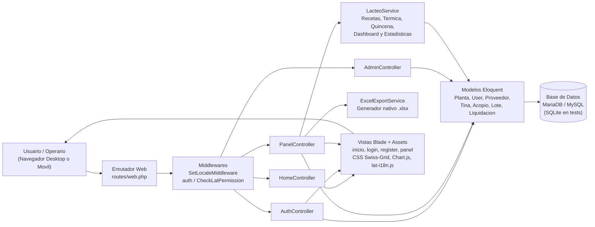
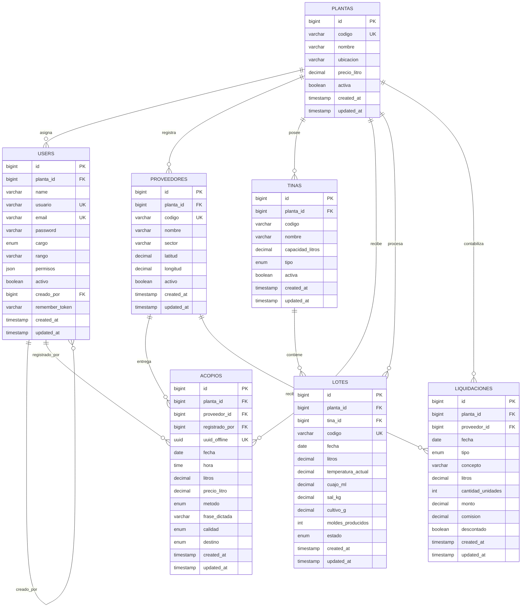
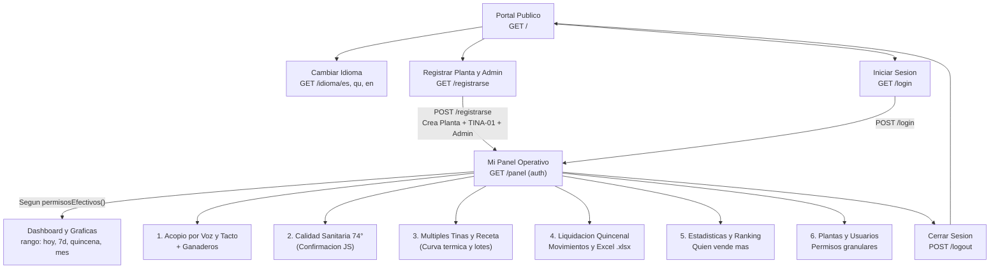
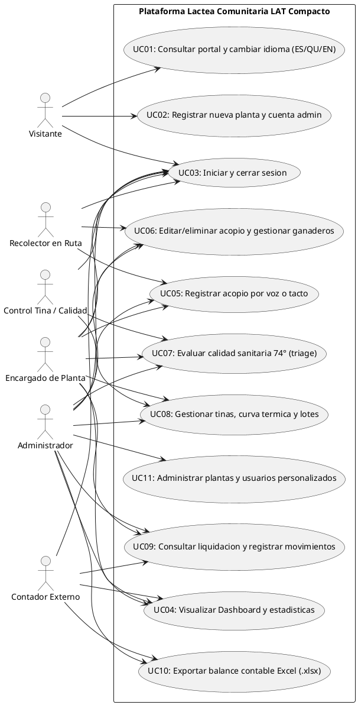
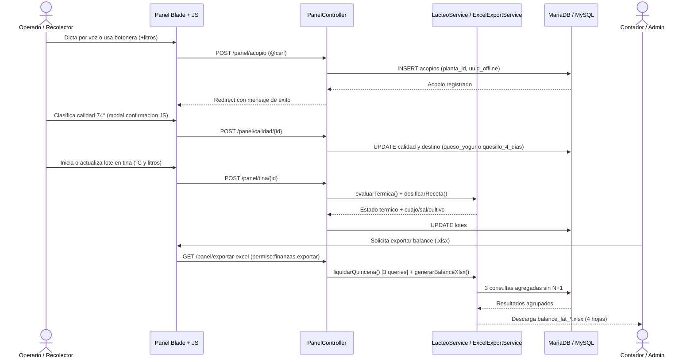
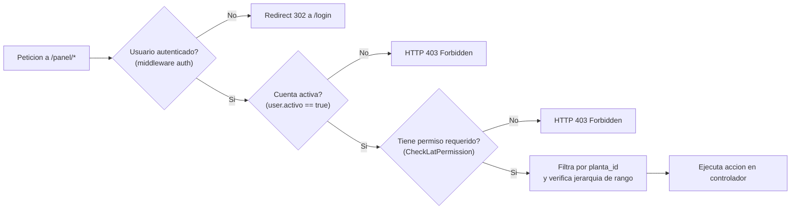

<div align="center">

“Año de la Esperanza y el Fortalecimiento de la Democracia”

# UNIVERSIDAD CONTINENTAL
**Facultad de Ingeniería**  
**Escuela Profesional de Ingeniería de Sistemas e Informática**

---

**Asignatura:** Programación Web — **NRC:** 24589

### PROYECTO: DESARROLLO DE APLICACIÓN WEB CON IMPACTO SOCIAL
## "PLATAFORMA LÁCTEA COMUNITÁRIA LAT COMPACTO"
### SISTEMA DE ACOPIO RURAL POR VOZ, CONTROL SANITARIO Y LIQUIDACIÓN JUSTA

**Caso Social:** Acopio rural por voz, control sanitario y liquidación justa en cadena láctea comunitaria

---

**ESTUDIANTES:**
- Ortiz Gutierrez, Nasdig Jordan (Arquitecto de Base de Datos y Persistencia) – 33.3%
- Lovatón Casas, Arantxa Alejandra (Ingeniero Backend y Lógica Core) – 33.3%
- Obregon Choque, Kelmer Wilder (Diseñador Frontend UI/UX y Accesibilidad) – 33.4%

*(Nota para el grupo: ajustar los porcentajes de aporte si acuerdan ponderar de otra forma las horas de la última iteración antes de exportar a PDF.)*

**DOCENTE:** ALFREDO COLLANTES MENDOZA

**Fecha y lugar:** Semana 08 – Cusco, 2026  
**Enlace al repositorio GitHub:** https://github.com/KelmerOC/LAT

</div>

---

## ÍNDICE DE CONTENIDO

- [1. RESUMEN EJECUTIVO](#1-resumen-ejecutivo)
- [2. INTRODUCCIÓN](#2-introducción)
  - [2.1 Contexto general](#21-contexto-general)
  - [2.2 Objetivo general](#22-objetivo-general)
  - [2.3 Objetivos específicos](#23-objetivos-específicos)
  - [2.4 Alcance en Semana 08](#24-alcance-en-semana-08)
  - [2.5 Beneficiarios directos e indirectos](#25-beneficiarios-directos-e-indirectos)
  - [2.6 Justificación del uso de tecnología web con impacto social](#26-justificación-del-uso-de-tecnología-web-con-impacto-social)
- [3. PROBLEMÁTICA SOCIAL Y JUSTIFICACIÓN](#3-problemática-social-y-justificación)
  - [3.1 Descripción de la problemática](#31-descripción-de-la-problemática)
  - [3.2 Evidencia de entrevistas (mínimo 3)](#32-evidencia-de-entrevistas-mínimo-3)
  - [3.3 Justificación del impacto social](#33-justificación-del-impacto-social)
  - [3.4 Análisis del rol de la ingeniería en la solución](#34-análisis-del-rol-de-la-ingeniería-en-la-solución)
- [4. MARCO ÉTICO Y RESPONSABILIDAD SOCIAL](#4-marco-ético-y-responsabilidad-social)
  - [4.1 Impacto de la solución tecnológica en la sociedad](#41-impacto-de-la-solución-tecnológica-en-la-sociedad)
  - [4.2 Consideraciones éticas en el desarrollo](#42-consideraciones-éticas-en-el-desarrollo)
  - [4.3 Plan de sostenibilidad y transferencia a la comunidad](#43-plan-de-sostenibilidad-y-transferencia-a-la-comunidad)
  - [4.4 Políticas de respeto a la propiedad intelectual](#44-políticas-de-respeto-a-la-propiedad-intelectual)
  - [4.5 Acuerdos de trabajo y compromisos del equipo](#45-acuerdos-de-trabajo-y-compromisos-del-equipo)
- [5. DISEÑO Y ARQUITECTURA DE LA SOLUCIÓN](#5-diseño-y-arquitectura-de-la-solución)
  - [5.1 Framework seleccionado y justificación](#51-framework-seleccionado-y-justificación)
  - [5.2 Arquitectura MVC](#52-arquitectura-mvc)
  - [5.3 Modelo de datos](#53-modelo-de-datos)
  - [5.4 Diseño de interfaz](#54-diseño-de-interfaz)
  - [5.5 Diseño de seguridad web](#55-diseño-de-seguridad-web)
  - [5.6 Escalabilidad y sostenibilidad](#56-escalabilidad-y-sostenibilidad)
- [6. INFORME DE FUNCIONALIDAD DE LA PÁGINA WEB](#6-informe-de-funcionalidad-de-la-página-web)
  - [6.1 Módulos del sistema](#61-módulos-del-sistema)
  - [6.2 Flujo de navegación](#62-flujo-de-navegación)
  - [6.3 Roles y permisos](#63-roles-y-permisos)
  - [6.4 Casos de uso principales](#64-casos-de-uso-principales)
  - [6.5 Funcionalidades CRUD completas](#65-funcionalidades-crud-completas)
  - [6.6 Métricas proyectadas de impacto social](#66-métricas-proyectadas-de-impacto-social)
- [7. DESARROLLO INICIAL Y OPTIMIZACIÓN TÉCNICA](#7-desarrollo-inicial-y-optimización-técnica)
  - [7.7 Optimización de consultas y rendimiento](#77-optimización-de-consultas-y-rendimiento)
    - [7.7.1 Diagnóstico inicial](#771-diagnóstico-inicial)
    - [7.7.2 Técnicas aplicadas](#772-técnicas-aplicadas)
    - [7.7.3 Evidencias antes/después](#773-evidencias-antesdespués)
  - [7.8 Seguridad web implementada y evidencias](#78-seguridad-web-implementada-y-evidencias)
    - [7.8.1 Amenazas consideradas](#781-amenazas-consideradas)
    - [7.8.2 Controles implementados](#782-controles-implementados)
    - [7.8.3 Evidencias de pruebas](#783-evidencias-de-pruebas)
- [8. GESTIÓN DEL PROYECTO](#8-gestión-del-proyecto)
  - [8.1 Cronograma con hitos y responsables](#81-cronograma-con-hitos-y-responsables)
  - [8.2 Distribución de responsabilidades](#82-distribución-de-responsabilidades)
  - [8.3 Registro de reuniones y acuerdos](#83-registro-de-reuniones-y-acuerdos)
  - [8.4 Acuerdos de trabajo y compromisos](#84-acuerdos-de-trabajo-y-compromisos)
- [9. REFERENCIAS Y PROPIEDAD INTELECTUAL](#9-referencias-y-propiedad-intelectual)
  - [9.1 Referencias bibliográficas](#91-referencias-bibliográficas)
  - [9.2 Licencias de software utilizadas](#92-licencias-de-software-utilizadas)
  - [9.3 Declaración de originalidad](#93-declaración-de-originalidad)
- [10. ANEXOS](#10-anexos)
  - [Anexo A: Manual de usuario (borrador)](#anexo-a-manual-de-usuario-borrador)
  - [Anexo B: Evidencias de entrevistas](#anexo-b-evidencias-de-entrevistas)
  - [Anexo C: Capturas de pantalla del sistema](#anexo-c-capturas-de-pantalla-del-sistema)
  - [Anexo D: Diagramas adicionales](#anexo-d-diagramas-adicionales)
  - [Anexo E: Enlace al repositorio Git](#anexo-e-enlace-al-repositorio-git)
  - [Anexo F: Declaración de originalidad firmada](#anexo-f-declaración-de-originalidad-firmada)
  - [Anexo G: Evidencias de optimización de consultas](#anexo-g-evidencias-de-optimización-de-consultas)
  - [Anexo H: Evidencias de pruebas de seguridad web](#anexo-h-evidencias-de-pruebas-de-seguridad-web)

---

## 1. RESUMEN EJECUTIVO

La **Plataforma Láctea Comunitaria LAT Compacto** es una aplicación web con impacto social pensada para microempresas familiares, asociaciones ganaderas y queserías rurales de Anta y Cusco Provincia. Responde a problemas reales del acopio diario: cuadernos de pesaje deteriorados por agua y suero, desacuerdos en la liquidación quincenal, descarte de leche con acidez y barreras digitales para operarios rurales.

El sistema está construido con **Laravel 13** (PHP 8.3) bajo arquitectura MVC y capa de servicios (`LacteoService` y `ExcelExportService`), base de datos relacional MariaDB/MySQL y soporte para despliegue en XAMPP o Docker/Render. Implementa gestión multi-planta, acopio por voz (Web Speech API) y botonera táctil, triage sanitario a 74° hacia quesillo de 4 días, monitoreo térmico de múltiples tinas con dosificación automática, liquidaciones sin comisión (S/ 0.00), exportación Excel (`.xlsx`), dashboard con gráficas Chart.js, permisos granulares por rol y rango, e interfaz trilingüe (español, quechua e inglés).

A Semana 08 el núcleo funcional y las pruebas PHPUnit base están programados; falta adjuntar entrevistas, capturas finales en vivo, planes `EXPLAIN` y pruebas formales de vulnerabilidades. Con su uso se espera transparentar pagos, evitar desperdicio lácteo y respetar la privacidad rural. *(186 palabras)*

---

## 2. INTRODUCCIÓN

### 2.1 Contexto general

En las comunidades ganaderas de Cusco Provincia —especialmente en sectores como Markjo, Compone, Izcuchaca, Huayllacocha, Cachimayo y Chinchero— gran parte de la transformación láctea se realiza en queserías familiares gestionadas por padres e hijos. Cada mañana se reciben porongos de leche desde pequeños productores (entre 5 L y 150 L por entrega), se evalúa su acidez, se pasteuriza en tinas y cada quince días se calculan los pagos descontando adelantos en efectivo o en moldes de queso.

Sin embargo, el registro suele llevarse en cuadernos escolares que se mojan con leche o suero, lo que genera errores de suma, pérdida de datos y discusiones al cierre de quincena. Además, los softwares comerciales cobran licencias mensuales o comisiones por litro procesado que están fuera del alcance de una microempresa rural. Frente a esa realidad desarrollamos **LAT Compacto** en el curso de Programación Web, aplicando los temas vistos durante el semestre: maquetación y JavaScript responsivo, capa de servicio en el framework, optimización de consultas CRUD con Eloquent y seguridad web con control de acceso.

### 2.2 Objetivo general

Desarrollar e implementar la aplicación web comunitaria **LAT Compacto** con Laravel y Eloquent para digitalizar de forma accesible el acopio de leche por voz y tacto, el control sanitario sin desperdicio, el monitoreo térmico de tinas y la liquidación quincenal sin comisión (S/ 0.00) en microempresas lácteas de Cusco Provincia.

### 2.3 Objetivos específicos

- Estructurar una base de datos relacional multi-planta (7 tablas e índices compuestos) que soporte proveedores, acopios, múltiples tinas, lotes térmicos, movimientos financieros y usuarios con permisos granulares.
- Desacoplar la lógica de negocio en una capa de servicios (`LacteoService` y `ExcelExportService`) para calcular recetas de cuajo/sal/cultivo, curvas térmicas, liquidaciones quincenales sin N+1, estadísticas y exportación nativa a `.xlsx`.
- Diseñar una interfaz limpia y responsiva (sistema editorial Swiss-Grid en `DESIGN.md`), trilingüe (español, quechua e inglés), con botones táctiles grandes (`>= 54 px`) y un dashboard analítico con gráficas Chart.js.
- Implementar control de acceso por roles, rangos y permisos granulares, junto con controles contra vulnerabilidades web comunes (SQLi, XSS, CSRF y escalamiento de privilegios).
- Documentar con honestidad los avances reales en el repositorio y las evidencias pendientes para el cierre de la Evaluación 2 – Consolidado 2.

### 2.4 Alcance en Semana 08

En esta entrega de Semana 08 (cierre 24 de noviembre de 2026) realizamos una auditoría directa del repositorio `https://github.com/KelmerOC/LAT` para comprobar qué está implementado en código y qué queda por completar o capturar frente a los **10 indicadores de la rúbrica de Evaluación 2 – Consolidado 2** y los cuatro ejes generales del curso:

| # | Indicador de la rúbrica | Eje general relacionado | Estado real en Semana 08 | Evidencia verificada en el repositorio / Pendiente |
| :-: | :--- | :--- | :---: | :--- |
| 1 | **Comprensión y aplicación del framework** | Unidad 1 y 2 (Framework y capa de servicio) | **Cubierto en código** | Laravel 13 (`v13.39.0`), MVC limpio, 7 modelos Eloquent, 4 controladores, 2 servicios (`LacteoService`, `ExcelExportService`), 2 middlewares (`CheckLatPermission`, `SetLocaleMiddleware`), 3 migraciones y seeder completo. |
| 2 | **Estructura y navegabilidad** | Unidad 1 (HTML, CSS, JS) | **Cubierto en código** | Portal público (`/`), acceso (`/login`, `/registrarse`) y panel privado (`/panel`) con barra lateral modular filtrada por permisos, breadcrumb superior, cambio de planta y persistencia de sección en `sessionStorage`. |
| 3 | **Apariencia visual y diseño de interfaz** | Unidad 1 (CSS y UX) | **Cubierto en código (falta captura a color)** | Sistema `DESIGN.md` (Swiss-Grid + Acuarela Andina) en `public/css/lat-design-system.css` y `lat-dashboard.css`, logos SVG en `public/brand/`, 10 mockups/wireframes en `mockups/`. Falta exportar capturas en vivo a color del dashboard actual. |
| 4 | **Compatibilidad y responsividad** | Unidad 1 (CSS/JS responsivo) | **Cubierto en código (falta re-probar E2E)** | 21 reglas `@media` (de `1180px` a `480px`), cajón móvil en portada y sidebar off-canvas en panel, botones táctiles `>= 54px`/`64px` y soporte trilingüe (`372` claves en ES/QU/EN). `tests/e2e/visual-standards.cjs` requiere actualizarse al nuevo sidebar. |
| 5 | **Optimización de consultas con Laravel y Eloquent** | Unidad 3 (Optimización CRUD) | **Parcialmente cubierto** | Ya tiene 13 índices compuestos/únicos, liquidación sin N+1 en 3 consultas, `with()`, `withCount()` y `select()` parcial. Falta aplicar mejoras detectadas (evitar doble llamada a `obtenerEstadisticas()`, `whereDate` -> `whereBetween`, `paginate()`) y capturar `EXPLAIN`. |
| 6 | **Funcionalidad y cumplimiento de requisitos** | Unidades 1–3 | **Cubierto en lo central (3 pendientes de alcance futuro)** | Operan los 6 módulos + Dashboard + multi-planta + multi-tina + Excel `.xlsx` + i18n trilingüe. Quedan fuera de Semana 08 (proyectados en `PRODUCT.md`): mapa Leaflet/OSM, cola offline de acopios en `localStorage` y código OTP de 6 dígitos en registro. |
| 7 | **Pruebas para evitar vulnerabilidades** | Unidad 4 (Seguridad y pruebas) | **Parcialmente cubierto** | Controles activos contra SQLi, XSS, CSRF, Bcrypt, sesiones y RBAC/403 (probado en `LatFuncionalidadesTest.php`). Falta instalar `vendor/` para correr `php artisan test`, añadir tests explícitos de SQLi/XSS/CSRF, validar `evaluarCalidad`/`actualizarTina`, agregar `throttle`, cabeceras HTTP y correr `composer audit`. |
| 8 | **Claridad y detalle del informe** | Transversal | **En entrega (este documento)** | Informe completo en `docs/INFORME_SEMANA_08.md` con auditoría honesta, diagramas Mermaid/PlantUML, tablas y referencias ISO 690-2 (UC 2019). Falta incrustar imágenes y capturas antes de pasar a PDF. |
| 9 | **Acceso a diferentes tipos de usuarios** | Unidad 4 (Seguridad de acceso) | **Cubierto en código y tests** | 6 cargos (`administracion`, `encargado_planta`, `recolector_ruta`, `control_tina`, `contador_externo`, `personalizado`), 4 rangos jerárquicos y 18 permisos granulares verificados en middleware y vista. |
| 10 | **Mostrar de forma profesional los dashboards** | Unidad 1 y 3 | **Cubierto en código (falta captura en vivo)** | `panel/sections/dashboard.blade.php` y `estadisticas.blade.php` con 4 KPIs con delta porcentual, filtro de rango (`hoy`, `7d`, `quincena`, `mes`), 4 gráficas `Chart.js v4.4.7`, barras de ocupación de tinas, ranking multi-planta y timeline de actividad. |

### 2.5 Beneficiarios directos e indirectos

| Tipo de beneficiario | Grupo objetivo | Beneficio concreto |
| :--- | :--- | :--- |
| **Directos** | Microempresas queseras familiares y administradores de planta | Eliminación de cuadernos mojados, cálculo automático de recetas e insumos, control de múltiples tinas y reportes Excel listos para contabilidad. |
| **Directos** | Recolectores en ruta y operarios de planta (incluidos adultos mayores) | Registro de litros por voz o botonera táctil a una mano sin necesidad de correo personal ni manejo complejo de menús. |
| **Directos** | Pequeños productores ganaderos (proveedores de 5 L a 150 L) | Liquidación quincenal clara con comisión S/ 0.00, mismo precio por litro y aprovechamiento de leche ácida en quesillos en vez de descarte. |
| **Indirectos** | Contadores externos y entidades financieras locales | Balances exportados en `.xlsx` de 4 hojas ordenadas con fórmulas `SUM`, facilitando formalización y acceso a microcréditos. |
| **Indirectos** | Trabajadores de apoyo eventual (faenas de lavado/volteo) y consumidores | Pago registrado con respeto a la Ley N.° 29733 (sin exigir DNI innecesario) y mayor estandarización sanitaria en quesos y yogures comunitarios. |

### 2.6 Justificación del uso de tecnología web con impacto social

Elegir una **aplicación web responsiva** en lugar de una app móvil nativa o un programa de escritorio tiene ventajas directas para el contexto rural cusqueño: funciona desde cualquier celular Android económico o computadora básica en planta solo con navegador, no obliga a pagar tiendas de aplicaciones, permite actualizar mejoras en un solo servidor y puede instalarse gratis en la red local de la quesería (XAMPP) o en la nube (Docker/Render). Sumado al idioma quechua (*Runasimi*) y al dictado por voz, la web se convierte en una herramienta inclusiva que reduce la brecha tecnológica sin cobrar comisiones a las familias productoras.

---

## 3. PROBLEMÁTICA SOCIAL Y JUSTIFICACIÓN

### 3.1 Descripción de la problemática

A partir del análisis del sector lácteo artesanal de la cuenca de Anta y Cusco Provincia (documentado en `PRODUCT.md` y `status.md`), identificamos cinco problemas centrales que afectan la economía diaria de las microempresas queseras:

1. **Deterioro y pérdida de cuadernos de acopio:** Durante la recepción matutina (06:00–08:00 h) el agua, la leche y el suero mojan las libretas escolares donde se apuntan los litros entregados. Esto genera borrones y discusiones al cerrar la quincena.
2. **Desperdicio de leche por acidez:** Cuando un porongo llega con acidez detectada en la prueba de alcohol a 74°, en muchos centros se rechaza o se desecha, afectando directamente el ingreso del pequeño ganadero, cuando esa leche puede desviarse a quesillos frescos de consumo rápido (4 días).
3. **Variabilidad en la producción de queso:** Sin control visual del enfriamiento desde 72 °C hasta el rango de inoculación (36–40 °C) ni un cálculo rápido de cuajo, sal y cultivo según los litros reales de la tina, la calidad y el rendimiento en moldes varían entre lotes.
4. **Falta de herramientas accesibles y sin comisiones:** Los operarios trabajan con guantes húmedos y muchos son adultos mayores o quechuahablantes; además, los sistemas ERP comerciales cobran suscripciones que una quesería familiar de 100 a 500 litros diarios no puede sostener.
5. **Exposición innecesaria de datos personales:** En pagos de faenas eventuales ("ayuda del día" para lavado de porongos o volteo de quesos), pedir DNI y guardar fichas completas incumple el principio de minimización de datos de la Ley N.° 29733 [1].

### 3.2 Evidencia de entrevistas (mínimo 3)

Para validar los requisitos del caso social se definió un protocolo de 3 entrevistas semiestructuradas dirigidas a actores reales de la cadena láctea local. En la auditoría del repositorio se verificó que **las fichas firmadas, transcripciones y fotografías de las 3 entrevistas aún no se han cargado al repositorio**, por lo que deben adjuntarse antes de la conversión final a PDF:

| N.° | Perfil entrevistado | Temas clave de validación | Estado de evidencia |
| :-: | :--- | :--- | :---: |
| 1 | Dueño / administrador de quesería familiar (Anta / Cusco) | Registro diario de acopio, problemas con cuadernos, descuentos de adelantos y formato de balance para el contador. | Pendiente de adjuntar |
| 2 | Productor ganadero o recolector de leche en ruta | Facilidad de dictado por voz / botones grandes con una mano, uso de quechua y confianza en la liquidación quincenal al 0%. | Pendiente de adjuntar |
| 3 | Encargado de tina / calidad sanitaria (o contador de asociación) | Prueba de alcohol a 74°, desvío a quesillos de 4 días, curva de enfriamiento (72 °C a 36–40 °C) y control de insumos. | Pendiente de adjuntar |

> **[INSERTAR EVIDENCIA VISUAL AQUÍ]**
> - **Qué mostrar:** Fotografías o escaneos legibles de las 3 fichas de entrevista (o capturas de consentimiento y resumen de respuestas de los 3 actores de la cadena láctea comunitaria), más una tabla breve con los hallazgos reales recogidos en campo.
> - **Herramienta recomendada:** Ficha de entrevista impresa/digital, cámara fotográfica o formulario estructurado (respetando consentimiento informado y privacidad de los entrevistados).
> - **Archivo/Ruta de referencia en el repo:** `PRODUCT.md` (secciones 1 y 2) y `Anexo B` de `docs/INFORME_SEMANA_08.md`.

### 3.3 Justificación del impacto social

LAT Compacto ataca directamente causas económicas y humanas de desigualdad en el ámbito rural:

- **Justicia económica:** Garantiza comisión **S/ 0.00** (`config/lat.php` y columna `comision` con valor `0.00` por defecto) y aplica el mismo precio por litro tanto al productor de 5 litros como al de 150 litros.
- **Seguridad alimentaria y cero desperdicio:** Formaliza el triage sanitario de alcohol a 74° derivando la leche ácida a `quesillo_4_dias`, evitando que el ganadero pierda el esfuerzo de su ordeño.
- **Inclusión digital y cultural:** Incorpora interfaz completa en **Quechua (Runasimi)** además de español e inglés (`372` textos traducidos en `public/js/lat-i18n.js`), dictado por voz y teclas grandes para uso con una sola mano.
- **Respaldo para la formalización:** Genera libros Excel `.xlsx` de 4 hojas con totales automáticos, ayudando a las familias a llevar cuentas ordenadas ante SUNAT o cajas rurales.

### 3.4 Análisis del rol de la ingeniería en la solución

Desde la Ingeniería de Sistemas e Informática, el reto no consiste solo en "hacer un CRUD de leche", sino en diseñar software adecuado al entorno real donde se usará:

- **Ingeniería de datos:** Modelar el dominio multi-planta y multi-tina normalizado, con claves foráneas integradas e índices compuestos que mantengan respuestas rápidas incluso en PCs modestas con XAMPP.
- **Arquitectura de software:** Separar controladores HTTP de la lógica de negocio en `App\Services\LacteoService` y `App\Services\ExcelExportService`, evitando repetir fórmulas estequiométricas o cálculos financieros en las vistas.
- **Ingeniería de usabilidad y accesibilidad:** Aplicar contraste WCAG 2.1 AA (`#c2410c` sobre blanco con ratio `>= 5.2:1`), etiquetas `aria-*`, pausa de carrusel (WCAG 2.2.2) [2] y áreas táctiles amplias.
- **Seguridad por diseño:** Aislar datos por planta (`planta_id`), proteger cada acción con permisos granulares (`CheckLatPermission`) y evitar escalamiento de privilegios entre rangos.

---

## 4. MARCO ÉTICO Y RESPONSABILIDAD SOCIAL

### 4.1 Impacto de la solución tecnológica en la sociedad

La adopción de LAT Compacto impacta positivamente en la confianza entre ganaderos y queserías familiares. Al quedar cada entrega registrada con hora, litros, calidad y método (voz o manual), se reducen las fricciones comunitarias de fin de quincena. Además, al dar visibilidad sobre ventas, mermas y rendimiento de moldes en un dashboard claro, los jóvenes hijos de productores pueden asumir la gestión técnica de la planta familiar con datos objetivos.

### 4.2 Consideraciones éticas en el desarrollo

El proyecto recoge principios éticos concretos reflejados directamente en el código (`PRODUCT.md`, `resources/views/inicio.blade.php` y `database/migrations/`):

| Principio ético | Implementación concreta en LAT Compacto |
| :--- | :--- |
| **Comisión S/ 0.00** | Parámetro `LAT_COMISION=0.00` en `config/lat.php` y `comision = 0.00` en `liquidaciones`. |
| **Trato justo sin sesgo** | Mismo `precio_litro` configurado por planta para todos los proveedores sin discriminación por volumen. |
| **Cero desperdicio sanitario** | La evaluación `acida` asigna destino `quesillo_4_dias` en lugar de eliminar la entrega del cálculo. |
| **Privacidad (Ley N.° 29733)** [1] | La tabla `proveedores` usa código comunal (`PRV-01`) sin columna DNI; el tipo `ayuda_del_dia` en `liquidaciones` permite `proveedor_id = null` sin pedir documentos personales; los operarios en `users` tienen `email` opcional. |
| **Veracidad y no invención** | Según `DESIGN.md` y `PRODUCT.md`, la portada no muestra contadores falsos de clientes ni testimonios inventados; las fotografías de stock llevan aviso explícito (*"Fotografías referenciales de stock"*). |
| **Inclusión lingüística y accesibilidad** | Traducción completa a Quechua, Español e Inglés (`lat-i18n.js`), contraste AA y controles por teclado/voz. |

### 4.3 Plan de sostenibilidad y transferencia a la comunidad

Para que el proyecto siga siendo viable después del curso de Programación Web:

1. **Cero costo de licencias:** Todo el stack es de código abierto (PHP, Laravel, MariaDB/MySQL, Chart.js, Apache/Docker). Incluso la exportación `.xlsx` (`ExcelExportService.php`) fue escrita con PHP nativo + `zlib` sin requerir librerías comerciales.
2. **Doble modalidad de despliegue:** Una quesería sin internet estable puede correr LAT localmente en una laptop con XAMPP (`README.md`), mientras una asociación con varias plantas puede desplegar el contenedor Docker ya configurado (`Dockerfile`, `docker/start.sh`) en servicios cloud como Render.
3. **Transferencia progresiva:** Se proyecta entregar el manual de usuario (Anexo A), sesiones cortas de capacitación práctica con una quesería piloto de Anta y mantenimiento académico abierto desde el repositorio GitHub.

### 4.4 Políticas de respeto a la propiedad intelectual

- Todas las dependencias PHP y Node.js declaradas en `composer.json` y `package.json` se utilizan respetando sus licencias abiertas (MIT, BSD-3-Clause, Apache-2.0 e ISC), detalladas en la sección 9.2.
- Los activos visuales de marca (`public/brand/*.svg`, `public/favicon.svg`), las hojas de estilo (`lat-design-system.css`, `lat-dashboard.css`) y la lógica de negocio (`LacteoService`, `ExcelExportService`) fueron creados específicamente para este proyecto.
- Las fotografías del carrusel de portada provienen de Unsplash bajo licencia libre y están rotuladas honestamente en la vista como imágenes referenciales.

### 4.5 Acuerdos de trabajo y compromisos del equipo

El equipo acordó trabajar con honestidad académica (reportando lo realmente implementado y lo que falta), respetar la separación de responsabilidades por capas (Persistencia, Backend Core y Frontend/UX), mantener un historial trazable en GitHub con mensajes semánticos (`feat`, `fix`, `style`, `test`, `chore`) y revisar entre los tres integrantes el código antes de la sustentación de Semana 08.

---

## 5. DISEÑO Y ARQUITECTURA DE LA SOLUCIÓN

### 5.1 Framework seleccionado y justificación

Seleccionamos **Laravel 13** (`laravel/framework: ^13.17`, versión bloqueada `v13.39.0` en `composer.lock`, sobre **PHP ^8.3**) [3] por cuatro razones prácticas para este proyecto:

1. **Arquitectura MVC madura con capa de servicios:** Permite mantener los controladores claros delegando fórmulas lácteas, estadísticas y exportación Excel a `app/Services/`.
2. **Eloquent ORM y migraciones portables:** Facilita relaciones claras entre 7 entidades, consultas parametrizadas por PDO (mitigando SQLi) [6] y ejecución de migraciones tanto en **MariaDB/MySQL (XAMPP)** como en **SQLite en memoria** para pruebas PHPUnit (`phpunit.xml`).
3. **Seguridad integrada desde el núcleo:** Incluye middleware `auth`, protección CSRF automática (`@csrf`), hash Bcrypt (`Hash::make`) [6], escape automático en plantillas Blade (`{{ }}`) y middlewares personalizados (`CheckLatPermission`, `SetLocaleMiddleware`).
4. **Compatibilidad con despliegues académicos y reales:** Corre directamente en Apache/XAMPP local (`public/.htaccess`) y en contenedores Linux con Apache (`Dockerfile` basado en `php:8.4-apache`) [9].

*(Nota de auditoría: en documentos iniciales como `README.md` y `status.md` se mencionaba Laravel 11/12, pero al revisar `composer.json` y `composer.lock` el repositorio actual opera con **Laravel 13.39.0** y **PHPUnit 12.5.43**.)*

### 5.2 Arquitectura MVC

LAT Compacto aplica el patrón **Modelo–Vista–Controlador (MVC)** extendido con **Middlewares** (idioma, autenticación y permisos granulares) y una **Capa de Servicios** (`LacteoService`, `ExcelExportService`) para mantener el principio de responsabilidad única.



> [VISUALIZACIÓN: Renderizar este bloque en mermaid.live o plantuml.com/plantuml (o con la extensión Markdown Preview Mermaid Support en el editor) y pegar la imagen aquí].

**Flujo resumido de una petición:**
1. El navegador envía una solicitud HTTP a `routes/web.php`.
2. `SetLocaleMiddleware` aplica el idioma de sesión (`es`, `qu` o `en`); en rutas `/panel/*`, `auth` exige sesión activa y `permiso:<clave>` (`CheckLatPermission`) verifica que el usuario esté activo y tenga el permiso granular requerido.
3. El controlador valida los datos (`$request->validate`), coordina los modelos Eloquent o invoca `LacteoService` / `ExcelExportService`.
4. Los modelos interactúan con MariaDB/MySQL (o SQLite en pruebas) y el controlador devuelve una vista Blade renderizada, una redirección con mensaje flash o la descarga binaria `.xlsx`.

### 5.3 Modelo de datos

La base de datos fue evolucionada en **3 migraciones** (`2026_01_01_000001_crear_tablas_lat_compacto.php`, `2026_01_01_000002_agregar_plantas_tinas_y_ventas.php` y `2026_11_18_205518_agregar_permisos_personalizados_usuarios.php`) hasta consolidar **7 tablas relacionales** con aislamiento por planta (`planta_id`) y soporte de permisos JSON en `users`:



> [VISUALIZACIÓN: Renderizar este bloque en mermaid.live o plantuml.com/plantuml (o con la extensión Markdown Preview Mermaid Support en el editor) y pegar la imagen aquí].

**Diccionario resumido de entidades e índices:**

| Tabla | Clave Primaria / Únicas | Claves Foráneas y acción ON DELETE | Índices de optimización creados | Propósito en el negocio |
| :--- | :--- | :--- | :--- | :--- |
| `plantas` | `id` (PK), `codigo` (UK) | — | `idx_plantas_activa (activa)` | Microempresas/queserías registradas con su tarifa vigente por litro. |
| `users` | `id` (PK), `usuario` (UK), `email` (UK, nullable) | `planta_id -> plantas(id)` (`SET NULL`), `creado_por -> users(id)` (`SET NULL`) | Índices únicos en `usuario` y `email` | Personal de planta con cargo, rango jerárquico y arreglo JSON `permisos`. |
| `proveedores` | `id` (PK), `codigo` (UK) | `planta_id -> plantas(id)` (`CASCADE`) | `idx_proveedores_activo (activo)`, `idx_proveedores_planta_activo (planta_id, activo)` | Productores ganaderos identificados por código comunal (sin DNI). |
| `tinas` | `id` (PK), `uq_tinas_planta_codigo (planta_id, codigo)` | `planta_id -> plantas(id)` (`CASCADE`) | `idx_tinas_planta_activa (planta_id, activa)` | Tinas de pasteurización/cuajado de cada planta con su capacidad y tipo. |
| `acopios` | `id` (PK), `uuid_offline` (UK) | `planta_id -> plantas(id)` (`CASCADE`), `proveedor_id -> proveedores(id)` (`CASCADE`), `registrado_por -> users(id)` (`SET NULL`) | `idx_acopios_fecha_calidad (fecha, calidad)`, `idx_acopios_proveedor_fecha (proveedor_id, fecha)`, `idx_acopios_planta_fecha (planta_id, fecha)` | Entregas diarias de leche (voz o manual), calidad sanitaria y destino. |
| `lotes` | `id` (PK), `codigo` (UK) | `planta_id -> plantas(id)` (`CASCADE`), `tina_id -> tinas(id)` (`SET NULL`) | `idx_lotes_fecha_estado (fecha, estado)`, `idx_lotes_planta_estado (planta_id, estado)` | Ciclos térmicos de pasteurización/enfriamiento, receta calculada y moldes. |
| `liquidaciones` | `id` (PK) | `planta_id -> plantas(id)` (`CASCADE`), `proveedor_id -> proveedores(id)` (`SET NULL`) | `idx_liquidaciones_prov_descontado (proveedor_id, descontado)`, `idx_liquidaciones_fecha_tipo (fecha, tipo)`, `idx_liquidaciones_planta_fecha_tipo (planta_id, fecha, tipo)` | Adelantos (efectivo/queso), ayuda del día sin DNI, gastos y ventas de producto. |

### 5.4 Diseño de interfaz

El diseño visual sigue la especificación **Editorial Swiss-Grid y Acuarela Andina** definida en `DESIGN.md` e implementada en `public/css/lat-design-system.css` y `public/css/lat-dashboard.css`:

- **Identidad visual limpia:** Marco continuo con líneas divisorias de `1px`, geometría recta (`border-radius: 0px` a `2px`) sin sombras difusas, paleta contrastada con naranja accesible (`#c2410c` sobre blanco, cumpliendo WCAG 2.1 AA), azul cielo (`#0284c7`), azul pizarra (`#0a2f4d`) y tipografía `Inter` con cifras tabulares delgadas (`font-weight: 300`, `tabular-nums`) para litros, temperaturas y soles.
- **Accesibilidad y ergonomía rural:** Botón de dictado por voz de `>= 64 px`, botonera táctil de `>= 54 px`, enlace *skip-link*, atributos `aria-expanded` / `aria-modal` / `aria-live`, botón de pausa del carrusel (WCAG 2.2.2) y soporte trilingüe completo (`372` claves sincronizadas en Español, Quechua e Inglés en `public/js/lat-i18n.js`).
- **Responsividad:** Implementada con 21 reglas `@media` entre `1180 px` y `480 px`: en portada la barra cambia a cajón móvil desde `<= 860 px`; en el panel operativo (`lat-dashboard.css`), la grilla KPI pasa de 4 a 2 columnas (`<= 1180 px`) y a 1 columna (`<= 680 px`), y la barra lateral se convierte en menú deslizable off-canvas desde `<= 992 px`.
- **Dashboard profesional:** Incluye barra lateral con módulos autorizados, barra superior con selector de rango (`Hoy`, `7 días`, `Quincena`, `Mes`) y selector multi-planta, 4 tarjetas KPI con variación porcentual respecto al período anterior, 3 gráficas interactivas **Chart.js v4.4.7** [8] (acopio diario apilado óptima vs. ácida, ventas vs. gastos y producción de moldes) más 1 gráfica doughnut sanitaria en Estadísticas, barras de ocupación térmica por tina, ranking de plantas y feed cronológico de actividad reciente.

**Estado real de wireframes y mockups en el repositorio:**
En la carpeta `mockups/` existen **10 archivos PNG** generados automáticamente con `scripts/generate_wireframes.cjs` y `scripts/generate_mockups.cjs` (commit `ae5e501` del 03/11/2026):

| Pantalla | Wireframe esquemático existente | Mockup B/N existente | Observación de auditoría |
| :--- | :--- | :--- | :--- |
| Portada pública | `mockups/mockup_1_portada_wireframe.png` | `mockups/mockup_1_portada_desktop_bw.png` | Coincide con la estructura actual de `inicio.blade.php`. |
| Panel – Acopio por voz | `mockups/mockup_2_panel_acopio_wireframe.png` | `mockups/mockup_2_panel_acopio_desktop_bw.png` | Corresponde a la versión previa con pestañas superiores (anterior al sidebar del 18/11). |
| Panel – Control sanitario | `mockups/mockup_3_control_sanitario_wireframe.png` | `mockups/mockup_3_control_sanitario_desktop_bw.png` | Falta capturar la vista actual a color dentro del nuevo layout con sidebar. |
| Panel – Tina y receta | `mockups/mockup_4_tina_receta_wireframe.png` | `mockups/mockup_4_tina_receta_desktop_bw.png` | Falta capturar la versión multi-tina actual. |
| Vista móvil (smartphone) | `mockups/mockup_5_movil_wireframe.png` | `mockups/mockup_5_movil_smartphone_bw.png` | Falta capturar la vista móvil actual del dashboard y drawer lateral. |

> **[INSERTAR EVIDENCIA VISUAL AQUÍ]**
> - **Qué mostrar:** Capturas a color en vivo desde el navegador de: (1) portada pública en Español y Quechua, (2) nuevo Dashboard con las 4 tarjetas KPI y las 3 gráficas Chart.js, (3) vista de Estadísticas con ranking de plantas y doughnut sanitario, y (4) vista móvil (`390x844`) del panel con sidebar abierto.
> - **Herramienta recomendada:** Navegador Chrome/Edge + DevTools (`F12 -> Toggle Device Toolbar`) ejecutando `http://localhost/lat-compacto/` o `php artisan serve`.
> - **Archivo/Ruta de referencia en el repo:** `resources/views/inicio.blade.php`, `resources/views/panel/sections/dashboard.blade.php`, `resources/views/panel/sections/estadisticas.blade.php` y `mockups/`.

### 5.5 Diseño de seguridad web

El diseño de seguridad de LAT Compacto se alinea con las recomendaciones del **OWASP Top 10 (2021)** [4] para proteger datos operativos y financieros de las plantas comunitarias:

- **Amenazas identificadas:** Inyección SQL (SQLi), Cross-Site Scripting (XSS), falsificación de peticiones entre sitios (CSRF), control de acceso roto / escalamiento de privilegios / acceso cruzado entre plantas (IDOR), fijación de sesión y fuerza bruta en login, validación insuficiente en formularios, exposición de datos sensibles y dependencias desactualizadas.
- **Controles previstos:** Consultas parametrizadas con Eloquent/PDO, escape automático en Blade (`{{ }}`) y `textContent` en JavaScript, tokens `@csrf` con cookies `HttpOnly` y `SameSite=Lax`, contraseñas con hash Bcrypt, validación cliente (HTML5) y servidor (`$request->validate`), forzado de HTTPS en producción, limitación de intentos de login y cabeceras HTTP de seguridad.
- **Estrategia de autenticación y roles:** Autenticación por identificador `usuario` o `email` (solo cuentas con `activo = true`), regeneración de sesión al iniciar y destrucción al salir. Autorización en dos capas mediante el middleware `CheckLatPermission` (`permiso:...`) y verificación jerárquica de rango en `User` y `AdminController`, soportando 6 cargos (incluido `personalizado`), 4 rangos y 18 permisos granulares aislados por `planta_id`.
- **Prevención de SQL Injection y XSS:** Prohibición de concatenar inputs en consultas SQL (solo bindings PDO en Eloquent/Query Builder) y prohibición de imprimir datos de usuario con `{!! !!}` o `innerHTML`.
- **Mapeo resumido a OWASP Top 10:** `A01 Broken Access Control` (middleware `permiso`, `dePlanta()`, no escalamiento), `A02 Cryptographic Failures` (Bcrypt + HTTPS en producción), `A03 Injection` (Eloquent/PDO + Blade escaping + escape XML en `.xlsx`), `A05 Security Misconfiguration` (`Options -Indexes`, `.gitignore` saneado, `APP_DEBUG=false` en producción), `A06 Vulnerable and Outdated Components` (revisión con `composer audit` / `npm audit`) y `A07 Identification and Authentication Failures` (regeneración de sesión, cuentas inactivas bloqueadas y rate limiting pendiente).

*Nota explícita:* La verificación de lo que ya está implementado en el código fuente, las brechas detectadas en la auditoría y las evidencias de pruebas de seguridad se detallan en la **sección 7.8**.

### 5.6 Escalabilidad y sostenibilidad

- **Escalabilidad funcional (multi-planta y multi-tina):** Desde la migración `2026_01_01_000002`, todas las tablas operativas están particionadas lógicamente por `planta_id`, permitiendo que una misma instancia atienda a múltiples queserías independientes (`PLT-01`, `PLT-02`, `PLT-03` o nuevas plantas creadas desde `/registrarse`) con múltiples tinas por planta.
- **Escalabilidad de despliegue:** El repositorio incluye configuración para Apache/XAMPP local (`.htaccess`, `public/.htaccess`) y contenedor productivo (`Dockerfile`, `docker/000-default.conf`, `docker/start.sh`) preparado para Render, con OPcache habilitado y caché automática de configuración, rutas y vistas (`config:cache`, `route:cache`, `view:cache`).
- **Sostenibilidad técnica:** La suite de pruebas `tests/Feature/LatFuncionalidadesTest.php` y los semilleros realistas (`DatabaseSeeder.php`) permiten incorporar nuevos módulos sin romper las reglas de negocio ni los permisos existentes.

---

## 6. INFORME DE FUNCIONALIDAD DE LA PÁGINA WEB

### 6.1 Módulos del sistema

| Módulo | Ruta principal | Descripción funcional verificada en código | Estado |
| :--- | :--- | :--- | :---: |
| **Portal público** | `GET /` | Portada institucional Swiss-Grid, carrusel con pausa WCAG, 4 pasos del flujo lácteo, sección de empresas familiares, 4 pilares éticos y selector trilingüe (ES/QU/EN). | Completo |
| **Autenticación y registro** | `/login`, `/registrarse`, `/logout` | Ingreso por `usuario` o `email`, registro público que crea en una transacción `Planta + TINA-01 + User administrador`, y cambio de idioma persistido en sesión (`/idioma/{lang}`). | Completo |
| **Dashboard analítico** | `GET /panel?rango=...` | 4 KPIs con delta porcentual, filtro de período (`hoy`, `7d`, `quincena`, `mes`), 3 gráficas Chart.js, ocupación térmica de tinas, ranking multi-planta y actividad reciente. | Completo |
| **M1: Acopio por voz y tacto** | `POST/PUT/DELETE /panel/acopio`, `/panel/proveedor` | Dictado con Web Speech API (`es-PE`) [7] y confirmación hablada (`speechSynthesis`), botonera táctil de una mano (`+10` a `+50 L`), edición/eliminación y alta de ganaderos. | Completo |
| **M2: Control sanitario (74°)** | `POST /panel/calidad/{id}` | Triage rápido de entregas del día con modal de confirmación JS antes de aprobar (`queso_yogur`) o desviar leche ácida (`quesillo_4_dias`). | Completo |
| **M3: Múltiples tinas y receta** | `/panel/tinas`, `/panel/tinas/{id}/lote`, `/panel/tina/{id}` | Alta y edición de tinas por planta, inicio de lotes, seguimiento de curva térmica (72 °C → 36–40 °C), cálculo automático de cuajo, sal y cultivo, y cierre con moldes producidos. | Completo |
| **M4: Liquidación y ventas** | `POST/PUT/DELETE /panel/movimiento` | Cálculo quincenal neto sin N+1 (bruto menos adelantos, comisión S/ 0.00), registro de ventas, adelantos, gastos y ayuda del día sin DNI (Ley N.° 29733), con edición y borrado. | Completo |
| **M5: Estadísticas y Excel** | `GET /panel/exportar-excel` | Ranking comparativo de plantas (*"¿Quién vende más?"*), top productores, proporción voz/manual, doughnut sanitario y descarga de libro Excel `.xlsx` nativo de 4 hojas con fórmulas `SUM`. | Completo |
| **M6: Administración y accesos** | `/panel/admin/plantas`, `/panel/admin/usuarios`, `/panel/cambiar-planta` | Gestión multi-planta, cambio rápido de planta activa y creación/edición de usuarios con matriz visual de 18 permisos granulares por sección y control de rango. | Completo |

*Aclaración honesta de alcance:* En `PRODUCT.md` se plantearon tres funciones adicionales que **aún no están programadas** en Semana 08 (quedan previstas para la siguiente fase): (1) mapa de rutas con Leaflet/OpenStreetMap (aunque `proveedores` ya guarda `latitud` y `longitud`), (2) cola offline en `localStorage` para sincronizar acopios sin internet (aunque `acopios` ya genera `uuid_offline`), y (3) verificación de registro por código temporal de 6 dígitos por correo.

### 6.2 Flujo de navegación



> [VISUALIZACIÓN: Renderizar este bloque en mermaid.live o plantuml.com/plantuml (o con la extensión Markdown Preview Mermaid Support en el editor) y pegar la imagen aquí].

La navegación separa la **zona pública** (informativa y de acceso) de la **zona privada** (`/panel`). Al iniciar sesión, el usuario aterriza automáticamente en su primera sección autorizada (`$usuario->primeraSeccionPermitida()`), y el menú lateral solo renderiza las secciones permitidas para evitar confusión operativa y reforzar el principio de menor privilegio.

### 6.3 Roles y permisos

LAT Compacto combina **6 cargos** (5 plantillas predefinidas + `personalizado`), **4 rangos jerárquicos** (`administrador`, `supervisor`, `operador`, `personalizado`) y un catálogo de **18 permisos granulares** (`app/Models/User.php`, constantes `PERMISOS_CATALOGO` y `PLANTILLAS_CARGO`):

| Cargo / Perfil sembrado | Credencial demo (`secreto123`) | Rango | Dashboard (`ver` / `ver_red`) | Acopio (`ver`, `crear`, `editar`, `proveedores`) | Calidad (`ver`, `evaluar`) | Tinas (`ver`, `operar`, `gestionar`) | Finanzas (`ver`, `registrar`, `editar`, `exportar`) | Estadísticas (`ver`) | Admin (`usuarios`, `plantas`) |
| :--- | :--- | :--- | :---: | :---: | :---: | :---: | :---: | :---: | :---: |
| **Administración** | `donjusto@sanborreal.pe` | `administrador` | Sí / Sí | Todos (4) | Todos (2) | Todos (3) | Todos (4) | Sí | Todos (2) |
| **Encargado de planta** | `carlos.anta` | `supervisor` | Sí / No | Todos (4) | Todos (2) | Todos (3) | `ver`, `registrar` | Sí | Ninguno |
| **Recolector en ruta** | `mateo.ruta` | `operador` | No / No | `ver`, `crear`, `proveedores` | Ninguno | Ninguno | Ninguno | No | Ninguno |
| **Control de tina / calidad** | `sabina.tina` | `operador` | No / No | Ninguno | Todos (2) | `ver`, `operar` | Ninguno | No | Ninguno |
| **Contador externo** | `contador.marco` | `operador` | Sí / No | Ninguno | Ninguno | Ninguno | `ver`, `exportar` | Sí | Ninguno |
| **Personalizado (ejemplo)** | `lucia.personal` | `personalizado` | No / No | Ninguno | Todos (2) | `ver`, `operar` | Ninguno | No | Ninguno |

**Reglas de jerarquía anti-escalamiento (`AdminController` y `User.php`):**
- Un supervisor con `admin.usuarios` solo puede crear/editar cuentas de su propia `planta_id`, no puede editar cuentas de `administracion` y solo puede otorgar permisos que él mismo posee (`permisosAsignables()`).
- Si se intenta invocar una ruta no permitida por URL directa o petición `POST`/`PUT`/`DELETE`, `CheckLatPermission` responde **HTTP 403 Forbidden**.

### 6.4 Casos de uso principales



> [VISUALIZACIÓN: Renderizar este bloque en mermaid.live o plantuml.com/plantuml (o con la extensión Markdown Preview Mermaid Support en el editor) y pegar la imagen aquí].

**Especificación breve de casos de uso clave:**

| Código | Caso de uso | Actor(es) principal(es) | Flujo principal resumido | Resultado esperado |
| :---: | :--- | :--- | :--- | :--- |
| **UC02** | Registro público de planta | Visitante | Completa datos personales, planta, ubicación y precio/L; el sistema valida y ejecuta transacción. | Crea `Planta`, `TINA-01` y `User` admin, iniciando sesión en `/panel`. |
| **UC05** | Acopio por voz / tacto | Recolector, Encargado, Admin | Selecciona ganadero, dicta con micrófono o suma litros en botonera táctil y envía formulario. | Inserta registro en `acopios` con `uuid_offline`, hora y precio de planta. |
| **UC07** | Triage sanitario 74° | Calidad, Encargado, Admin | Selecciona aprobar o desviar a quesillo; confirma en modal JS antes de enviar `POST`. | Actualiza `calidad` y `destino` (`queso_yogur` o `quesillo_4_dias`). |
| **UC08** | Monitoreo de tina y receta | Calidad, Encargado, Admin | Inicia lote o actualiza temperatura/litros; al concluir ingresa moldes obtenidos y confirma cierre. | Recalcula cuajo/sal/cultivo, cambia estado térmico y cierra lote en `terminado`. |
| **UC09–10** | Liquidación y exportación Excel | Contador, Admin | Revisa balance quincenal neto, asienta movimientos/ventas y pulsa exportar Excel. | Descarga `.xlsx` válido (PKZIP/OOXML) con 4 hojas y fórmulas `SUM`. |
| **UC11** | Usuarios con permisos granulares | Admin / Supervisor con rango | Define credenciales, cargo/rango y marca checkboxes de secciones/controles asignables. | Guarda `permisos` JSON y restringe al nuevo usuario a esas secciones. |

### 6.5 Funcionalidades CRUD completas

| Entidad | Create (Crear) | Read (Consultar) | Update (Actualizar) | Delete / Desactivación | Controlador y Middleware |
| :--- | :--- | :--- | :--- | :--- | :--- |
| **Acopios** | `POST /panel/acopio` (`guardarAcopio`) | `GET /panel` (`index`) | `PUT /panel/acopio/{id}` (`actualizarAcopio`) + `POST /panel/calidad/{id}` (`evaluarCalidad`) | `DELETE /panel/acopio/{id}` (`eliminarAcopio`) — borrado físico con confirmación JS | `PanelController` (`acopio.crear`, `acopio.editar`, `calidad.evaluar`) |
| **Movimientos / Liquidaciones** | `POST /panel/movimiento` (`registrarMovimiento`) | `GET /panel` (`index`) y `GET /panel/exportar-excel` | `PUT /panel/movimiento/{id}` (`actualizarMovimiento`) | `DELETE /panel/movimiento/{id}` (`eliminarMovimiento`) — borrado físico con confirmación JS | `PanelController` (`finanzas.registrar`, `finanzas.editar`, `finanzas.exportar`) |
| **Proveedores (Ganaderos)** | `POST /panel/proveedor` (`guardarProveedor`) | `GET /panel` (`index`) | `PUT /panel/proveedor/{id}` (`actualizarProveedor`) | Sin borrado físico (conserva trazabilidad de acopios; campo `activo` en BD, pendiente UI de desactivación) | `PanelController` (`acopio.proveedores`) |
| **Tinas** | `POST /panel/tinas` (`crearTina`) | `GET /panel` (`index`) | `PUT /panel/tinas/{id}` (`editarTina`) | Desactivación lógica (`activa = 0` en `editarTina`) para no perder historial de lotes | `PanelController` (`tinas.gestionar`) |
| **Lotes térmicos** | `POST /panel/tinas/{tinaId}/lote` (`iniciarLoteEnTina`) | `GET /panel` (`index`) | `POST /panel/tina/{id}` (`actualizarTina`) | Cierre de ciclo (`estado = terminado` + `moldes_producidos`); sin borrado físico por auditoría productiva | `PanelController` (`tinas.operar`) |
| **Plantas lácteas** | `POST /registrarse` y `POST /panel/admin/plantas` (`crearPlanta`) | `GET /panel` (`index`) | `PUT /panel/admin/plantas/{id}` (`actualizarPlanta`) | Desactivación lógica (`activa = 0` en `actualizarPlanta`) | `AuthController`, `AdminController` (`admin.plantas`) |
| **Usuarios** | `POST /registrarse` y `POST /panel/admin/usuarios` (`crearUsuario`) | `GET /panel` (`index`) | `PUT /panel/admin/usuarios/{id}` (`actualizarUsuario`) | Desactivación lógica (`activo = 0` en `actualizarUsuario`, impidiendo auto-desactivación) | `AuthController`, `AdminController` (`admin.usuarios`) |

### 6.6 Métricas proyectadas de impacto social

Respetando el principio de veracidad del proyecto, estas cifras son **metas proyectadas** para validar en una prueba piloto con queserías de Anta (no resultados medidos todavía):

| Indicador de impacto | Línea base estimada (cuaderno físico) | Meta proyectada con LAT Compacto | Forma de verificación futura |
| :--- | :--- | :--- | :--- |
| Tiempo de registro por entrega de porongo | 45–60 s (anotar, revisar suma y secar libreta) | `<= 15 s` usando voz o botonera táctil | Cronometraje en recepción matutina piloto |
| Discrepancias en liquidación quincenal | Frecuentes por borrones o adelantos olvidados | Reducción `>= 80%` con detalle imprimible/Excel | Conteo de reclamos por quincena |
| Descarte de leche por acidez (74°) | Pérdida parcial o total del porongo | `0%` descarte por desvío a quesillo de 4 días | Proporción `acida -> quesillo_4_dias` en `acopios` |
| Costo de comisión de software por litro | Software comercial con suscripción mensual | **S/ 0.00** permanente | Configuración y licencia comunitaria abierta |
| Inclusión de operarios quechuahablantes | Interfaces solo en español técnico | 100% de pantallas operativas en ES/QU/EN | Pruebas de usabilidad con operarios locales |

---

## 7. DESARROLLO INICIAL Y OPTIMIZACIÓN TÉCNICA

En Semana 08 el proyecto ya cuenta con su núcleo funcional completo y sembrado en Laravel 13. En esta sección documentamos la auditoría técnica sobre los archivos reales del repositorio en dos áreas críticas del curso: optimización de consultas CRUD con Eloquent (7.7) y seguridad web con evidencias de pruebas (7.8).

### 7.7 Optimización de consultas y rendimiento

#### 7.7.1 Diagnóstico inicial

Al auditar `app/Http/Controllers/PanelController.php`, `app/Services/LacteoService.php` y las migraciones en `database/migrations/`, identificamos las consultas críticas del sistema (las que más filas recorren y las que se ejecutan al abrir `/panel` o exportar Excel) y detectamos tanto prácticas ya resueltas como cuellos de botella reales aún presentes:

| Ubicación real en el código | Consulta crítica observada | Problema detectado en la auditoría | Impacto esperado al crecer los datos |
| :--- | :--- | :--- | :--- |
| `PanelController@index` (líneas 242–248) y `LacteoService::obtenerDatosDashboard` (línea 407) | Carga del panel para admin/encargado/contador | **Doble ejecución:** `PanelController@index` llama a `obtenerEstadisticas()` y luego `obtenerDatosDashboard()`, que vuelve a invocar internamente `obtenerEstadisticas()` y vuelve a consultar `Tina::with('loteActivo')` (ya consultado en la línea 159). | Duplica consultas agregadas y lecturas de tablas en cada carga de `/panel`. |
| `Acopio::scopeDelDia`, `scopeDelPeriodo`, `LacteoService` (líneas 150, 157, 164, 197, 225, 288, 306, 322) | `->whereDate('fecha', '>=', $desde)` sobre columna `DATE` | En MySQL/MariaDB, `whereDate()` genera `DATE(fecha) >= ?`; aplicar una función sobre la columna indexada puede impedir el aprovechamiento directo del índice B-Tree (`idx_acopios_planta_fecha`, `idx_liquidaciones_planta_fecha_tipo`). | Posible *Index Scan* completo o *Full Table Scan* al superar miles de filas. |
| `PanelController@index` (líneas 122, 141, 234, 656, 662) y `LacteoService` (líneas 195, 224, 286, 304, 321) | `Acopio::with(...)->get()`, `Liquidacion::...->get()`, `Lote::...->get()`, `User::with(...)->get()` | **Uso de `SELECT *`** en las tablas principales (aunque las relaciones `with('proveedor:id,...')` sí acotan columnas) y agregaciones hechas en colecciones PHP (`->where()->sum()`) en lugar de `GROUP BY` en SQL. | Mayor consumo de RAM y transferencia innecesaria de columnas como `frase_dictada` o timestamps. |
| `PanelController@index` (líneas 117, 127, 136, 145, 237) | Listados de `acopiosHoy`, `proveedores`, `usuarios`, `plantas`, `movimientos` | **Paginación inexistente (`paginate()`):** se usa `get()` sin paginar (y `limit(25)->get()` en movimientos, sin acceso a páginas anteriores). | Degradación progresiva del DOM y tiempo de respuesta en plantas con muchos registros. |
| `PanelController@index` (líneas 209–219) | Auto-creación de lote inicial cuando no hay lote activo | **N+1 puntual:** `$tinas->map(fn ($tina) => $tina->load('loteActivo'))` ejecuta 1 consulta por cada tina dentro del bucle. | `N` consultas extra cuando la planta abre jornada sin lotes activos. |
| `database/migrations/2026_01_01_000002...` | Relación `Tina::loteActivo()` (`where('tina_id', ...)->whereIn('estado', ...)`) | **Índice faltante en `(tina_id, estado)`** en `lotes` (solo existe índice compuesto `(planta_id, estado)` y FK simple `tina_id`). | Búsqueda menos selectiva por tina al acumular cientos de lotes terminados. |

#### 7.7.2 Técnicas aplicadas

En el código actual ya se implementaron técnicas sólidas de optimización, y sobre la base del diagnóstico anterior definimos un plan concreto de mejoras directas en los archivos del repositorio:

**A. Técnicas ya aplicadas y verificadas en el código:**
1. **Índices compuestos y únicos en migraciones (13 índices):** Incluyen `idx_acopios_planta_fecha (planta_id, fecha)`, `idx_acopios_fecha_calidad (fecha, calidad)`, `idx_acopios_proveedor_fecha (proveedor_id, fecha)`, `idx_lotes_planta_estado (planta_id, estado)`, `idx_liquidaciones_prov_descontado (proveedor_id, descontado)` e `idx_liquidaciones_planta_fecha_tipo (planta_id, fecha, tipo)`.
2. **Eliminación de N+1 en liquidación quincenal (`LacteoService::liquidarQuincena`, líneas 84–139):** Reemplaza el patrón clásico de consultar entregas y adelantos dentro de un `foreach` por productor (`1 + 2N` consultas) por **exactamente 3 consultas constantes**: listado de proveedores activos con `select()`, suma agrupada de litros con `whereIn()->groupBy('proveedor_id')->selectRaw('proveedor_id, SUM(litros)...')` y suma agrupada de adelantos pendientes.
3. **Eager loading (`with()`) y `withCount()`:** Aplicados en `PanelController@index` y `exportarExcel` (`Planta::withCount(['tinas', 'users', 'proveedores'])`, `User::with(['planta:id,codigo,nombre', 'creador:id,name,usuario'])`, `Acopio::with('proveedor:id,codigo,nombre,sector')`, `Tina::with('loteActivo')`, `Liquidacion::with('proveedor:id,nombre')`), evitando N+1 al renderizar las tablas Blade.
4. **Consultas preparadas/parametrizadas:** El 100% de las consultas con filtros dinámicos usa Eloquent / Query Builder con bindings PDO (permite reutilizar planes de ejecución y previene SQLi).
5. **Proyección parcial de columnas (`select()`):** Ya aplicada en `Proveedor` (`select('id', 'planta_id', 'codigo', 'nombre', 'sector')`), `Planta` (`get(['id', 'codigo', 'nombre', 'ubicacion', 'precio_litro', 'activa'])`) y en las relaciones cargadas con `with()`.
6. **Caché de artefactos de framework y almacenamiento local:** `docker/start.sh` ejecuta `config:cache`, `route:cache` y `view:cache` al arrancar; en el navegador se usa `localStorage` (`lat_lang`) y `sessionStorage` (`lat_active_section_u{id}`) para evitar llamadas redundantes.

**B. Mejoras concretas propuestas sobre los archivos reales (siguiente ajuste técnico):**

| Técnica | Archivo objetivo | Cambio concreto propuesto |
| :--- | :--- | :--- |
| **Evitar consultas duplicadas** | `PanelController.php` y `LacteoService.php` | Pasar `$tinas` y `$estadisticas` ya calculados a `obtenerDatosDashboard()` (o calcular `ranking_plantas` una sola vez) para eliminar ~6 consultas repetidas por carga de `/panel`. |
| **Aprovechar índices en fechas** | `Acopio.php` y `LacteoService.php` | Sustituir `whereDate('fecha', '>=', $desde)->whereDate('fecha', '<=', $hasta)` por `whereBetween('fecha', [$desde, $hasta])` (ya que la columna es tipo `DATE`). |
| **Eliminar `SELECT *` y agrupar en SQL** | `PanelController.php` y `LacteoService.php` | Agregar `select(...)` explícito en `Acopio`, `Liquidacion`, `Lote` y `User`, y calcular las series diarias del dashboard con `GROUP BY fecha` + `SUM(CASE WHEN ...)` directo en SQL. |
| **Paginación con `paginate()`** | `PanelController.php` y `finanzas.blade.php` / `acopio.blade.php` | Cambiar `limit(25)->get()` en `$movimientos` y `get()` en `$usuarios` por `paginate(15)->withQueryString()`. |
| **Corregir N+1 de borde e índice faltante** | `PanelController.php` (línea 209) + nueva migración | Sacar `$tinas->load('loteActivo')` fuera del `map()` y añadir índice compuesto `idx_lotes_tina_estado (tina_id, estado)` en `lotes`. |
| **Caché de rankings (`Cache::remember`)** | `LacteoService::obtenerEstadisticas` | Cachear el ranking multi-planta por 60–120 segundos e invalidarlo al registrar una `venta_producto` o un nuevo `Acopio`. |

#### 7.7.3 Evidencias antes/después

La siguiente tabla resume la reducción estructural de consultas verificada en el diseño actual y el objetivo al aplicar las mejoras propuestas (el conteo real en milisegundos con `EXPLAIN` debe capturarse en MariaDB/XAMPP):

| Escenario evaluado | Antes (enfoque ingenuo / sin optimizar) | Estado actual en Semana 08 | Meta tras aplicar mejoras propuestas |
| :--- | :--- | :--- | :--- |
| **Liquidación quincenal para 50 proveedores** (`liquidarQuincena`) | `1 + 2(50) = 101` consultas (N+1 en bucle) | **3 consultas exactas** (`Proveedor` + 2 `GROUP BY`) | 3 consultas usando `whereBetween` (índice B-Tree completo) |
| **Listado de entregas hoy (50 registros) con proveedor** | `1 + 50 = 51` consultas (lazy loading en Blade) | **2 consultas** (`Acopio::with('proveedor:...')`) | 2 consultas con `select()` en `acopios` y `paginate(15)` |
| **Carga completa de `/panel` (rol admin)** | > 40 consultas sin índices ni eager loading | **~22–26 consultas** (incluye doble llamada a estadísticas y tinas) | **~12–15 consultas** reutilizando resultados + caché de ranking |
| **Búsqueda de acopios por planta y rango de fecha** | `Full Table Scan` (`type: ALL`) | Índice `idx_acopios_planta_fecha` creado (riesgo por `whereDate`) | `type: range` confirmado con `EXPLAIN` usando `whereBetween` |

> **[INSERTAR EVIDENCIA VISUAL AQUÍ]**
> - **Qué mostrar:** (1) Salida en consola SQL de `EXPLAIN` sobre las consultas de `acopios` y `liquidaciones` comparando consulta sin índice / con `whereDate` vs. consulta optimizada con `idx_acopios_planta_fecha` y `whereBetween`; (2) captura de tiempos de carga de `/panel` en DevTools (`F12 -> Network`) o conteo de queries en Laravel log antes y después.
> - **Herramienta recomendada:** Consola MariaDB/MySQL en XAMPP (`mysql.exe` o phpMyAdmin -> pestaña SQL con `EXPLAIN`) y Navegador Chrome/Edge DevTools (`F12 -> Network`).
> - **Archivo/Ruta de referencia en el repo:** `app/Services/LacteoService.php` (líneas 84–139 y 144–457), `app/Http/Controllers/PanelController.php` (líneas 91–281) y `database/migrations/2026_01_01_000002_agregar_plantas_tinas_y_ventas.php`.

---

### 7.8 Seguridad web implementada y evidencias

#### 7.8.1 Amenazas consideradas

| Amenaza | Vector de ataque en LAT Compacto | Riesgo si no se controla |
| :--- | :--- | :--- |
| **SQL Injection (SQLi)** | Campos de login (`login`), filtros de rango (`?rango=`), formularios de acopio, movimientos o búsqueda por ID en rutas `/panel/*/{id}`. | Bypass de autenticación o lectura/borrado de liquidaciones y usuarios. |
| **Cross-Site Scripting (XSS)** | Campos de texto libre: `concepto` en movimientos, `nombre`/`sector` de ganaderos, `frase_dictada` de voz o nombre de planta. | Robo de sesión o ejecución de scripts maliciosos en el navegador del administrador. |
| **CSRF (Cross-Site Request Forgery)** | Formularios sensibles (`POST /panel/acopio`, `POST /panel/movimiento`, `DELETE`, creación de usuarios en `/panel/admin/usuarios`). | Registro o borrado no autorizado de pagos aprovechando una sesión abierta. |
| **Autenticación y sesiones inseguras** | Contraseñas débiles o en texto plano, fijación de sesión, cookies legibles por JS, cuentas desactivadas aún con acceso o fuerza bruta en `/login`. | Suplantación de identidad de administradores o contadores. |
| **Control de acceso roto y escalamiento (IDOR / RBAC)** | Operario que intenta abrir `/panel/exportar-excel`, modificar un acopio de otra `planta_id` o asignarse permisos de `administracion`. | Fuga de información financiera entre plantas o toma de control del sistema. |
| **Exposición de datos sensibles** | Repositorio con `.env` o dumps de BD, `APP_DEBUG=true` en producción, listado de directorios Apache o recopilación innecesaria de DNI. | Filtración de credenciales de BD, `APP_KEY` o datos personales (Ley N.° 29733). |
| **Validación insuficiente en formularios** | Envío de montos negativos, temperaturas irreales, litros mayores a la capacidad de tina o estados `calidad` manipulados vía POST directo. | Corrupción de cálculos de recetas, liquidaciones y estados sanitarios. |
| **Dependencias vulnerables** | Paquetes desactualizados en `composer.lock`, `package-lock.json` o librerías JS locales (`chart.umd.min.js`). | Explotación de vulnerabilidades conocidas (CVEs) en terceros. |

#### 7.8.2 Controles implementados

La auditoría línea por línea de controladores, middlewares, vistas Blade, JavaScript y archivos de configuración muestra el estado real de cada control:

| Control de seguridad | Estado en Semana 08 | Implementación verificada en el repositorio / Brecha a corregir |
| :--- | :---: | :--- |
| **Consultas preparadas / parametrizadas** | **Implementado** | 100% de consultas de usuario usan Eloquent/Query Builder con bindings PDO. Ningún `DB::raw`/`selectRaw` concatena entradas del request. |
| **Sanitización de entradas y salidas (XSS)** | **Implementado** | Todas las vistas Blade usan `{{ }}` (escape HTML automático). Los únicos `{!! !!}` son SVGs estáticos internos (`$ico*` en `panel.blade.php`). JS usa `textContent` en `lat-i18n.js` y confirmaciones; `ExcelExportService` escapa XML con `ENT_XML1`. |
| **Protección CSRF** | **Implementado** | Middleware CSRF de Laravel activo en todas las rutas `web`, directiva `@csrf` verificada en todos los formularios `POST/PUT/DELETE` y cookies con `same_site => 'lax'`. |
| **Hash de contraseñas** | **Implementado** | `Hash::make()` en `AuthController`, `AdminController` y `DatabaseSeeder`, cast `'password' => 'hashed'` y ocultación en `$hidden` (`User.php`). |
| **Control de sesiones y roles** | **Implementado** | `session()->regenerate()` al autenticar, `invalidate()` + `regenerateToken()` al salir, `http_only => true`, serialización `'json'`, middleware `CheckLatPermission`, verificación de `activo = true`, aislamiento por `planta_id` y regla anti-escalamiento `puedeGestionarUsuario()`. |
| **Validación cliente y servidor** | **Parcial (2 huecos)** | HTML5 + `$request->validate()` activos en casi todos los endpoints. **Brecha detectada:** `PanelController::evaluarCalidad()` (línea 382) y `PanelController::actualizarTina()` (líneas 500–524) leen `input()` sin `$request->validate()`. |
| **Cabeceras de seguridad y HTTPS** | **Parcial** | `AppServiceProvider` fuerza HTTPS en producción (`URL::forceScheme('https')`) y `bootstrap/app.php` configura `trustProxies`. `Options -Indexes` activo en Apache. **Falta:** agregar `X-Frame-Options`, `X-Content-Type-Options`, `Referrer-Policy` y `CSP` en middleware/Apache, y `throttle:5,1` en `/login` y `/registrarse`. |
| **Manejo seguro de errores y entorno** | **Parcial** | `.gitignore` endurecido (excluye `.env`, `*.sqlite`, `*.log`, `*.xlsx`). **Atención:** `.env.example` trae `APP_DEBUG=true` (solo para desarrollo local; en Render debe ir `APP_DEBUG=false` y `SESSION_SECURE_COOKIE=true`) y `login.blade.php` prellena `secreto123` y botones demo que deben restringirse a entorno local (`@if(app()->isLocal())`). |
| **Revisión de dependencias** | **Pendiente de ejecutar** | `composer.lock` y `package-lock.json` presentes con versiones actuales (`laravel/framework v13.39.0`, `playwright 1.64.1`, `Chart.js 4.4.7`), pero falta ejecutar y capturar `composer audit` y `npm audit`. |

#### 7.8.3 Evidencias de pruebas

**1. Pruebas automatizadas existentes en el repositorio:**
- En `tests/Feature/LatFuncionalidadesTest.php` existen **10 pruebas de integración PHPUnit** (sobre SQLite en memoria), de las cuales **4 validan directamente seguridad de acceso y control de roles**:
  - `test_admin_crea_y_edita_credenciales_de_usuario_y_no_admin_es_bloqueado`: verifica `403` si un usuario sin `admin.usuarios` intenta crear un administrador.
  - `test_usuario_personalizado_solo_ve_y_accede_a_sus_secciones_y_controles`: verifica que un usuario con solo `tinas.ver`/`tinas.operar` no ve en HTML las demás secciones y recibe `403` en acopio, calidad, crear tina, movimientos y exportar Excel.
  - `test_control_granular_ver_sin_editar_bloquea_modificaciones`: verifica que quien solo tiene `acopio.ver` + `acopio.crear` recibe `403` en `PUT` y `DELETE` de acopios.
  - `test_rango_delegado_permite_crear_usuarios_solo_en_su_planta_y_sin_escalar`: verifica `403` ante intento de escalamiento vertical (`finanzas.ver`), creación en otra planta (`PLT-02`) o edición de una cuenta `administracion`.
- *Observación honesta de auditoría:* Al ejecutar `php artisan test` en el entorno actual, el comando falló porque la carpeta `vendor/` no estaba instalada en esta copia local (`composer install` pendiente). Además, `tests/e2e/visual-standards.cjs` aún busca selectores de la barra de pestañas anterior (`#tab-btn-acopio`, `.tabs-bar-desktop`) y requiere actualizarse para el nuevo sidebar.

**2. Pruebas contra vulnerabilidades pendientes de ejecutar y capturar (SQLi, XSS, CSRF y validación):**
Aunque los controles base contra SQLi, XSS y CSRF están en el código, **aún no existen pruebas dedicadas en PHPUnit ni capturas de prueba manual** para evidenciar su bloqueo. La batería mínima a ejecutar y capturar antes de exportar el informe a PDF es:

| Prueba de seguridad | Entrada / Escenario de ataque | Comportamiento esperado del sistema |
| :--- | :--- | :--- |
| **SQL Injection en Login** | Campo `login`: `' OR '1'='1' --` con contraseña cualquiera en `POST /login` | Rechazo con error de credenciales inválidas (consulta parametrizada por Eloquent). |
| **XSS almacenado en Movimiento / Ganadero** | Campo `concepto`: `<script>alert('XSS')</script>` en `POST /panel/movimiento` | Se guarda como texto plano y Blade lo muestra escapado literalmente sin ejecutar alerta JS. |
| **Protección CSRF** | Petición `POST /panel/acopio` sin campo `_token` (vía DevTools, Postman o `curl`) | Laravel rechaza la solicitud con **HTTP 419 Page Expired**. |
| **Validación de formularios** | Enviar `litros = -50` o `monto = 0` o `usuario = "malo<>"` saltando HTML5 (`novalidate`) | Respuesta con errores de validación del servidor sin insertar en BD. |
| **Escalamiento / RBAC y dependencias** | Correr `php artisan test` (tras `composer install`) + `composer audit` + `npm audit` | 10/10 tests en verde (incluidos los 403) y reporte sin vulnerabilidades críticas. |

> **[INSERTAR EVIDENCIA VISUAL AQUÍ]**
> - **Qué mostrar:** Capturas de pantalla de: (1) intento de SQLi en `/login` rechazado, (2) intento de XSS en campo `concepto` renderizado como texto escapado en la tabla sin ejecutar `alert()`, (3) prueba de formulario con datos inválidos bloqueados por el servidor y rechazo CSRF (`419`), y (4) salida en terminal de `php artisan test` (10 pruebas pasando) y `composer audit`.
> - **Herramienta recomendada:** Navegador + DevTools (`F12 -> Network / Elements`), Postman o `curl`, y terminal PowerShell ejecutando `php artisan test --compact` y `composer audit`.
> - **Archivo/Ruta de referencia en el repo:** `tests/Feature/LatFuncionalidadesTest.php`, `app/Http/Controllers/AuthController.php`, `app/Http/Controllers/PanelController.php`, `app/Http/Controllers/AdminController.php` y `app/Http/Middleware/CheckLatPermission.php`.

---

## 8. GESTIÓN DEL PROYECTO

### 8.1 Cronograma con hitos y responsables

El cronograma refleja los **28 commits reales** registrados en `git log` del repositorio (`01/11/2026` al `18/11/2026`) y las actividades finales de auditoría y cierre hacia el **24/11/2026** (Semana 08):

| Fase / Fecha | Hito principal | Commits reales de referencia | Responsable(s) | Estado |
| :--- | :--- | :--- | :--- | :---: |
| **01 nov 2026** | Inicialización del repositorio e instalación base de Laravel | `9f3659f`, `aac1b14` | Obregon Choque, Kelmer Wilder | Completado |
| **02 nov 2026** | Migración unificada con índices compuestos, ajuste PHP 8.3, modelos base (`User`, `Proveedor`, `Acopio`, `Lote`, `Liquidacion`) y `DatabaseSeeder` | `bc399bd`, `7e08b87`, `e392d06`, `f482af4`, `cdfc8e6`, `219d5b5`, `a90db1b` | Ortiz Gutierrez, Nasdig Jordan (`75120565-arch`) | Completado |
| **02 nov 2026** | Capa de servicio `LacteoService` (recetas, térmica, quincena sin N+1), controladores core (`HomeController`, `PanelController`, `AuthController`) y rutas | `08b84ce`, `6555caf`, `79ffee4` | Lovatón Casas, Arantxa Alejandra (`Arantxa` / `Lovaton`) | Completado |
| **02–03 nov 2026** | Sistema visual Swiss-Grid (`DESIGN.md`, `lat-design-system.css`), SVG de marca, layout trilingüe, portada, login, panel con Web Speech API y 10 mockups/wireframes | `8522897`, `b411e31`, `9bb5644`, `401d96a`, `e37e655`, `ae5e501` | Obregon Choque, Kelmer Wilder (`KelmerOC`) | Completado |
| **18 nov 2026** | Evolución multi-planta, múltiples tinas, ventas, `ExcelExportService` (`.xlsx`), registro público, `AdminController`, modales de edición, confirmación JS y pruebas PHPUnit/E2E | `04f6492`, `dda533e`, `928bc09`, `a25beea`, `28c9485`, `c69b217`, `29cac9e` | Integración liderada por Obregon Choque, Kelmer Wilder (con revisión del equipo) | Completado |
| **18 nov 2026** | Despliegue Docker para Render, nuevo Dashboard con gráficas Chart.js, permisos granulares por sección/rango e integración trilingüe completa ES/QU/EN | `d106ec1`, `0b853eb`, `7ca8c20` | Integración liderada por Obregon Choque, Kelmer Wilder | Completado |
| **19–24 nov 2026** | Auditoría de repositorio, redacción de `docs/INFORME_SEMANA_08.md`, ejecución de pruebas de seguridad/EXPLAIN, entrevistas y exportación a PDF | Entrega Semana 08 (cierre 24/11/2026) | Todo el equipo | En cierre |

### 8.2 Distribución de responsabilidades

| Estudiante | Rol en el equipo | Entregables principales asumidos | Commits en Git (`git shortlog`) | % Aporte* |
| :--- | :--- | :--- | :---: | :---: |
| **Ortiz Gutierrez, Nasdig Jordan** | Arquitecto de Base de Datos y Persistencia | Migración inicial con índices compuestos, modelos Eloquent (`User`, `Proveedor`, `Acopio`, `Lote`, `Liquidacion`), relaciones, scopes y `DatabaseSeeder`. | 7 (`75120565-arch`) | 33.3% |
| **Lovatón Casas, Arantxa Alejandra** | Ingeniero Backend y Lógica Core | Capa de servicios `LacteoService` (recetas, térmica y liquidación sin N+1), controladores core (`AuthController`, `PanelController`) y rutas protegidas. | 3 (`Arantxa` + `Lovaton`) | 33.3% |
| **Obregon Choque, Kelmer Wilder** | Diseñador Frontend UI/UX y Accesibilidad | Design System Swiss-Grid, vistas Blade, i18n trilingüe (372 claves), Web Speech API, mockups, integración multi-planta/dashboard Chart.js, permisos granulares, Docker y tests. | 18 (`KelmerOC`) | 33.4% |

*\*Nota: El reparto inicial planificado en `GUIA_GITHUB_ESTUDIANTES.md` fue equitativo (1/3 por integrante). En la iteración del 18/11 varios cambios integrados se subieron desde la cuenta de KelmerOC; el equipo se distribuye igualmente las tareas de documentación, entrevistas, pruebas `EXPLAIN`/seguridad y sustentación.*

### 8.3 Registro de reuniones y acuerdos

| N.° | Fecha | Participantes | Temas tratados | Acuerdos principales |
| :-: | :--- | :--- | :--- | :--- |
| 1 | 01 nov 2026 | Nasdig, Arantxa, Kelmer | Definición del caso social, alcance en Laravel y división en 3 capas | Definir la guía de commits (`GUIA_GITHUB_ESTUDIANTES.md`) y base del repositorio en GitHub. |
| 2 | 02 nov 2026 | Nasdig, Arantxa, Kelmer | Revisión de migración, modelos, `LacteoService`, rutas y vistas iniciales | Integrar el flujo completo de los 4 módulos operativos con XAMPP/MariaDB y credenciales de prueba. |
| 3 | 03 nov 2026 | Nasdig, Arantxa, Kelmer | Revisión visual, responsividad y wireframes | Adoptar el estilo Swiss-Grid (`DESIGN.md`) y generar los 10 archivos base en `mockups/`. |
| 4 | 18 nov 2026 | Nasdig, Arantxa, Kelmer | Ampliación para rúbrica de Consolidado 2 (dashboards, roles y despliegue) | Incorporar multi-planta, múltiples tinas, exportación `.xlsx`, Dashboard Chart.js, usuarios personalizados por rango, i18n trilingüe completo y Docker para Render. |
| 5 | 24 nov 2026 | Nasdig, Arantxa, Kelmer | Auditoría final de Semana 08 y lista de evidencias para el PDF | Redactar `docs/INFORME_SEMANA_08.md` y repartir capturas faltantes (entrevistas, `EXPLAIN`, pruebas SQLi/XSS y pantallas en vivo). |

### 8.4 Acuerdos de trabajo y compromisos

- **Flujo Git:** Commits atómicos con prefijos semánticos (`feat`, `fix`, `style`, `perf`, `test`, `chore`, `docs`) y prohibición de subir archivos sensibles (`.env`, respaldos SQL o binarios de BD).
- **Calidad antes de sustentar:** Ejecutar `composer install`, `php artisan migrate:fresh --seed` y `php artisan test` en la máquina de demostración antes de presentar ante el docente.
- **Cierre de brechas:** Antes de convertir el informe a PDF, el equipo se compromete a completar las capturas marcadas con `[INSERTAR EVIDENCIA VISUAL AQUÍ]` y aplicar las validaciones faltantes en `evaluarCalidad` y `actualizarTina`.

---

## 9. REFERENCIAS Y PROPIEDAD INTELECTUAL

### 9.1 Referencias bibliográficas

*(Referencias redactadas conforme al manual institucional de la Universidad Continental: ARIAS CHÁVEZ, Dennis. Manual para citar y referenciar fuentes en textos de ingeniería según la norma ISO 690-2, 2019 [5].)*

1. PERÚ. CONGRESO DE LA REPÚBLICA. *Ley N.° 29733: Ley de Protección de Datos Personales* [en línea]. Diario Oficial El Peruano, 3 de julio de 2011 [fecha de consulta: 24 de noviembre de 2026]. Disponible en: <https://www.gob.pe/institucion/congreso-de-la-republica/normas-legales/243470-29733>
2. WORLD WIDE WEB CONSORTIUM (W3C). *Web Content Accessibility Guidelines (WCAG) 2.1* [en línea]. W3C Recommendation, 5 de junio de 2018 [fecha de consulta: 24 de noviembre de 2026]. Disponible en: <https://www.w3.org/TR/WCAG21/>
3. LARAVEL LLC. *Laravel Documentation: Eloquent ORM, Blade Templates, Validation and Security* [en línea]. Laravel Framework, 2026 [fecha de consulta: 24 de noviembre de 2026]. Disponible en: <https://laravel.com/docs>
4. OWASP FOUNDATION. *OWASP Top Ten: The Ten Most Critical Web Application Security Risks* [en línea]. OWASP, 2021 [fecha de consulta: 24 de noviembre de 2026]. Disponible en: <https://owasp.org/www-project-top-ten/>
5. ARIAS CHÁVEZ, Dennis. *Manual para citar y referenciar fuentes en textos de ingeniería según la norma ISO 690-2* [en línea]. Huancayo: Universidad Continental, Fondo Editorial, 2019 [fecha de consulta: 24 de noviembre de 2026]. ISBN electrónico: 978-612-4443-04-6. Disponible en: <https://repositorio.continental.edu.pe/>
6. THE PHP GROUP. *PHP Manual: PDO, Prepared Statements and Password Hashing* [en línea]. PHP Documentation Group, 2026 [fecha de consulta: 24 de noviembre de 2026]. Disponible en: <https://www.php.net/manual/es/>
7. MOZILLA DEVELOPER NETWORK (MDN). *Web Speech API* [en línea]. Mozilla Foundation, 2026 [fecha de consulta: 24 de noviembre de 2026]. Disponible en: <https://developer.mozilla.org/en-US/docs/Web/API/Web_Speech_API>
8. CHART.JS CONTRIBUTORS. *Chart.js Documentation (v4.4)* [en línea]. Chart.js Open Source Project, 2025 [fecha de consulta: 24 de noviembre de 2026]. Disponible en: <https://www.chartjs.org/docs/latest/>
9. DOCKER INC. *Docker Documentation: Dockerfile Reference and Containerization* [en línea]. Docker, 2026 [fecha de consulta: 24 de noviembre de 2026]. Disponible en: <https://docs.docker.com/>

### 9.2 Licencias de software utilizadas

Resumen extraído directamente de `composer.json`, `composer.lock`, `package.json`, `package-lock.json` y librerías frontend incluidas en `public/`:

| Componente / Paquete | Origen | Versión bloqueada | Ámbito | Licencia |
| :--- | :--- | :---: | :--- | :--- |
| **PHP** | Runtime | `^8.3` (`8.4` en Docker) | Producción | PHP License 3.01 |
| `laravel/framework` | `composer.json` | `v13.39.0` | Producción | MIT |
| `laravel/tinker` | `composer.json` | `v3.0.2` | Producción | MIT |
| `phpunit/phpunit` | `composer.json` | `12.5.43` | Desarrollo / Pruebas | BSD-3-Clause |
| `mockery/mockery` | `composer.json` | `1.6.15` | Desarrollo / Pruebas | BSD-3-Clause |
| `fakerphp/faker` | `composer.json` | `v1.24.1` | Desarrollo | MIT |
| `laravel/pint` | `composer.json` | `v1.32.1` | Desarrollo (formato) | MIT |
| `nunomaduro/collision` | `composer.json` | `v8.9.5` | Desarrollo | MIT |
| `laravel/boost` | `composer.json` | `v2.10.4` | Desarrollo | MIT |
| `laravel/pail` | `composer.json` | `v1.2.7` | Desarrollo | MIT |
| `laravel/pao` | `composer.json` | `v1.1.5` | Desarrollo | MIT |
| `playwright` (`playwright-core`) | `package.json` | `1.64.1` | Desarrollo / E2E | Apache-2.0 |
| **Chart.js** (`public/js/chart.umd.min.js`) | Librería cliente | `4.4.7` | Producción (UI) | MIT |
| **Proyecto LAT Compacto** | `composer.json` / `package.json` | `1.0.0` | Académico comunitario | MIT / ISC |

### 9.3 Declaración de originalidad

Nosotros, **Ortiz Gutierrez, Nasdig Jordan**, **Lovatón Casas, Arantxa Alejandra** y **Obregon Choque, Kelmer Wilder**, estudiantes de la Escuela Profesional de Ingeniería de Sistemas e Informática de la Universidad Continental (Asignatura Programación Web, NRC 24589), declaramos que el desarrollo de la **Plataforma Láctea Comunitaria LAT Compacto** y el presente informe corresponden a trabajo original de nuestro equipo. Todas las librerías, marcos de trabajo y fuentes normativas utilizadas han sido debidamente citadas y licenciadas en la sección 9, y el estado real del software coincide con lo auditado en nuestro repositorio GitHub.

Cusco, 24 de noviembre de 2026.

- **Ortiz Gutierrez, Nasdig Jordan** — Firma: ___________________________
- **Lovatón Casas, Arantxa Alejandra** — Firma: ___________________________
- **Obregon Choque, Kelmer Wilder** — Firma: ___________________________

---

## 10. ANEXOS

### Anexo A: Manual de usuario (borrador)

**1. Ingreso al sistema y cambio de idioma**
- Abrir la portada en `http://localhost/lat-compacto/` (o URL desplegada en Render).
- Elegir idioma en el selector superior (**ES** Español, **QU** Runasimi o **EN** English); la selección se guarda en la sesión y el navegador.
- Pulsar **Iniciar Sesión** (`/login`) e ingresar usuario/correo y contraseña (en demo local usar cualquiera de los 6 perfiles sembrados con clave `secreto123`), o crear una planta nueva desde **Registrarse** (`/registrarse`).

**2. Uso del Dashboard y filtros**
- Desde **Dashboard**, seleccionar el rango temporal (`Hoy`, `7 días`, `Quincena`, `Mes`) en la barra superior para actualizar los 4 KPIs y las 3 gráficas Chart.js.
- Si el usuario tiene permiso `admin.plantas`, puede alternar entre plantas desde el desplegable de la barra superior.

**3. Flujo operativo diario (Módulos 1 a 4)**
- **1. Acopio:** Seleccionar productor, pulsar **Dictar acopio por voz** (ejemplo: *"Don Eloy Condori, 35 litros"*) o sumar litros con la botonera táctil (`+10` a `+50`), y pulsar **Guardar entrega en tina**. Para corregir un error, usar **Editar** o el botón **Editar datos** de la barra superior.
- **2. Calidad sanitaria (74°):** Revisar las entregas del día y pulsar **Aprobar** (tina principal) o **Desviar a quesillo** (4 días). Confirmar el cambio en la ventana modal.
- **3. Tinas y receta:** En una tina libre, indicar litros y temperatura inicial para iniciar lote; en un lote activo, actualizar el sensor (°C) y litros para recalcular cuajo, sal y cultivo, y al finalizar ingresar los moldes obtenidos.
- **4. Liquidación y ventas:** Revisar la tabla quincenal (comisión S/ 0.00), registrar ventas, adelantos o *Pago de ayuda del día (sin DNI)* y pulsar **Descargar balance en Excel (.xlsx)** para entregar al contador.

**4. Administración de usuarios personalizados (Módulo 6)**
- En **6. Plantas y usuarios**, pulsar **+ Crear usuario personalizado**, llenar nombre, usuario, contraseña y cargo/rango, marcar exactamente las secciones y controles que podrá ver, y guardar.

---

### Anexo B: Evidencias de entrevistas

Espacio reservado para las 3 fichas de entrevista aplicadas a actores de la cadena láctea comunitaria (administrador de quesería, productor/recolector y encargado de calidad/contador):

> **[INSERTAR EVIDENCIA VISUAL AQUÍ]**
> - **Qué mostrar:** Evidencia de las 3 entrevistas realizadas (fotografías con consentimiento, fichas firmadas o transcripciones resumidas con fecha, lugar, cargo del entrevistado y necesidades validadas).
> - **Herramienta recomendada:** Cámara/escáner de fichas físicas o exportación en imagen/PDF de encuestas de validación.
> - **Archivo/Ruta de referencia en el repo:** `PRODUCT.md` (problemática y 7 pilares éticos) y `docs/INFORME_SEMANA_08.md` (sección 3.2).

---

### Anexo C: Capturas de pantalla del sistema

**Archivos de diseño ya presentes en el repositorio (`mockups/`):**
1. `mockups/mockup_1_portada_wireframe.png` y `mockups/mockup_1_portada_desktop_bw.png`
2. `mockups/mockup_2_panel_acopio_wireframe.png` y `mockups/mockup_2_panel_acopio_desktop_bw.png`
3. `mockups/mockup_3_control_sanitario_wireframe.png` y `mockups/mockup_3_control_sanitario_desktop_bw.png`
4. `mockups/mockup_4_tina_receta_wireframe.png` y `mockups/mockup_4_tina_receta_desktop_bw.png`
5. `mockups/mockup_5_movil_wireframe.png` y `mockups/mockup_5_movil_smartphone_bw.png`

**Capturas finales en vivo pendientes de incrustar:**

> **[INSERTAR EVIDENCIA VISUAL AQUÍ]**
> - **Qué mostrar:** Capturas a color en vivo de la aplicación actual: (1) portada en Español y Quechua, (2) Dashboard completo con gráficas Chart.js, (3) módulo de Acopio por voz y botón Editar datos, (4) módulo de Múltiples Tinas, (5) Liquidación quincenal + archivo `.xlsx` abierto en Excel, (6) vista de acceso reducido de un usuario personalizado (`lucia.personal` o `mateo.ruta`) y (7) vista móvil responsiva.
> - **Herramienta recomendada:** Navegador Chrome/Edge + DevTools (`F12`) + Microsoft Excel / LibreOffice Calc para mostrar el libro `.xlsx` descargado.
> - **Archivo/Ruta de referencia en el repo:** `resources/views/inicio.blade.php`, `resources/views/panel.blade.php`, `resources/views/panel/sections/*.blade.php` y `app/Services/ExcelExportService.php`.

---

### Anexo D: Diagramas adicionales

**D.1 Diagrama de secuencia: Ciclo del litro de leche (Acopio → Triage 74° → Tina → Excel)**



> [VISUALIZACIÓN: Renderizar este bloque en mermaid.live o plantuml.com/plantuml (o con la extensión Markdown Preview Mermaid Support en el editor) y pegar la imagen aquí].

**D.2 Flujo de control de acceso granular (`CheckLatPermission` + jerarquía de rango)**



> [VISUALIZACIÓN: Renderizar este bloque en mermaid.live o plantuml.com/plantuml (o con la extensión Markdown Preview Mermaid Support en el editor) y pegar la imagen aquí].

---

### Anexo E: Enlace al repositorio Git

- **URL oficial en GitHub:** https://github.com/KelmerOC/LAT
- **Rama principal auditada:** `main` (28 commits registrados entre `01/11/2026` y `18/11/2026`; último commit auditado: `7ca8c20` — *feat(i18n): integracion trilingue completa en quechua e ingles*).
- **Pasos rápidos para levantar localmente en XAMPP:**
  ```powershell
  git clone https://github.com/KelmerOC/LAT.git
  cd LAT
  composer install
  copy .env.example .env
  php artisan key:generate
  php artisan migrate:fresh --seed
  php artisan serve
  ```

---

### Anexo F: Declaración de originalidad firmada

> **[INSERTAR EVIDENCIA VISUAL AQUÍ]**
> - **Qué mostrar:** Documento escaneado o fotografía nítida de la Declaración de Originalidad (sección 9.3) con las firmas manuscritas o firmas digitales de los tres integrantes del equipo (Ortiz Gutierrez, Lovatón Casas y Obregon Choque).
> - **Herramienta recomendada:** Escáner de documentos / firma digital en PDF.
> - **Archivo/Ruta de referencia en el repo:** `docs/INFORME_SEMANA_08.md` (sección 9.3).

---

### Anexo G: Evidencias de optimización de consultas

Consultas SQL preparadas sobre `lat_compacto_db` para ejecutar en MariaDB/MySQL y capturar el plan `EXPLAIN` (antes/después):

```sql
-- 1. Verificar uso de indice compuesto en acopios por planta y rango de fechas (optimizada con BETWEEN)
EXPLAIN SELECT proveedor_id, SUM(litros) AS total_litros
FROM acopios
WHERE planta_id = 1 AND fecha BETWEEN '2026-11-01' AND '2026-11-30'
GROUP BY proveedor_id;

-- 2. Comparar con whereDate (DATE(fecha) impide usar eficientemente el B-Tree)
EXPLAIN SELECT proveedor_id, SUM(litros) AS total_litros
FROM acopios
WHERE planta_id = 1 AND DATE(fecha) >= '2026-11-01' AND DATE(fecha) <= '2026-11-30'
GROUP BY proveedor_id;

-- 3. Verificar uso de indice idx_liquidaciones_prov_descontado en adelantos pendientes
EXPLAIN SELECT proveedor_id, SUM(monto) AS total_adelantos
FROM liquidaciones
WHERE planta_id = 1 AND descontado = 0 AND tipo IN ('adelanto_efectivo', 'adelanto_queso')
GROUP BY proveedor_id;
```

> **[INSERTAR EVIDENCIA VISUAL AQUÍ]**
> - **Qué mostrar:** Capturas de pantalla de la ejecución real de los 3 comandos `EXPLAIN` en MariaDB/MySQL (mostrando las columnas `type`, `possible_keys`, `key`, `rows` y `Extra`) y captura de tiempos de carga de `/panel` en DevTools (`Network`).
> - **Herramienta recomendada:** phpMyAdmin / consola MySQL de XAMPP (`C:\xampp\mysql\bin\mysql.exe`) y Chrome/Edge DevTools (`F12 -> Network`).
> - **Archivo/Ruta de referencia en el repo:** `app/Services/LacteoService.php` y `database/migrations/2026_01_01_000001_crear_tablas_lat_compacto.php`.

---

### Anexo H: Evidencias de pruebas de seguridad web

Comandos de verificación a ejecutar en terminal local (previo `composer install` y `npm install`):

```powershell
# 1. Ejecutar suite PHPUnit (incluye 4 pruebas de bloqueo HTTP 403 y no escalamiento)
php artisan test --compact

# 2. Auditar vulnerabilidades conocidas en dependencias PHP y Node
composer audit
npm audit

# 3. Prueba de rechazo CSRF sin token (debe devolver HTTP 419)
curl -i -X POST http://127.0.0.1:8000/login -d "login=donjusto&password=secreto123"
```

> **[INSERTAR EVIDENCIA VISUAL AQUÍ]**
> - **Qué mostrar:** Capturas de: (1) terminal con `php artisan test --compact` en verde, (2) salida de `composer audit` y `npm audit`, (3) respuesta `HTTP 419` en prueba sin token CSRF, (4) intento de SQLi (`' OR '1'='1' --`) rechazado en `/login`, y (5) payload XSS (`<script>alert('XSS')</script>`) escapado como texto en la tabla de movimientos.
> - **Herramienta recomendada:** Terminal PowerShell + Navegador con DevTools (`F12 -> Network / Elements`).
> - **Archivo/Ruta de referencia en el repo:** `tests/Feature/LatFuncionalidadesTest.php`, `app/Http/Middleware/CheckLatPermission.php` y `resources/views/panel/sections/finanzas.blade.php`.
